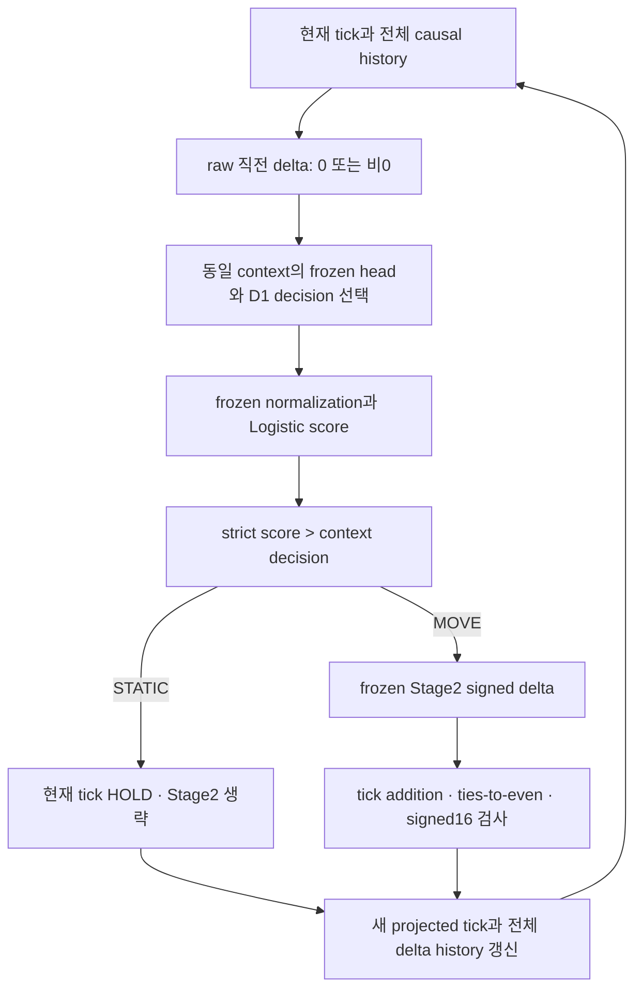

# V4 D: 전환 상태별 decision 설계와 E 평가 계약

CyberPilot V4는 움직임 시작을 놓치고, 움직임이 끝나는 행에서도 MOVE로 판단했다. 이번에는 기존 모델의 점수를 유지하면서, 직전 source-grid 변화가 있었는지에 따라 TRAIN 판단 기준을 따로 정하는 **D1 하나**를 실험 후보로 명세한다. 새 기준의 수치를 계산하거나 gate를 만들지 않았다. 실제 효과는 별도 승인된 E에서 확인해야 한다.

## 근거와 변경 범위

기준 HEAD는 `d30b61668dce158237b3f008a351b679c785eb6e`, 원래 V4 실행 HEAD는 `bd8045ef2a0da62a92603439f38e7740f5923622`다. 기준 [exact-head CI](https://github.com/rownlvh8875-coder/CyberPilot/actions/runs/39053356254)는 completed / SUCCESS였다.

[C 공개 결과](empirical-hurdle-stage1-v4-c-diagnostic-results.json)의 Fold별 16-job median에서 STATIC_HOLD false-MOVE는 A 34.886%, B 0.778%였다. MOVE_TERMINATION false-MOVE는 양 Fold의 16개 job 모두 100%였다. 이전 STATIC DEV AUC median은 A 0.537743, B 0.555800이다. A의 이전 STATIC AUC와 B의 이전 MOVE AUC는 TRAIN→DEV에서 각각 16/16 감소했다. 모두 겹치는 job의 기술 통계다.

C에서 숨긴 onset/continuation 세부 결과는 열거나 추정하지 않는다. 과거 공개 onset 비율은 JOB_ROW_EXPOSURES 합산율이므로 이번 median으로 바꾸어 부르지 않는다. C는 기존 정책의 관찰이며 D1의 효과 증거가 아니다.

[정책 JSON](empirical-hurdle-stage1-v4-d-transition-aware-policy.json)은 필요한 공개 입력 11개와 원래 수치 소스 6개, workflow를 raw SHA256 및 canonical receipt로 묶는다. 원래 실행 source와 현재 source의 byte identity도 검증한다. C 프로토콜 `V4_C_DIAGNOSTIC_PROTOCOL_V1`의 raw SHA256은 `0549292dd5101c39b118839d881720a23037cc6db6e516c6fa5d8bcda04b742f`다. 과거 실행 승인서는 새 E 권한이 아니다.

변경 파일은 이 문서, 정책 JSON, [E 평가 계약 JSON](empirical-hurdle-stage1-v4-d-offline-evaluation-contract.json), 정적/synthetic 테스트 한 파일뿐이다. 실행 가능한 gate, selector, inference 또는 rollout 코드를 추가하지 않는다. Apache-2.0 저장소의 기존 runtime·모델·controller·정책·workflow와 submodule은 보존한다.

## D0와 D1

| 항목 | D0 | D1 |
| --- | --- | --- |
| 식별자 | V4_FROZEN_SINGLE_SHARED_DECISION | V4_TWO_CONTEXT_TRAIN_ONLY_DECISION |
| 모델·점수 | 원래 V4 dual-head·normalizer | D0와 동일 |
| TRAIN 선택 모집단 | job의 두 head 점수를 원래 순서로 합친 전체 TRAIN | 같은 TRAIN을 raw prior delta가 0/비0인 두 집단으로 분리 |
| decision 수 | candidate/fold job당 공통 1개 | candidate/fold/context당 1개, job당 2개 |
| 적용 | strict score > frozen decision | strict score > 해당 context decision |
| 동일 점수 | STATIC | STATIC |
| Stage2·projection | 원래 계약 | 동일 계약 |

`decision_previous_static`과 `decision_previous_move`는 이름만 정의한다. 실제 값은 없다. 전체 32 jobs에 같은 숫자를 주거나 Fold DEV 결과로 보정하지 않는다. D1은 유일한 신규 실험 설계이며 채택된 정책이 아니다. D0 자체와 기존 selector 구현은 수정하지 않는다.

기존 [R07](empirical-hurdle-stage1-v4-decision-policy-requirements-spec.json)의 TRAIN 선택 보전은 D0에 그대로 적용된다. D1에서 별도로 명세한 변화는 **집단 분리와 decision lookup**이다. 기존 목적함수·tie 의미를 바꾸거나 D0를 덮어쓰는 승인이 아니다.

## TRAIN-only 선택 명세

향후 E가 승인되면 각 job/context의 원래 TRAIN score·label·prior delta만 사용한다. 두 truth class가 모두 있어야 하며 없어지거나 identity가 충돌하면 fail closed한다. 행을 버리거나 값을 대체하는 fallback은 없다.

- 후보 decision 집합: `{0,1}`과 해당 context의 고유한 유한 TRAIN score의 합집합. 입력 확률은 finite `[0,1]`이어야 한다.
- 각 decision에서 strict `score > decision`으로 TP/TN을 정의한다. equality는 STATIC이다.
- `P`는 양성 수, `N_negative`는 음성 수다. 정수 `BA_NUM = TP*N_negative + TN*P`를 최대화한다.
- 동률이면 TN이 큰 것, 다시 동률이면 더 큰 TRAIN decision을 선택한다. 정수 비교이며 float tolerance·사후 보정은 없다.
- 두 decision과 TRAIN/source/anchor/context binding을 봉인한 뒤 DEV를 열도록 E의 단계 경계를 둔다. TRAIN supervised label은 선택에만 쓰며 inference 입력이 아니다.

기존 [threshold source](https://github.com/rownlvh8875-coder/CyberPilot/blob/bd8045ef2a0da62a92603439f38e7740f5923622/openpilot/tools/cyber_autotune/empirical_hurdle_fit_cv_math.py#L157)의 정수 목적함수와 tie 순서를 context별로 적용한다는 명세다. 이번 D에서는 해당 함수를 실행하거나 TRAIN gate를 복원하지 않는다. 새 cutoff·calibration·가중치·margin 최적화도 없다.

## 인과적 상태와 realization

네 truth 집단은 관측 후 붙이는 label이다. `(직전 변화 있음, 다음 정답 변화 있음)`이 `(0,0)`이면 STATIC_HOLD, `(0,1)`이면 MOVE_ONSET, `(1,0)`이면 MOVE_TERMINATION, `(1,1)`이면 MOVE_CONTINUATION이다. 다음 정답은 routing 입력이 아니다.

One-step은 원래 observed prior delta로 두 context를 고른다. Recursion 첫 step도 완전한 observed history에서 시작한다. 이후에는 **실제 projected tick 차이**로 routing하며 전체 projected tick·delta history를 다음 feature에 반영한다. Gate bit나 미래 observed truth로 context를 갱신하지 않는다. 경로·horizon마다 reset하며 segment 경계를 넘거나 history를 padding하지 않는다.

근거는 [probability](https://github.com/rownlvh8875-coder/CyberPilot/blob/bd8045ef2a0da62a92603439f38e7740f5923622/openpilot/tools/cyber_autotune/empirical_hurdle_v4_execution.py#L20), [integrated](https://github.com/rownlvh8875-coder/CyberPilot/blob/bd8045ef2a0da62a92603439f38e7740f5923622/openpilot/tools/cyber_autotune/empirical_hurdle_v4_execution.py#L152), [recursive](https://github.com/rownlvh8875-coder/CyberPilot/blob/bd8045ef2a0da62a92603439f38e7740f5923622/openpilot/tools/cyber_autotune/empirical_hurdle_v4_execution.py#L185), [projection](https://github.com/rownlvh8875-coder/CyberPilot/blob/bd8045ef2a0da62a92603439f38e7740f5923622/openpilot/tools/cyber_autotune/empirical_s2_ri_fit_cv_math.py#L49)이다. Raw prior delta로 normalization 이전에 head를 고른다. D1의 decision context도 같은 raw state를 사용한다.

STATIC gate는 HOLD다. MOVE gate는 Stage2와 rounding을 거쳐 HOLD가 될 수도 MOVE가 될 수도 있다. 강제 nonzero movement나 새 deadband는 없다. 비정상 값·signed16 overflow는 fail closed이며 clipping하지 않는다. 기존 명령 normalization·feature 순서·window·모델·Stage2·projection은 불변이다.

D1이 projected history를 바꾸면 이후 score도 바뀔 수 있다. 따라서 저장된 D0 recursive score/path를 D1 경로처럼 재사용할 수 없다. 새 recursive 실행은 별도 E 승인이 필요하다.

## 가설과 보호해야 할 trade-off

이전 STATIC TRAIN 집단에 맞는 decision은 시작/정지 균형을, 이전 MOVE TRAIN 집단의 decision은 종료/지속 균형을 다르게 만들 가능성이 있다. 선택된 값이 원래 값과 같을 수도 있으며 변화 방향이나 개선을 보장하지 않는다.

STATIC_HOLD FP 감소와 onset FN 증가, termination FP 감소와 continuation FN 증가를 함께 보고한다. Fold A 개선이 Fold B 악화와 공존할 수 있다. 이전 STATIC의 낮은 구분력, Stage2 magnitude residual, quantization, recursive feedback은 D1만으로 해결된다고 볼 수 없다. BA 목적함수는 exact-hit 또는 장기 tick error 목적함수와 다르다.

Hysteresis, dwell-time, smoothing, 새 head·memory·representation·calibration과 D2/D3는 포함하지 않는다. D1이 실패하면 숫자를 조금씩 조정하거나 후보를 자동 추가하지 않는다.

## E에서 검증할 계약

R01–R17은 [기존 spec](empirical-hurdle-stage1-v4-decision-policy-requirements-spec.json)을 복사하지 않고 정책 JSON의 `requirements_traceability`로 연결했다. **17/17은 설계 추적성 대상이며 성능 충족 주장이 아니다.** R02의 새 조건부 STATIC cutoff는 별도 정책 개정이 필요하고, R11의 독립 causal share는 미식별로 유지한다.

[기존 22개 검증 영역](empirical-hurdle-stage1-v4-decision-policy-future-validation.json)은 평가 JSON의 `validation_domains` 1–22와 연결했다. 네 전이, confusion, harmful movement/FP-to-HOLD, exact-hit loss/gain 항등식, ranking·Brier·transfer, 양 Fold, TRUE MOVE, Stage2 residual, projection, full-state drift, 모든 horizon, 재현성·원본 무결성, HOLDOUT·vehicle 경계를 빠짐없이 보고해야 한다.

**32-clause의 합격 comparator는 같은 anchor의 HOLD_LAST다.** D0는 추가로 필요한 정책 비교 기준이며 HOLD_LAST를 대체하지 않는다. [원래 acceptance JSON](empirical-hurdle-acceptance-gate-v1.json)의 전체 raw hash·receipt·clauses body hash를 고정했다. 5개 one-step, 3개 TRUE MOVE, 24개 rollout clause의 inequality·epsilon 0·support 201·anchor·both-fold 조건은 모두 불변이다. TRUE MOVE 연속 오차는 실제 gate를 포함한 integrated delta 기준이며 oracle Stage2로 바꾸지 않는다.

One-step 연속 오차는 integrated delta−truth delta이고 exact-hit은 projected integer tick 기준이다. Recursive 오차는 terminal projected tick−observed target이다. H25/50/100/200 각각 OVERALL과 PATH_MOVED를 모두 검증한다. PATH_MOVED는 **관측 truth path**가 initial tick에서 한 번이라도 달라진 경로이며 policy의 projected MOVE로 재정의하지 않는다. Support 부족은 NOT_IDENTIFIABLE 및 해당 필수 clause nonpass로 기록한다. H25 성공이나 gate-perfect STATIC 경로 다수로 장기 움직인 경로의 부족을 대체할 수 없다.

필수 clause 하나라도 실패하면 해당 candidate/fold는 적합하지 않다. Both-fold 통과 없는 평균 개선은 채택 근거가 아니다. 모두 실패하면 NO_ADMISSIBLE_CANDIDATE를 유지한다. 모두 통과하더라도 retrospective gate 통과일 뿐 정책 채택·후보 선정·HOLDOUT·실차 승격은 자동 발생하지 않는다. 새 전이별 hard cutoff가 필요하면 E 전에 명시적 정책 개정을 받아야 한다.

## E에 필요한 정확한 추가 승인과 자료

다음 승인은 **E 구현 및 실제 과학 실행**을 대상으로 정확한 코드/protocol 버전과 허용 연산을 명시해야 한다. 최소 입력은 B1에 묶인 TRAIN 세 필드, DEV causal feature/current/target, frozen Stage1·normalizer·Stage2, 초기 history·supplied command/speed·관측 reference path와 각 horizon의 immutable anchor다. C의 일곱 필드만으로 새 tick/rollout 평가를 할 수 없다.

Private 파일/필드·모델/decision metadata의 정확한 allowlist, 승인된 descriptor 처리, output·권한·capacity/reserve·자원 상한을 E에서 결부해야 한다. Mixed carrier나 broad verifier 권한을 추정하지 않는다. 필요한 finalized 입력이 없으면 E_INPUT_INSUFFICIENT이며 raw/qlog 재구성이나 대체 root 탐색은 금지한다.

E 전에 numeric/causal/privacy synthetic 테스트, 두 독립 검토와 exact-head CI를 통과한 실행 protocol을 고정해야 한다. 두 independent repeat의 byte-exact 결과와 원본·inference·재계산이 차단된 verify-only도 요구한다. DEV는 이미 관찰됐으므로 blinded independent validation이라고 부르지 않는다. TRAIN 결정 선택에 DEV truth/gate를 쓰거나 retrospective 결과로 future holdout 기준을 최적화하지 않는다.

E 공개 projection도 입력 접근 전에 고정·검토한다. C의 bin/cell count 비공개와 최소 support·complementary suppression을 유지하고, 한 arm의 집단이 작으면 양 정책·양 Fold의 같은 지표군을 함께 숨긴다. 기존 공개 자료와 결합한 역산도 검토한다. Private 경로·hash·decision 값·coefficients·rowwise 값은 공개하지 않는다.

## D 검증과 종료

정적/synthetic 테스트는 D0/D1 scope, strict equality, 정수 tie 순서, causal routing, gate/realization, projection, R01–R17, 22영역과 32-clause 원문 identity를 검사한다. 실제 policy selector를 구현하거나 기존 scientific 함수를 호출하지 않는다. 회귀의 synthetic fitting은 실제 private-input 연산과 구분하며 실제 D/E evidence를 가린 환경에서 실행한다.

수치/설계와 권한/개인정보 독립 검토 둘 다 APPROVED, 로컬 검증과 최종 commit의 exact-head CI completed / SUCCESS, local/origin 일치 및 clean 조건을 확인한 뒤에만 `D_TRANSITION_AWARE_DESIGN_FROZEN_E_PENDING`을 최종 handoff한다. 실제 수행한 검사와 review receipt는 별도 작업 기록에 남긴다. 이 문서가 미래 CI 성공을 미리 증명하지 않는다.

기존 `HURDLE_STAGE1_V4_NO_ADMISSIBLE_CANDIDATE`, `MODEL_SELECTION_FAILED_CLOSED`, selected candidate null을 유지한다. Replica는 REPLICA_PAYLOAD_EQUALITY_NOT_FULLY_REVERIFIED, 원래 TRAIN rowwise gate는 NOT_SAVED다. 새 E gate는 별도 새 산출물이어야 한다.

HOLDOUT CLOSED, FUTURE_UNTOUCHED_HOLDOUT_REQUIRED, NO_MODEL_ADMITTED_FOR_FUTURE_HOLDOUT, FINAL_POOLED_REFIT_NOT_AUTHORIZED, COMPOSITION_NOT_AUTHORIZED를 보전한다. Vehicle은 NOT_READY / REAL_VEHICLE_UNVERIFIED / VEHICLE_ACTIVATION_BLOCKED, authority NONE이다. Hugging Face는 NOT_REQUIRED / NOT_USED다.

Source-grid tick 변화는 물리 EPS 움직임이 아니다. Logged command는 POST-CARCONTROLLER normalized command이며 applied torque가 아니다. steeringRateDeg는 SOURCE_NATIVE_RATE_CODE_ONLY / RATE_SOURCE_CONTRACT_PARTIAL이다. 이번 D의 private scientific 입력 접근·threshold 연산·refit·inference·rollout·새 과학 집계·원본 쓰기는 모두 금지한다. D 설계 공개 후 E/F/V5로 자동 진행하지 않는다.
