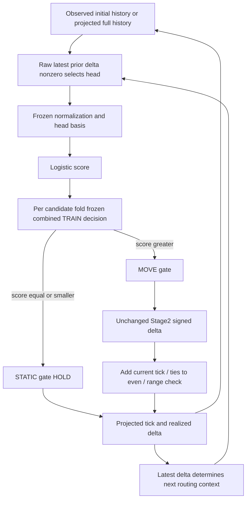

# V4 Stage1 판단 정책 요구사항 검토

CyberPilot V4는 모델 학습에는 문제가 없었지만, 언제 움직이고 언제 멈출지 판단하는 과정에서 오류가 확인됐다.

움직임 시작을 놓치는 경우가 있고, 움직임이 끝나야 하는데 계속 MOVE로 판단하는 문제가 있다. 그렇다고 판단 기준 하나를 변경하면 문제가 해결된다고 볼 수는 없다.

실제로 어떤 판단 기준이 더 좋은지 검증하려면 움직임 시작·종료의 정확도뿐 아니라 정지 상태의 불필요한 움직임, source-grid 변화 크기, 장기 예측까지 함께 확인해야 한다.

이번 작업은 이런 검증을 위한 요구사항을 확정하는 것이다. 새로운 모델이나 판단 기준을 실제로 구현하지 않는다. 여기서 움직임은 source-grid tick 변화이며 검증된 물리 EPS 움직임을 뜻하지 않는다.

## 1. Executive summary

공개 근거는 현재 오류와 계약을 설명하고 요구사항을 작성하기에 충분하다. 그러나 대체 decision의 효과는 공개 집계만으로 식별되지 않는다. 요구사항 검토 완료는 새 정책 성능의 승인과 다르다. [empirical-hurdle-stage1-v4-decision-transfer-identifiability.json](https://github.com/rownlvh8875-coder/CyberPilot/blob/cb344b0d1e738baa780c503bee838386ff21865b/docs/cyberpilot/changes/empirical-hurdle-stage1-v4-decision-transfer-identifiability.json) `/feasibility_states`

17개 요구사항을 확정했다: MUST14, SHOULD1, FUTURE_APPROVAL_REQUIRED1, UNRESOLVED1. MUST는 보전·보고·검증 의무이고 새로운 수치 기준이 아니다. 어떤 요구사항 아래서든 새 acceptance cutoff를 만들려면 별도 정책 승인이 필요하다. 모든22개 향후 검증 영역은 생략할 수 없지만, 이 의무가 미승인 데이터를 계산할 권한을 부여하지 않는다.

단일 다음 action은 **STAGE1_DECISION_EVIDENCE_ACCESS_AUTHORIZATION_REVIEW**다. exact manifest/root/field 범위가 명시된 접근 승인 요청을 검토하는 단계다. 현재는 검토 가능한 초안이며 **NOT_ACCESS_READY**다. 실제 접근·집계·정책 채택·실험은 모두 미승인이다.

기존 결과는 HURDLE_STAGE1_V4_NO_ADMISSIBLE_CANDIDATE / MODEL_SELECTION_FAILED_CLOSED / selected_candidate=null로 유지한다. [empirical-hurdle-stage1-v4-decision-transfer-feasibility-policy.json](https://github.com/rownlvh8875-coder/CyberPilot/blob/cb344b0d1e738baa780c503bee838386ff21865b/docs/cyberpilot/changes/empirical-hurdle-stage1-v4-decision-transfer-feasibility-policy.json) `/preserved_result`

## 2. Baseline / evidence lock

| Identity | 고정 값 |
| --- | --- |
| 기준 HEAD | cb344b0d1e738baa780c503bee838386ff21865b |
| Branch | feature/cyber-autotune |
| Original execution | bd8045ef2a0da62a92603439f38e7740f5923622 |
| Transition review | 3d2e77897f385565fe504937d77766dd73c4c6a9 |
| Mixed review | 471537fc0d95d86e7b9f553af5a067a72951abdc |
| Attribution | 42541f583f39dc16609dd207c84cfd366445c0df |
| Original publication | 3943f5c2f4ef641e673ca6a47b24b44a359765c8 |
| 직전 feasibility policy receipt | 2fe02dcf43f83877bf494251781f56638240920aefd08d015963bf6ca71a33d0 |
| 이번 requirements policy receipt | 8d7be8540516f4a10b47fe1a33ab41c36853abbd879e0a3e85b63a527dd4f3e1 |
| 공개 입력 / JSON seal / static source | 55 / 51 / 17 |
| 직전 lock | 45 public / 42 seals / 17 sources |
| 원 실행과 동일한 scientific source | 7개 byte identity |
| 기준 exact-head CI | 38999691063 attempt1 completed / SUCCESS |

직전 입력 lock은 수정하지 않았다. 최신 feasibility9JSON+MD를 별도 pointer/SHA로 추가했다. 모든 기존 공개 입력과17소스/workflow를 기준 Git bytes 및 SHA256에 대조했고 canonical JSON seal도 확인했다. 원본 private evidence를 열어 다시 봉인한 것은 아니다. 전체 경로·해시·함수 위치는 [requirements policy](empirical-hurdle-stage1-v4-decision-policy-requirements-policy.json)의 `input_lock`에 있다. [empirical-hurdle-stage1-v4-decision-transfer-feasibility-policy.json](https://github.com/rownlvh8875-coder/CyberPilot/blob/cb344b0d1e738baa780c503bee838386ff21865b/docs/cyberpilot/changes/empirical-hurdle-stage1-v4-decision-transfer-feasibility-policy.json) `/input_lock`

새 commit 자신의 SHA를 파일에 넣는 순환은 피한다. result_publication_head는 containing Git commit으로 해석하며 최종 exact-head CI/local-origin equality/clean proof는 커밋 뒤 외부 metadata와 최종 handoff에서 확인한다.

## 3. Existing decision contract

다음 흐름은 실행 없이 소스 텍스트로 확인했다. [empirical_hurdle_v4_execution.py:20 probability](https://github.com/rownlvh8875-coder/CyberPilot/blob/cb344b0d1e738baa780c503bee838386ff21865b/openpilot/tools/cyber_autotune/empirical_hurdle_v4_execution.py#L20); [empirical_hurdle_v4_execution.py:152 integrated](https://github.com/rownlvh8875-coder/CyberPilot/blob/cb344b0d1e738baa780c503bee838386ff21865b/openpilot/tools/cyber_autotune/empirical_hurdle_v4_execution.py#L152); [empirical_hurdle_v4_execution.py:185 recursive](https://github.com/rownlvh8875-coder/CyberPilot/blob/cb344b0d1e738baa780c503bee838386ff21865b/openpilot/tools/cyber_autotune/empirical_hurdle_v4_execution.py#L185)

| 책임 | 기존 계약 | 소스 |
| --- | --- | --- |
| Representation | intercept, delayed command L개, prior delta L개, current tick, speed; P=2L+3 | [empirical_s2_ri_fit_cv_math.py:31 features](https://github.com/rownlvh8875-coder/CyberPilot/blob/cb344b0d1e738baa780c503bee838386ff21865b/openpilot/tools/cyber_autotune/empirical_s2_ri_fit_cv_math.py#L31) |
| Head routing | raw latest prior delta!=0를 normalization 전에 확인 | [empirical_hurdle_v4_execution.py:20 probability](https://github.com/rownlvh8875-coder/CyberPilot/blob/cb344b0d1e738baa780c503bee838386ff21865b/openpilot/tools/cyber_autotune/empirical_hurdle_v4_execution.py#L20) |
| Basis / score | STATIC은 latest prior-delta 구조열 제거, MOVE는 기존 effective columns; head별 Logistic | [empirical_hurdle_v4_fitting_policy.py:84 basis](https://github.com/rownlvh8875-coder/CyberPilot/blob/cb344b0d1e738baa780c503bee838386ff21865b/openpilot/tools/cyber_autotune/empirical_hurdle_v4_fitting_policy.py#L84) |
| TRAIN decision | 원래 순서 combined score에서 TRAIN only; job당 두 head 공통 decision | [empirical_hurdle_v4_execution.py:54 train](https://github.com/rownlvh8875-coder/CyberPilot/blob/cb344b0d1e738baa780c503bee838386ff21865b/openpilot/tools/cyber_autotune/empirical_hurdle_v4_execution.py#L54); [empirical_hurdle_fit_cv_math.py:157 threshold](https://github.com/rownlvh8875-coder/CyberPilot/blob/cb344b0d1e738baa780c503bee838386ff21865b/openpilot/tools/cyber_autotune/empirical_hurdle_fit_cv_math.py#L157) |
| Gate | strict score>decision이면 MOVE, equality STATIC | [empirical_hurdle_v4_execution.py:152 integrated](https://github.com/rownlvh8875-coder/CyberPilot/blob/cb344b0d1e738baa780c503bee838386ff21865b/openpilot/tools/cyber_autotune/empirical_hurdle_v4_execution.py#L152) |
| DEV 적용 | TRAIN durable finalization+receipt 검증 뒤 동일 in-memory decision; 새 결정/별도 numerical reload 없음 | [empirical_hurdle_v4_execution.py:267 execute_job](https://github.com/rownlvh8875-coder/CyberPilot/blob/cb344b0d1e738baa780c503bee838386ff21865b/openpilot/tools/cyber_autotune/empirical_hurdle_v4_execution.py#L267); [empirical_hurdle_v4_io.py:127 finalized](https://github.com/rownlvh8875-coder/CyberPilot/blob/cb344b0d1e738baa780c503bee838386ff21865b/openpilot/tools/cyber_autotune/empirical_hurdle_v4_io.py#L127) |
| Stage2 / realization | STATIC HOLD; MOVE만 기존 signed Stage2; MOVE도 rounding 뒤 HOLD 가능 | [empirical_hurdle_v4_execution.py:152 integrated](https://github.com/rownlvh8875-coder/CyberPilot/blob/cb344b0d1e738baa780c503bee838386ff21865b/openpilot/tools/cyber_autotune/empirical_hurdle_v4_execution.py#L152); [empirical_hurdle_fit_cv_math.py:215 predict_delta](https://github.com/rownlvh8875-coder/CyberPilot/blob/cb344b0d1e738baa780c503bee838386ff21865b/openpilot/tools/cyber_autotune/empirical_hurdle_fit_cv_math.py#L215) |
| Projection | finite 검사→np.rint ties-to-even→signed16 범위 검사, clip/fallback 없음 | [empirical_s2_ri_fit_cv_math.py:49 project](https://github.com/rownlvh8875-coder/CyberPilot/blob/cb344b0d1e738baa780c503bee838386ff21865b/openpilot/tools/cyber_autotune/empirical_s2_ri_fit_cv_math.py#L49) |
| Recursive state | 초기 observed L+1 ticks; 이후 projected current와 전체 delta history; 각 path/horizon reset | [empirical_hurdle_v4_execution.py:185 recursive](https://github.com/rownlvh8875-coder/CyberPilot/blob/cb344b0d1e738baa780c503bee838386ff21865b/openpilot/tools/cyber_autotune/empirical_hurdle_v4_execution.py#L185) |

공통 decision은 **한 candidate/fold job 안에서** 두 head가 공유한다는 의미다.32개 job이나 두 Fold가 같은 numerical value를 사용한다는 뜻이 아니다. 후보집합은0,1과 unique finite TRAIN probabilities, 목적함수는 `(BA_NUM,TN,더 큰 decision)` lexicographic maximum이고 `BA_NUM=TP*N_negative+TN*N_positive`다. selector를 실행하지 않았고 실제 값을 읽지 않았다. Binary BA 목적은 최종 tick exact-hit 목적과 동일하지 않다. [empirical-hurdle-stage1-v4-decision-transfer-train-dev-matrix.json](https://github.com/rownlvh8875-coder/CyberPilot/blob/cb344b0d1e738baa780c503bee838386ff21865b/docs/cyberpilot/changes/empirical-hurdle-stage1-v4-decision-transfer-train-dev-matrix.json) `/policy_audit`

Initial observed history/command/speed의 eligibility와 segment/horizon 경계는 기존 anchor contract를 보전한다. Missing history를 새로 pad하거나 다른 segment에서 가져오는 정책은 없다. H개 step은 H+1 path ticks를 만든다. HOLD comparator는 초기 tick을 horizon 내내 유지하며 PATH_MOVED는 관측 path의 중간 departure도 포함한다. supplied future command/speed 조건부 rollout은 실제 controller closed-loop나 실시간 future-input availability의 증거가 아니다. [empirical_hurdle_v4_execution.py:212 rollout](https://github.com/rownlvh8875-coder/CyberPilot/blob/cb344b0d1e738baa780c503bee838386ff21865b/openpilot/tools/cyber_autotune/empirical_hurdle_v4_execution.py#L212); [empirical_hurdle_fit_cv_data.py:146 rollout](https://github.com/rownlvh8875-coder/CyberPilot/blob/cb344b0d1e738baa780c503bee838386ff21865b/openpilot/tools/cyber_autotune/empirical_hurdle_fit_cv_data.py#L146)

## 4. Frozen scientific findings

| 결과 | 고정 값 | 근거 |
| --- | --- | --- |
| STATIC loss / MOVE gain / net | 571,317 / 228,164 / -343,153;32/32 loss>gain | [empirical-hurdle-stage1-v4-mixed-architecture-evidence-ledger.json](https://github.com/rownlvh8875-coder/CyberPilot/blob/cb344b0d1e738baa780c503bee838386ff21865b/docs/cyberpilot/changes/empirical-hurdle-stage1-v4-mixed-architecture-evidence-ledger.json) `/facts/E1` |
| Gate FP / HOLD conversion / harmful | 1,662,235 / 1,090,918 / 571,317;34.37% | [empirical-hurdle-stage1-v4-mixed-architecture-evidence-ledger.json](https://github.com/rownlvh8875-coder/CyberPilot/blob/cb344b0d1e738baa780c503bee838386ff21865b/docs/cyberpilot/changes/empirical-hurdle-stage1-v4-mixed-architecture-evidence-ledger.json) `/facts/E2` |
| Onset recall A/B | 40.195% /2.147% | [empirical-hurdle-stage1-v4-mixed-architecture-evidence-ledger.json](https://github.com/rownlvh8875-coder/CyberPilot/blob/cb344b0d1e738baa780c503bee838386ff21865b/docs/cyberpilot/changes/empirical-hurdle-stage1-v4-mixed-architecture-evidence-ledger.json) `/facts/E3` |
| Termination FP A/B | 100% /100% | [empirical-hurdle-stage1-v4-mixed-architecture-evidence-ledger.json](https://github.com/rownlvh8875-coder/CyberPilot/blob/cb344b0d1e738baa780c503bee838386ff21865b/docs/cyberpilot/changes/empirical-hurdle-stage1-v4-mixed-architecture-evidence-ledger.json) `/facts/E3` |
| Continuation recall A/B | 100.000% /약99.999% | [empirical-hurdle-stage1-v4-mixed-architecture-evidence-ledger.json](https://github.com/rownlvh8875-coder/CyberPilot/blob/cb344b0d1e738baa780c503bee838386ff21865b/docs/cyberpilot/changes/empirical-hurdle-stage1-v4-mixed-architecture-evidence-ledger.json) `/facts/E3` |
| One-step FPR A/B | 41.193% /10.430% | [empirical-hurdle-stage1-v4-mixed-architecture-evidence-ledger.json](https://github.com/rownlvh8875-coder/CyberPilot/blob/cb344b0d1e738baa780c503bee838386ff21865b/docs/cyberpilot/changes/empirical-hurdle-stage1-v4-mixed-architecture-evidence-ledger.json) `/facts/E4` |
| One-step FNR A/B | 33.041% /54.098% | [empirical-hurdle-stage1-v4-mixed-architecture-evidence-ledger.json](https://github.com/rownlvh8875-coder/CyberPilot/blob/cb344b0d1e738baa780c503bee838386ff21865b/docs/cyberpilot/changes/empirical-hurdle-stage1-v4-mixed-architecture-evidence-ledger.json) `/facts/E4` |
| TRAIN→DEV score shift A/B | +0.017882 /-0.009916 | [empirical-hurdle-stage1-v4-mixed-architecture-evidence-ledger.json](https://github.com/rownlvh8875-coder/CyberPilot/blob/cb344b0d1e738baa780c503bee838386ff21865b/docs/cyberpilot/changes/empirical-hurdle-stage1-v4-mixed-architecture-evidence-ledger.json) `/facts/E4` |
| Calibration-bias shift A/B | +0.022050 /-0.014084 | [empirical-hurdle-stage1-v4-mixed-architecture-evidence-ledger.json](https://github.com/rownlvh8875-coder/CyberPilot/blob/cb344b0d1e738baa780c503bee838386ff21865b/docs/cyberpilot/changes/empirical-hurdle-stage1-v4-mixed-architecture-evidence-ledger.json) `/facts/E4` |
| AUC TRAIN/DEV overall | 0.707438 /0.702174 | [empirical-hurdle-stage1-v4-mixed-architecture-evidence-ledger.json](https://github.com/rownlvh8875-coder/CyberPilot/blob/cb344b0d1e738baa780c503bee838386ff21865b/docs/cyberpilot/changes/empirical-hurdle-stage1-v4-mixed-architecture-evidence-ledger.json) `/facts/E5` |
| AUC previous STATIC | 0.554846 /0.545865 | [empirical-hurdle-stage1-v4-mixed-architecture-evidence-ledger.json](https://github.com/rownlvh8875-coder/CyberPilot/blob/cb344b0d1e738baa780c503bee838386ff21865b/docs/cyberpilot/changes/empirical-hurdle-stage1-v4-mixed-architecture-evidence-ledger.json) `/facts/E5` |
| AUC previous MOVE | 0.592356 /0.574285 | [empirical-hurdle-stage1-v4-mixed-architecture-evidence-ledger.json](https://github.com/rownlvh8875-coder/CyberPilot/blob/cb344b0d1e738baa780c503bee838386ff21865b/docs/cyberpilot/changes/empirical-hurdle-stage1-v4-mixed-architecture-evidence-ledger.json) `/facts/E5` |
| Historical improved/equal/worse | OVERALL32/0/0; PREV_STATIC13/0/19; PREV_MOVE32/0/0 | [empirical-hurdle-stage1-v4-mixed-architecture-evidence-ledger.json](https://github.com/rownlvh8875-coder/CyberPilot/blob/cb344b0d1e738baa780c503bee838386ff21865b/docs/cyberpilot/changes/empirical-hurdle-stage1-v4-mixed-architecture-evidence-ledger.json) `/facts/E5` |

Exact-hit identity는 `candidate_hits=HOLD_hits-STATIC_HIT_LOSS+MOVE_HIT_GAIN`이다. 이번에는 두 정수 합·차 항등식만 확인했다. 새 성능 평가를 계산하지 않았다. Transition rate는 겹치는 job count 합계의 비율이고 AUC·Fold FPR/FNR/score shift는 기존 job 평균이다. 이들을 pooled AUC나 독립 표본·유의성으로 해석하지 않는다. Historical ranking은 matching anchors의 V4 DEV 대 fixed V1 DEV 비교다.

32/32 job와 STATIC/MOVE64head는 정상 학습·평가 완료했다. Support/rank/separation/convergence나 불완전 실행을 원인으로 돌리지 않는다. [empirical-hurdle-stage1-v4-causal-rollout-error-attribution.md](https://github.com/rownlvh8875-coder/CyberPilot/blob/cb344b0d1e738baa780c503bee838386ff21865b/docs/cyberpilot/changes/empirical-hurdle-stage1-v4-causal-rollout-error-attribution.md) `opening paragraphs; head preconditions`

## 5. Stage1 four-transition requirements

`delta_prev=tick[k]-tick[k-1]`, `delta_true=tick[k+1]-tick[k]`, `z_truth=1[delta_prev!=0]`, `y_true=1[delta_true!=0]`. 네 cell은 정답을 관측한 뒤의 truth label이며 미래 target이나 state를 모델 입력으로 사용할 수 없다. [empirical-hurdle-stage1-v4-transition-truth-contract.json](https://github.com/rownlvh8875-coder/CyberPilot/blob/cb344b0d1e738baa780c503bee838386ff21865b/docs/cyberpilot/changes/empirical-hurdle-stage1-v4-transition-truth-contract.json) `/`

| Truth state | z/y | One-step head | 올바른 gate / 오류 | Realized tick 검증 |
| --- | --- | --- | --- | --- |
| STATIC_HOLD | 0/0 | STATIC-context | STATIC / MOVE는FP | target=current; projected tick 동일 여부 |
| MOVE_ONSET | 0/1 | STATIC-context | MOVE / STATIC은FN | target!=current; HOLD는 one-step miss |
| MOVE_TERMINATION | 1/0 | MOVE-context | STATIC / MOVE는FP | FP라도 projected HOLD일 수 있음 |
| MOVE_CONTINUATION | 1/1 | MOVE-context | MOVE / STATIC은FN | TP라도 magnitude/tick target miss 가능 |

네 cell 모두 candidate/fold별 counts, denominator, gate confusion, realization을 보고한다. Pure MOVE cell의 specificity/FPR, pure STATIC cell의 recall/FNR와 single-class AUC는 정의되지 않는다. Undefined rate는0이 아니라 null/INPUT_INSUFFICIENT로 남기고 precision은 predicted-MOVE support를 확인한다. AUC는 previous-state 두 truth class pair에 대해 보고한다. [empirical_hurdle_attribution_math.py:71 confusion_counts](https://github.com/rownlvh8875-coder/CyberPilot/blob/cb344b0d1e738baa780c503bee838386ff21865b/openpilot/tools/cyber_autotune/empirical_hurdle_attribution_math.py#L71); [empirical_hurdle_v4_attribution_math.py:35 rankings](https://github.com/rownlvh8875-coder/CyberPilot/blob/cb344b0d1e738baa780c503bee838386ff21865b/openpilot/tools/cyber_autotune/empirical_hurdle_v4_attribution_math.py#L35)

Recursive truth cell은 observed path로 평가하지만 actual head는 projected prior delta로 선택한다. Drift 이후 truth cell의 z와 실제 routing을 같다고 가정하면 안 된다. full projected tick/history도 두 모델 입력을 바꾼다. [empirical_hurdle_v4_execution.py:185 recursive](https://github.com/rownlvh8875-coder/CyberPilot/blob/cb344b0d1e738baa780c503bee838386ff21865b/openpilot/tools/cyber_autotune/empirical_hurdle_v4_execution.py#L185)

## 6. STATIC false movement protection

STATIC exact-hit 순손실은 직접 확인된 사실이다. Gate FP 중1,090,918은 projected HOLD였고571,317은 harmful movement였다. 따라서 gate FP 감소만으로 최종 tick 정확도 개선을 선언할 수 없다. MOVE gate를 항상 nonzero movement로 강제하면 기존 harmless FP를 harmful하게 만들 위험이 있다. 효과 크기는 식별되지 않았다. [empirical-hurdle-stage1-v4-mixed-architecture-evidence-ledger.json](https://github.com/rownlvh8875-coder/CyberPilot/blob/cb344b0d1e738baa780c503bee838386ff21865b/docs/cyberpilot/changes/empirical-hurdle-stage1-v4-mixed-architecture-evidence-ledger.json) `/facts/E1`; [empirical-hurdle-stage1-v4-mixed-architecture-evidence-ledger.json](https://github.com/rownlvh8875-coder/CyberPilot/blob/cb344b0d1e738baa780c503bee838386ff21865b/docs/cyberpilot/changes/empirical-hurdle-stage1-v4-mixed-architecture-evidence-ledger.json) `/facts/E2`

R08은 손실/이득 identity와 gate-to-HOLD를 반드시 분리 보고하도록 요구한다. R12는 기존 overall ONE_STEP_EXACT_HIT gate를 그대로 보전한다. R02의 새로운 조건부 STATIC cutoff는 FUTURE_APPROVAL_REQUIRED이고 이번에 채택하지 않았다. 해당 기준이 없다는 이유로 STATIC 진단을 생략할 수 없다.

## 7. Onset and termination protection

Onset은 STATIC-context head에서 평가한다. Fold B recall2.147%는 핵심 보호 대상으로 독립 보고한다. Gate STATIC이면 supplied current를 HOLD하므로 one-step true onset을 놓친다. Recursive에서는 projected prior delta가0이 되고 full state가 다음 입력에 전달되지만, exogenous sequence가 바뀌므로 흡수 STATIC 상태라고 단정하지 않는다. [empirical-hurdle-stage1-v4-mixed-architecture-evidence-ledger.json](https://github.com/rownlvh8875-coder/CyberPilot/blob/cb344b0d1e738baa780c503bee838386ff21865b/docs/cyberpilot/changes/empirical-hurdle-stage1-v4-mixed-architecture-evidence-ledger.json) `/facts/E3`; [empirical_hurdle_v4_execution.py:152 integrated](https://github.com/rownlvh8875-coder/CyberPilot/blob/cb344b0d1e738baa780c503bee838386ff21865b/openpilot/tools/cyber_autotune/empirical_hurdle_v4_execution.py#L152); [empirical_hurdle_v4_execution.py:185 recursive](https://github.com/rownlvh8875-coder/CyberPilot/blob/cb344b0d1e738baa780c503bee838386ff21865b/openpilot/tools/cyber_autotune/empirical_hurdle_v4_execution.py#L185)

Termination은 MOVE-context head의 negative label이다. 두 Fold FP100%와 거의100% continuation recall은 같은 previous-MOVE frozen operating point의 두 측면이다. 현재 코드에는 history와 termination negative가 이미 있다. Feature/label 부재, Logistic의 필연적 실패 또는 hard-coded always-MOVE로 설명할 근거는 없다. 실제 score와 frozen decision으로 gate를 결정한다. [empirical_hurdle_v4_execution.py:267 execute_job](https://github.com/rownlvh8875-coder/CyberPilot/blob/cb344b0d1e738baa780c503bee838386ff21865b/openpilot/tools/cyber_autotune/empirical_hurdle_v4_execution.py#L267); [empirical_hurdle_v4_execution.py:20 probability](https://github.com/rownlvh8875-coder/CyberPilot/blob/cb344b0d1e738baa780c503bee838386ff21865b/openpilot/tools/cyber_autotune/empirical_hurdle_v4_execution.py#L20)

R03/R04/R05는 onset, termination, continuation을 함께 분리 보고하는 의무다. 새 recall/FPR 기준이나 simultaneous improvement 보장은 아니다. TRAIN four-transition gate가 없어 현재 conditional TRAIN→DEV decision transfer는 직접 입증할 수 없다. [empirical-hurdle-stage1-v4-decision-transfer-transition-matrix.json](https://github.com/rownlvh8875-coder/CyberPilot/blob/cb344b0d1e738baa780c503bee838386ff21865b/docs/cyberpilot/changes/empirical-hurdle-stage1-v4-decision-transfer-transition-matrix.json) `/states`

## 8. Ranking/calibration/decision responsibility

Ranking은 score 순서, calibration은 nominal probability와 발생률의 관계, decision은 frozen rule의 gate다. PREV_MOVE AUC가32/32 개선돼도 양 class의 relevant score가 같은 MOVE 쪽에 있으면 termination FP100%가 공존할 수 있다. 이는 가능한 원리 설명이며 private decision이나 score를 추정한 것이 아니다. [empirical-hurdle-stage1-v4-decision-transfer-observability-matrix.json](https://github.com/rownlvh8875-coder/CyberPilot/blob/cb344b0d1e738baa780c503bee838386ff21865b/docs/cyberpilot/changes/empirical-hurdle-stage1-v4-decision-transfer-observability-matrix.json) `/hypothesis_limits`

PREV_STATIC은13개 개선/19개 악화이므로 decision-only 해결 가설의 반대 근거가 남는다. Mean bias는 full reliability curve가 아니고 Brier/mean/AUC만으로 특정 operating point의 적합성이나 다른 rule의 confusion을 복원할 수 없다. R07은 이 책임을 분리하고 R17은 representation·magnitude·recursion 가설을 유지한다. [empirical-hurdle-stage1-v4-decision-transfer-identifiability.json](https://github.com/rownlvh8875-coder/CyberPilot/blob/cb344b0d1e738baa780c503bee838386ff21865b/docs/cyberpilot/changes/empirical-hurdle-stage1-v4-decision-transfer-identifiability.json) `/decision_only_hypothesis_strength`

## 9. Fold A/B requirements

Fold A는 positive mean/bias shift, 높은 one-step FPR와 H200 gate excess, Fold B는 negative shift, 높은 FNR와 낮은 onset recall/H200 gate deficit가 관측됐다. H200 gate MOVE는A44.512% 대 true13.201%,B4.041% 대 true14.736%다. One-step observed context와 recursive projected-state cohort는 다른 관측이다. [empirical-hurdle-stage1-v4-mixed-architecture-evidence-ledger.json](https://github.com/rownlvh8875-coder/CyberPilot/blob/cb344b0d1e738baa780c503bee838386ff21865b/docs/cyberpilot/changes/empirical-hurdle-stage1-v4-mixed-architecture-evidence-ledger.json) `/facts/E4`

한 Fold의 개선으로 다른 Fold의 실패를 상쇄하지 않는다. 기존 both-fold complete gate를 유지하고 각 Fold own anchors/routes와 common label semantics를 사용한다. TRAIN과 DEV가 동일 sample이라는 뜻은 아니다. Population mixture와 class prevalence 변화가 mean score에 영향을 줄 수 있어 uniform head score shift나 route 원인을 단정하지 않는다. [empirical-hurdle-stage1-v4-decision-transfer-fold-risk.json](https://github.com/rownlvh8875-coder/CyberPilot/blob/cb344b0d1e738baa780c503bee838386ff21865b/docs/cyberpilot/changes/empirical-hurdle-stage1-v4-decision-transfer-fold-risk.json) `/folds`

필수10개 영역: overall confusion, onset/termination, state ranking, calibration transfer, score shift, predicted MOVE prevalence, harmful movement, Stage2 residual, recursive feedback, terminal error. Fold-specific 새로운 cutoff 또는 correction은 선택하지 않는다.

## 10. Tradeoff matrix

| ID / 관계 | 관측된 공존 | 판정 |
| --- | --- | --- |
| A STATIC harmful movement 감소 vs onset miss 증가 | STATIC loss exceeds MOVE gain in32jobs; onset recall low, especially Fold B. | POSSIBLE_TRADEOFF_NOT_PROVEN |
| B Onset 개선 vs termination 오검출 | Onset misses and termination gate FP100 coexist in separate routed populations. | POSSIBLE_TRADEOFF_NOT_PROVEN |
| C Continuation recall vs termination | Near-perfect continuation recall coexists with termination FP100 at the frozen previous-MOVE operating point. | POSSIBLE_TRADEOFF_NOT_PROVEN |
| D Fold A 개선 vs Fold B 악화 | Opposite score/bias shifts and different FPR/FNR are factual. | POSSIBLE_TRADEOFF_NOT_PROVEN |
| E Gate 개선 vs tick realization 악화 | Most STATIC gate FP realize HOLD; some are harmful. | POSSIBLE_TRADEOFF_NOT_PROVEN |
| F One-step 개선 vs recursive 악화 | TRUE_MOVE protection passed while long rollout failed; full numeric state recurs. | POSSIBLE_TRADEOFF_NOT_PROVEN |
| G Overall AUC 개선 vs state decision 악화 | Overall improved32; PREV_STATIC improved13/worse19; transition failures remain. | POSSIBLE_TRADEOFF_NOT_PROVEN |

위 표는 기존 factual rule의 오류가 함께 존재한다는 근거다. 어떤 변경이 한 지표를 개선하고 다른 지표를 악화시킨다는 개입 tradeoff를 확인한 것은 아니다. 모든 관계에 same-population gate+realization, bothfolds와 frozen horizons 검증이 필요하다. Changed-policy simultaneous gain이나 improvement percentage는 제시하지 않는다. 각 행의 missing evidence/실패 조건/승인은 [tradeoff JSON](empirical-hurdle-stage1-v4-decision-policy-tradeoff-matrix.json)에 있다.

## 11. Existing vs future policy requirements

| ID / 요구사항 | 수준 | 현재 검증 의미 |
| --- | --- | --- |
| R01 미래 truth leakage 방지 | MUST | 문서 traceability; 미래 정책 성능 충족 아님 |
| R02 조건부 STATIC harmful movement 보호 기준 | FUTURE_APPROVAL_REQUIRED | 문서 traceability; 미래 정책 성능 충족 아님 |
| R03 MOVE onset 독립 보고 | MUST | 문서 traceability; 미래 정책 성능 충족 아님 |
| R04 MOVE termination 독립 보고 | MUST | 문서 traceability; 미래 정책 성능 충족 아님 |
| R05 Continuation과 termination 동시 평가 | MUST | 문서 traceability; 미래 정책 성능 충족 아님 |
| R06 Fold A/B 분리 검증 | MUST | 문서 traceability; 미래 정책 성능 충족 아님 |
| R07 Ranking/calibration/decision 책임 분리 | MUST | 문서 traceability; 미래 정책 성능 충족 아님 |
| R08 Gate와 realized movement 분리 | MUST | 문서 traceability; 미래 정책 성능 충족 아님 |
| R09 TRUE MOVE 보호 유지 | MUST | 문서 traceability; 미래 정책 성능 충족 아님 |
| R10 Stage2/normalizer/projection와 full-state 호환성 | MUST | 문서 traceability; 미래 정책 성능 충족 아님 |
| R11 Recursive causal share 및 새 robustness 기준 | UNRESOLVED | 문서 traceability; 미래 정책 성능 충족 아님 |
| R12 Frozen32clause gate 불변 | MUST | 문서 traceability; 미래 정책 성능 충족 아님 |
| R13 Determinism 및 input immutability | MUST | 문서 traceability; 미래 정책 성능 충족 아님 |
| R14 Public/private evidence 권한 경계 | MUST | 문서 traceability; 미래 정책 성능 충족 아님 |
| R15 Future untouched HOLDOUT 독립성 | MUST | 문서 traceability; 미래 정책 성능 충족 아님 |
| R16 Vehicle activation boundary | MUST | 문서 traceability; 미래 정책 성능 충족 아님 |
| R17 경쟁 가설과 최소 범위 연구 원칙 | SHOULD | 문서 traceability; 미래 정책 성능 충족 아님 |

17개 모두 지정된17필드로 evidence, counterevidence, component, failure, actual source, metric, frozen gate, missing input, future verification, approval/privacy/safety/status를 연결했다. 전체 계약은 [requirements spec](empirical-hurdle-stage1-v4-decision-policy-requirements-spec.json)이다.

R11 UNRESOLVED는 feedback의 독립적 causal share와 새 robustness cutoff만 뜻한다. R10의 full-state ownership, projected routing/mechanical lag와22domain의 recursive 보고 의무는 MUST로 남는다. R17 SHOULD가 기존 계약·authority·필수 보고를 면제하지 않는다. R02 외의 onset/termination/calibration 등 **모든 새 수치 기준**도 D 승인이 필요하다.

기존32clauses는5 one-step +3 TRUE_MOVE +4horizons×2populations×3error metrics다. Inequality/anchor/support/comparator와 both-folds는 변경하지 않았으며 실제 selector를 호출하지 않았다. 새 diagnostic을 acceptance로 승격하지 않았다. TRUE_MOVE3지표는32/32평가·0실패였고 H200 OVERALL/PATH_MOVED RMSE는32/32실패했다.31common-job cohort와 구분한다. [empirical-hurdle-stage1-v4-v1-v2-v3-comparison.json](https://github.com/rownlvh8875-coder/CyberPilot/blob/cb344b0d1e738baa780c503bee838386ff21865b/docs/cyberpilot/changes/empirical-hurdle-stage1-v4-v1-v2-v3-comparison.json) `/family_summaries/v4/clause_counts`; [empirical-hurdle-acceptance-gate-v1.json](https://github.com/rownlvh8875-coder/CyberPilot/blob/cb344b0d1e738baa780c503bee838386ff21865b/docs/cyberpilot/changes/empirical-hurdle-acceptance-gate-v1.json) `/`; [empirical_hurdle_fit_cv_gates.py:10 fold_gate](https://github.com/rownlvh8875-coder/CyberPilot/blob/cb344b0d1e738baa780c503bee838386ff21865b/openpilot/tools/cyber_autotune/empirical_hurdle_fit_cv_gates.py#L10); [empirical_hurdle_fit_cv_gates.py:75 select](https://github.com/rownlvh8875-coder/CyberPilot/blob/cb344b0d1e738baa780c503bee838386ff21865b/openpilot/tools/cyber_autotune/empirical_hurdle_fit_cv_gates.py#L75)

## 12. Evidence sufficiency

| M | 최소 증거 / 현재 상태 | 승인 경계 |
| --- | --- | --- |
| M1 | Candidate/fold/role with fixed population identity. / PUBLIC_ONLY_AVAILABLE | CURRENT_PUBLIC_REVIEW_ONLY |
| M2 | Candidate/fold/role/observed previous-state pair; DEV truth cell separately. / PUBLIC_ONLY_AVAILABLE | CURRENT_PUBLIC_REVIEW_ONLY |
| M3 | Original32job order plus existing per-fold/context min/median/p95/max. / PUBLIC_ONLY_AVAILABLE | CURRENT_PUBLIC_REVIEW_ONLY |
| M4 | Manifest-bound candidate/fold/role population and matched anchors; no broad root search. / SAVED_PRIVATE_BY_SOURCE_CONTRACT_LIVE_MANIFEST_NOT_REOPENED | SEPARATE_DATA_AND_PROCESSING_APPROVAL_REQUIRED |
| M5 | Candidate/fold/TRAIN/four truth cells with explicit denominators and nulls. / TRAIN_ROW_GATES_NOT_SAVED_CONTEXT_GATE_TABLE_NOT_PUBLIC | SEPARATE_DATA_AND_PROCESSING_APPROVAL_REQUIRED |
| M6 | Candidate/fold/role/previous-state pair; bin/small-cell rules require prior protocol approval, no numbers chosen now. / NOT_EMITTED_BY_INSPECTED_FROZEN_SCHEMA_OTHER_SAVED_STATUS_UNKNOWN | SEPARATE_DATA_AND_PROCESSING_APPROVAL_REQUIRED |
| M7 | Candidate/fold/role/context with predeclared questions and privacy protocol; no threshold curve or margins generated now. / NO_PUBLIC_FROZEN_BOUNDARY_DISTRIBUTION_OTHER_SAVED_STATUS_UNKNOWN | SEPARATE_DATA_AND_PROCESSING_APPROVAL_REQUIRED |
| M8 | Preapproved complete evaluation populations, both folds and all frozen horizons; factual arrays alone are insufficient for missing alternative branches. / NO_AUTHORIZED_ALTERNATIVE_OR_INDEPENDENT_EFFICACY_EVIDENCE | SEPARATE_POLICY_AND_EXECUTION_APPROVAL_REQUIRED |
| M9 | Predeclared independent populations and ordered replay/simulation/shadow requirements if vehicle work is ever proposed. / NO_NEW_INDEPENDENT_VALIDATION_AUTHORIZED | SEPARATE_POLICY_AND_EXECUTION_APPROVAL_REQUIRED |

M1–M3은 requirements 정의에 충분하다. Public TRAIN overall confusion/prevalence/recall/specificity, TRAIN/DEV previous-state AUC/means/bias/Brier, DEV four-transition confusion과 job/fold variability가 있다. TRAIN overall confusion이 있다고 TRAIN 네 truth-cell confusion을 아는 것은 아니다. [empirical-hurdle-stage1-v4-decision-transfer-evidence-inventory.json](https://github.com/rownlvh8875-coder/CyberPilot/blob/cb344b0d1e738baa780c503bee838386ff21865b/docs/cyberpilot/changes/empirical-hurdle-stage1-v4-decision-transfer-evidence-inventory.json) `/items`

TRAIN rowwise gates는 NOT_SAVED / INPUT_INSUFFICIENT / NO_THRESHOLD_APPLICATION다. Combined TRAIN score와 DEV score/gate는 소스 저장 계약에 있지만 live private existence/manifest/anchor alignment를 이번에 확인하지 않았다. Reliability/bin/boundary distribution은 inspected schema가 출력하지 않으며 다른 저장물 존재도 미확인이다. 어떠한 histogram/reliability curve/boundary statistic도 새로 만들지 않았다. [empirical_hurdle_v4_execution.py:247 save_train](https://github.com/rownlvh8875-coder/CyberPilot/blob/cb344b0d1e738baa780c503bee838386ff21865b/openpilot/tools/cyber_autotune/empirical_hurdle_v4_execution.py#L247); [empirical_hurdle_v4_attribution.py:579 analyze_job](https://github.com/rownlvh8875-coder/CyberPilot/blob/cb344b0d1e738baa780c503bee838386ff21865b/openpilot/tools/cyber_autotune/empirical_hurdle_v4_attribution.py#L579)

M4–M7은 별도B/C가 필요하다. M5의 미저장 gate를 기존 decision으로 생성하는 행위도 별도 processing scope이며 접근만으로 허용되지 않는다. M8/M9의 changed Stage2 branches/full recursive effect와 independent generalization은 factual private evidence만으로 충족되지 않아 별도D/E 및 독립 authority가 필요하다. [empirical-hurdle-stage1-v4-decision-transfer-next-evidence-gate.json](https://github.com/rownlvh8875-coder/CyberPilot/blob/cb344b0d1e738baa780c503bee838386ff21865b/docs/cyberpilot/changes/empirical-hurdle-stage1-v4-decision-transfer-next-evidence-gate.json) `/minimum_evidence`

## 13. Minimum authorization package

| Approval | 현재 grant | 필수 범위와 stop |
| --- | --- | --- |
| A Current public-only requirements review | 이번 public review만 | No private access, new aggregate or next review execution; finish and STOP. |
| B Private evidence access | NOT_GRANTED | Unresolved roots/identities or denied/ungranted scope -> STOP; B never grants C/D/E/F. |
| C New privacy-safe aggregate processing | NOT_GRANTED | Missing saved TRAIN gates -> INPUT_INSUFFICIENT; any even-frozen decision application must be explicitly in C scope; no automatic reconstruction or alternate policy. |
| D Policy specification/change adoption | NOT_GRANTED | No new numerical cutoff/calibration/representation acceptance adopted without D; D alone never grants data access, implementation, E or F. |
| E Scientific execution | NOT_GRANTED | No authorization -> no inference, threshold experiment, calibration fit, rollout, selector or candidate validation; required evidence failure aborts/marks insufficiency per approved contract. |
| F Independent HOLDOUT and vehicle subauthorities | NOT_GRANTED | Both subauthorities NOT_GRANTED; HOLDOUT CLOSED and vehicle NONE persist. |

승인은 비전이적이다. B를 받아도 C 집계, D 정책 채택, implementation/E실험 또는F를 자동 승인하지 않는다. D만으로 코드 구현/데이터/실행을 승인하지 않는다. F의 HOLDOUT admission과 vehicle activation도 서로 별도 권한이다. Current Approval A는 이번 review에만 적용되며 후속 review를 자동 시작할 권한이 아니다. Prior evidence category/Option A–E와 Approval A–F는 다른 namespace다.

구체적인 B 요청 초안은 candidate/fold/role별 retrospective saved metadata/필드, 원 manifest/anchor identity, replica proof, exact canonical root, read/write 목적, immutable source baseline, 출력·privacy·stop 조건을 지정해야 한다. 기존 공개 authorization/actual/attribution manifest/input-lock/policy/source/storage receipts는 [approval package](empirical-hurdle-stage1-v4-decision-policy-approval-matrix.json)에서 pointer로만 연결한다. 과거 authorization은 새 grant가 아니다. [empirical-hurdle-stage1-v4-score-transfer.json](https://github.com/rownlvh8875-coder/CyberPilot/blob/cb344b0d1e738baa780c503bee838386ff21865b/docs/cyberpilot/changes/empirical-hurdle-stage1-v4-score-transfer.json) `/actual_manifest_sha256`

Private canonical roots는 이번 승인으로 해결할 수 없어 UNRESOLVED다. 경로를 추측하거나 탐색하지 않았다. 따라서 **REVIEWABLE_DRAFT_NOT_ACCESS_READY**이며 정확한 authoritative metadata가 제공되지 않으면 B grant/접근을 보류한다. Metadata identity-only 권한과 numerical array 권한도 명시적으로 나눠야 한다. C 요청은 predeclared question/grouping/support/privacy/repeat/resume와 미저장 처리 조건을 별도 제시한다.

## 14. Future validation blueprint

| 순서 / 영역 | 기존 gate 또는 descriptive contract | 필요 승인 |
| --- | --- | --- |
| 1 Baseline identity | Existing public/source/authorization binding. | B for private identity; C/E only if separately granted. |
| 2 Existing32clause gate | ALL32_CLAUSES_UNCHANGED | D for any future change; E for evaluation/selector. |
| 3 STATIC_HOLD | ONE_STEP_EXACT_HIT_OVERALL_NOT_CONDITIONAL_CUTOFF | B/C diagnostics; D new criterion; E policy test. |
| 4 MOVE_ONSET | TRUE_MOVE_AND_OVERALL_GATES_UNCHANGED | B/C then separate D/E. |
| 5 MOVE_TERMINATION | OVERALL_GATES_UNCHANGED_NO_NEW_TERMINATION_CUTOFF | B/C then separate D/E. |
| 6 MOVE_CONTINUATION | TRUE_MOVE_GATES_UNCHANGED | B/C then separate D/E. |
| 7 Four-population confusion | NO_NEW_ACCEPTANCE_CLAUSE | B/C; no gate reconstruction without explicit scope. |
| 8 Harmful false movement | ONE_STEP_EXACT_HIT_UNCHANGED | C factual diagnostics; D/E policy effect. |
| 9 Gate-to-HOLD conversion | FROZEN_PROJECTION_UNCHANGED | B/C or separate D/E, never forced nonzero. |
| 10 State-conditioned AUC | DESCRIPTIVE_ONLY_NOT_ACCEPTANCE | Existing public A; new factual C; new model E. |
| 11 Calibration and Brier | DESCRIPTIVE_ONLY_NOT_ACCEPTANCE | B/C bins; D/E any fitting or policy test. |
| 12 TRAIN-to-DEV transfer | TRAIN_ONLY_DECISION_DEV_FROZEN | B/C additional evidence; D/E changes. |
| 13 Fold A/B protection | BOTH_FOLDS_COMPLETE_GATE | B/C missing factual; D/E efficacy. |
| 14 TRUE MOVE metrics | TRUE_MOVE_RMSE_MAE_P95 | E only for approved test, existing clauses unchanged. |
| 15 Stage2 magnitude residual | TRUE_MOVE_AND_ROLLOUT_GATES_UNCHANGED | C saved diagnostics; D/E changed execution, no Stage2 refit implied. |
| 16 Quantized tick projection | FINITE_TIES_EVEN_SIGNED16_RANGE_NO_CLIP | C saved diagnostics; D/E changes, no new quantizer adopted. |
| 17 Recursive context drift | CAUSAL_FULL_HISTORY_CONTRACT_UNCHANGED | C saved diagnostics; D/E any intervention or regenerated rollout. |
| 18 OVERALL rollout25/50/100/200 | ALL_EXISTING_OVERALL_HORIZON_CLAUSES | E exact approved rollout only, not current task. |
| 19 PATH_MOVED rollout25/50/100/200 | ALL_EXISTING_PATH_MOVED_HORIZON_CLAUSES | E exact approved rollout only; C saved subset diagnostics separately. |
| 20 Repeatability/input immutability | EXISTING_EXACT_REPEATS_RESUME_NO_SOURCE_WRITES | C/E own predeclared repeats/resume/storage scopes. |
| 21 Future untouched HOLDOUT integrity | HOLDOUT_CLOSED_NO_MODEL_ADMITTED | Separate F HOLDOUT subauthority; all other grants insufficient. |
| 22 Vehicle authority | NONE_NOT_READY_ACTIVATION_BLOCKED | Separate F vehicle subauthority; HOLDOUT approval insufficient. |

이는 승인된 미래 실험에 요구되는 검증 순서다. 현재 실행 계획을 승인한 것이 아니다.22영역은 evidence/support/null 또는 정당한 INPUT_INSUFFICIENT/NOT_IDENTIFIABLE를 반드시 보고한다. 이 의무로 missing gate/bin/margin/alternative rollout을 임의 생성할 수 없다. 필수 frozen acceptance clause가 실패하거나 required support가 없으면 admissible 판정을 할 수 없다. [empirical-hurdle-stage1-v4-decision-transfer-next-evidence-gate.json](https://github.com/rownlvh8875-coder/CyberPilot/blob/cb344b0d1e738baa780c503bee838386ff21865b/docs/cyberpilot/changes/empirical-hurdle-stage1-v4-decision-transfer-next-evidence-gate.json) `/frozen_gate`

Gate-perfect PATH_MOVED full/small/empty job은 H25=32/0/0,H50=5/27/0,H100=0/32/0,H200=0/25/7이다. Long ALL gate-perfect는 STATIC가 많아 selection bias가 있다. H100/H200 moved full-support 부재를 무시하고 Stage2 단독 원인을 확정하지 않는다. [empirical-hurdle-stage1-v4-mixed-architecture-evidence-ledger.json](https://github.com/rownlvh8875-coder/CyberPilot/blob/cb344b0d1e738baa780c503bee838386ff21865b/docs/cyberpilot/changes/empirical-hurdle-stage1-v4-mixed-architecture-evidence-ledger.json) `/facts/E7`

H200 gateTP projected step-delta error는 onset RMSE1.256/MAE0.894/p952.406,continuation1.662/1.221/3.313 tick이다. 이는 기존 projected-error job summary이며 raw Stage2 model error와 quantization/누적 projected state를 독립 분해한 수치가 아니다. TRUE_MOVE one-step protection과 population/metric도 다르다. [empirical-hurdle-stage1-v4-mixed-architecture-evidence-ledger.json](https://github.com/rownlvh8875-coder/CyberPilot/blob/cb344b0d1e738baa780c503bee838386ff21865b/docs/cyberpilot/changes/empirical-hurdle-stage1-v4-mixed-architecture-evidence-ledger.json) `/facts/E8`

Projected movement[h]가 next context[h+1]를 정하는 것은 MECHANICALLY_DETERMINED다. Early divergence와 terminal error는 OBSERVED_ASSOCIATION이며 독립 인과 기여율은 NOT_IDENTIFIABLE다. full numeric tick/history와 supplied sequence 영향도 보전한다. [empirical-hurdle-stage1-v4-mixed-architecture-evidence-ledger.json](https://github.com/rownlvh8875-coder/CyberPilot/blob/cb344b0d1e738baa780c503bee838386ff21865b/docs/cyberpilot/changes/empirical-hurdle-stage1-v4-mixed-architecture-evidence-ledger.json) `/facts/E6`; [empirical-hurdle-stage1-v4-mixed-architecture-evidence-ledger.json](https://github.com/rownlvh8875-coder/CyberPilot/blob/cb344b0d1e738baa780c503bee838386ff21865b/docs/cyberpilot/changes/empirical-hurdle-stage1-v4-mixed-architecture-evidence-ledger.json) `/facts/E9`; [empirical_hurdle_v4_execution.py:185 recursive](https://github.com/rownlvh8875-coder/CyberPilot/blob/cb344b0d1e738baa780c503bee838386ff21865b/openpilot/tools/cyber_autotune/empirical_hurdle_v4_execution.py#L185)

## 15. Requirements completeness

| 질문 | 확정 답변 / 한계 |
| --- | --- |
| Q01 확인된 실패는? | STATIC loss>gain32/32, onset missespeciallyB, terminationFP100bothfolds, one-step/recursive gate errors and magnitude residual are frozen facts; fitting itself completed. |
| Q02 기존 보호 조건은? | Frozen32clauses include one-step RMSE/MAE/p95/exact-hit/within-one, TRUE_MOVE3 and OVERALL/PATH_MOVED horizon metrics; same anchors/support/comparator/both-fold rule, causal interfaces and authority remain. |
| Q03 없는 보호 조건은? | No newly adopted dedicated conditional STATIC/onset/termination/calibration/robustness numeric cutoff; diagnostics are not acceptance. |
| Q04 어떤 새 보호가 정책 승인을 요구하나? | Every new or changed numerical criterion or decision/calibration policy needs D; data B/C and scientific execution E separate. R02 highlights one case, not the only boundary. |
| Q05 Public로 판단 가능한 요구사항은? | Current source contracts, frozen factual outcomes and reporting/evidence requirements M1-M3; documentation traceability only, not new-policy compliance. |
| Q06 Public로 판단 불가능한 것은? | TRAIN conditional gate transfer, reliability/boundary support, unique cause and changed-policy efficacy remain insufficient/unidentifiable. |
| Q07 어떤 private evidence가 필요한가? | M4 exact manifest-bound saved scores/DEV gates and immutable labels/contexts/anchors, followed only by separately approved M5-M7 minimal aggregate questions. |
| Q08 무엇이 미저장/미확인인가? | TRAIN row gates NOT_SAVED. TRAIN four-cell gate table not public. Saved score/gate contracts do not prove live existence/alignment; reliability/boundary outputs not emitted, other saved status unknown. |
| Q09 Private factual evidence만으로 대체 정책 효과를 검증할 수 있나? | No. Even approved factual aggregates cannot supply all changed Stage2 branches/full recursive states or independent generalization. Alternative effect needs separate D/E and independent validation. |
| Q10 Scientific execution 없이는 모르는 것은? | Changed-policy confusion, calibration efficacy, realized tick tradeoffs and recursive downstream effect; no numerical improvement estimate exists. |
| Q11 다음 실험 전 승인 단계는? | One next action: evidence-access authorization review of a concrete B draft; exact roots/manifest/field scopes unresolved means no access. C/D/E/F remain separate, ungranted. |
| Q12 왜 지금 실험을 시작할 수 없나? | This authorization is public requirements only; B/C/D/E/F not granted, TRAIN gate/reliability/boundary evidence missing and efficacy not identifiable. Report completeness is not an experiment permit. |

12개 질문과17개 요구사항에 evidence/verification/approval state가 연결됐다. **PASS_DOCUMENTATION_NOT_POLICY_PERFORMANCE**다. INPUT_INSUFFICIENT/NOT_IDENTIFIABLE는 적법한 review 결론이며 빈 내용을 과학적 PASS로 채우지 않았다.

확인된 사실은 frozen transition/static-loss/fold outcome와 코드 계약이다. 가설은 representation, decision transfer, magnitude, feedback의 원인 기여다. 새 decision-only 개선, 특정 calibration의 효력, threshold 단독 원인 및 독립적인 feedback causal share는 미식별이다. [empirical-hurdle-stage1-v4-decision-transfer-identifiability.json](https://github.com/rownlvh8875-coder/CyberPilot/blob/cb344b0d1e738baa780c503bee838386ff21865b/docs/cyberpilot/changes/empirical-hurdle-stage1-v4-decision-transfer-identifiability.json) `/questions`

| 향후 Option | 근거와 한계 | 결론 |
| --- | --- | --- |
| A Existing global decision 유지 | Per-job combined TRAIN rule is frozen, deterministic and applies without DEV reselection. 반대 근거: The original32jobs fail exact-hit and no candidate is admissible; preserving it is not a remedy. | REVIEW_SUPPORTED; policy_adopted=false |
| B Calibration/decision responsibility 분리 | Previous-MOVE AUC gains coexist with termination FP100%; mean/bias transfer differs by fold. 반대 근거: PREV_STATIC ranking worsened19/32; calibration summaries alone do not establish a decision-only remedy. | REVIEW_SUPPORTED_WITH_LIMITS; policy_adopted=false |
| C Context-aware decision requirements | DEV transition failures differ sharply while two context heads share one per-job decision. 반대 근거: TRAIN transition-conditioned gate confusion is missing; current rule is not proven sole cause. | REVIEW_SUPPORTED_WITH_LIMITS; policy_adopted=false |
| D Representation-first review | PREV_STATIC13improved/19worse versus fixedV1DEV; onset detection remains weak. 반대 근거: History and termination negatives already exist; PREV_MOVE ranking improved32/32 and feature absence is not proven. | REVIEW_SUPPORTED_AS_COMPETING_HYPOTHESIS; policy_adopted=false |
| E Evidence-first review | TRAIN row gates, reliability and boundary behavior are unavailable publicly. 반대 근거: Public evidence already suffices for bounded policy requirements; private access is not required to write those requirements. | REVIEW_SUPPORTED_AS_PREREQUISITE_TO_EFFECT_EVALUATION; policy_adopted=false |

## 16. Final next action

**STAGE1_DECISION_EVIDENCE_ACCESS_AUTHORIZATION_REVIEW** 한 가지만 권고하며 시작하지 않았다. 정책 구현이나 새 threshold 실험을 바로 권고하지 않는다. TRAIN transition confusion과 reliability/boundary support가 없어 정책 효과를 확인할 수 없기 때문이다.

| 필드 | 구체적 경계 |
| --- | --- |
| purpose | Decide grant/deny/defer for minimal exact manifest-bound retrospective saved-evidence identity/access scope before processing or policy experiments; end the generic review loop with a concrete approval gate. |
| minimum_input | Locked public historical manifest/auth/storage/source receipts; human-supplied authoritative exact canonical roots and named candidate/fold/role/field scope needed before B grant. No guessing or broad scan. |
| allowed_execution | Only separately authorized review of the draft, precise scope and privacy controls; grant/deny/defer decision. Any eventual B access limited to explicitly named metadata/arrays. None started now. |
| forbidden_execution | No private discovery/access before B; no C aggregate/decision application; no D adoption or E model/calibration/threshold/prediction/rollout/selection; no raw/qlog/HOLDOUT/vehicle/HF. |
| expected_artifact | Signed/specified B scope or explicit DENIED/DEFERRED receipt listing exact inputs, read roles, allowed fields, output, integrity and stop conditions; C protocol request remains separate. |
| approval_required | Separate user authorization for next review and any B grant; B alone grants no processing, policy, implementation, scientific experiment or F subauthority. |
| exit_condition | Exact roots/manifests/input alignment and permitted operations specified and independently checked, or fail-closed unresolved/denied outcome. No automatic follow-on. |
| safety_boundary | TRAIN/DEV saved retrospective only; both replicas retained; no source writes; original selected=null, HOLDOUT CLOSED and vehicle NONE. |
| counterevidence | Public evidence already suffices for requirements; private evidence alone will not prove efficacy. Representation remains a competing hypothesis and long-horizon Stage2/full-state risks remain. |
| remaining_uncertainty | Saved fields/manifest existence and exact alignment not reopened; TRAIN gates absent; M8/M9 still need different approval and independent validation. |

다음 review에서 grant/deny/defer할 수 있는 exact-scope 요청을 완성한다. roots/manifest가 미해결이면 접근 가능한 요청이라고 선언하지 않는다. 요청 검토 완료나 B grant도 C/D/E를 시작시키지 않는다. Public 자료만으로 계속 일반론을 반복하는 대신, 왜 필요한지와 어디까지 허용하는지 명시한 승인 gate로 종료한다.

## 17. Tests and independent reviews

신규 테스트는 stdlib로 public schema/receipt/정수 identity와 synthetic binary truth table만 검사한다. 기존 scientific 함수를 import하거나 호출하지 않는다. Historical regression의 synthetic fitting/prediction fixture는 실제 private scientific execution과 별도 기록한다. Combined/full의 legacy fixture는 mount namespace 내 synthetic temporary storage로 분리하고 실제 private evidence를 열지 않는다.

Local validation: **PASS**. 아래는 실제 실행 metadata가 있을 때만 PASS로 기록한다. Source/old evidence/workflow immutability와 정확히12개 added-file 범위도 확인 대상이다.

| 검사 | 실제 결과 / count | log SHA256 |
| --- | --- | --- |
| additional_public_tool_inspection | PASS / - | 23e20ff56e3d1646563bb09148f4620334370e2437edb577b7e81061b32cfcf9 |
| attribution | PASS / 95 | 18dd9d8d54432c2649a91aa4c32180cbcb713ee82cbff5ca0fcaeda740889b1e |
| combined | PASS / 2371 | cf377e3e1a7a6a3894e386083b57f7ddee836f77bd3581ffbbd3b8a201606be8 |
| compileall | PASS / - | e3b0c44298fc1c149afbf4c8996fb92427ae41e4649b934ca495991b7852b855 |
| diff-check | PASS / - | e3b0c44298fc1c149afbf4c8996fb92427ae41e4649b934ca495991b7852b855 |
| final_artifact_focused | PASS / - | 8645fc5f17bbacb9e2d5074336db79d6fafc19a4cccc0a816ad2859d0af5293a |
| final_artifact_publication | PASS / - | 37517e5f3dc66819f61f5a7bb8ace1921282415f10551d2defa5c3eb0985b570 |
| final_artifact_ruff | PASS / - | 82b3e6a6c090a57601d22943bd23fca9218d1031dbe5a7b754092f9a156b4f18 |
| final_artifact_whitespace | PASS / - | e3b0c44298fc1c149afbf4c8996fb92427ae41e4649b934ca495991b7852b855 |
| final_public_source_workflow_scope | PASS / - | metadata |
| full | PASS / 5135 | 0cfe3b7a6c1f09982600e7ebfa6e5a4e4acbdefc6a0bb227c30a5d184fb19583 |
| json | PASS / 799 | metadata |
| lateral | PASS / 16 | c0e1aa4b6cfbd249c40e08ca1d07992c954f40534d3c4807ad38bde5c01a67b2 |
| previous_feasibility | PASS / 31 | 2cca7178ee69acdf82cdb468dc4d605a3bb348c6176627ad3fcaacd5009853bc |
| previous_mixed | PASS / 24 | 7b560c1270315e57f4a1c91908fe3a96b23d04249775256084c7dd162043b90f |
| previous_transition | PASS / 28 | 7e6352a74bfcab478268a10172b2030aad7f9d33bde37a2fd2d1ca9a23d50521 |
| public_report_links | PASS / 71 | metadata |
| public_source_workflow_integrity_and_scope | PASS / - | metadata |
| publication | PASS / - | 37517e5f3dc66819f61f5a7bb8ace1921282415f10551d2defa5c3eb0985b570 |
| requirements_focused | PASS / 34 | 588bb412545f369502fe8f75b9aa1518a5d953d4e47f7b21e5cd07307850c3bc |
| ruff | PASS / - | 82b3e6a6c090a57601d22943bd23fca9218d1031dbe5a7b754092f9a156b4f18 |
| scons | PASS / - | 870f4ab033b2c85dbd11bd689b1dedd563221b66b4fdd762fa7cd9a0cf82f056 |
| validation_driver | PASS / - | 7b446e4603c0c5f50311263ceb119db0d5b3363a30ec1f9b4bc3061dfed29828 |

| 독립 검토 | 상태 | report SHA256 |
| --- | --- | --- |
| authority | APPROVED | 1c2068a400d58e48df8b22a8f893c0c9d0c889244e6a798072402f079d6ee815 |
| numerical | APPROVED | abe705d32c004709974e4264441edacfbb27723808619574923c46d7d8139946 |

독립 검토 방식은 서로 다른 두 Codex reviewer가 public documents/static source와 stdlib schema test를 확인하는 것이다. 미실시 리뷰는 승인으로 기록하지 않는다. Prepublication 내용 승인과 final exact-head CI 확인은 분리한다. 최종 CI/clean/equality는 커밋 이후 최종 handoff에서 별도 보고한다.

## 18. Authority and stop conditions

HURDLE_STAGE1_V4_STAGE1_DECISION_POLICY_REQUIREMENTS_REVIEW_COMPLETE는 모든 필수 검증과 exact-publication-head CI SUCCESS/clean 조건을 충족했을 때의 완료 상태다. Report artifact에 containing-commit 조건을 명시하며 최종 handoff 전에는 미검증 CI를 SUCCESS로 간주하지 않는다.

REQUIREMENTS_REVIEW_ONLY / REPORT_ONLY / PUBLIC_EVIDENCE_ONLY / NO_NEW_MODEL_EXECUTION / NO_THRESHOLD_CHANGE / NO_POLICY_IMPLEMENTATION / **NO_FUTURE_EXECUTION_AUTHORIZED**.

| Actual scientific operation | Counter |
| --- | --- |
| calibration_fit_calls | 0 |
| candidate_search_calls | 0 |
| holdout_discovery | 0 |
| holdout_openings | 0 |
| model_refit_calls | 0 |
| normalizer_refit_calls | 0 |
| prediction_replay_calls | 0 |
| private_array_openings | 0 |
| qlog_openings | 0 |
| raw_log_openings | 0 |
| rollout_regeneration_calls | 0 |
| selection_calls | 0 |
| source_write_count | 0 |
| stage2_refit_calls | 0 |
| threshold_reselection_calls | 0 |
| vehicle_activation_calls | 0 |

Zero counter의 근거는 declared public-only read allowlist, scientific imports 부재, 원 source/evidence Git bytes/SHA 전후 확인과 허용된12개 신규 docs/tests diff다. Synthetic regression은 실제 scientific input의 counter와 구분한다. 신규 문서·schema test 작성은 sealed scientific source write가 아니다.

원 결과: HURDLE_STAGE1_V4_NO_ADMISSIBLE_CANDIDATE / MODEL_SELECTION_FAILED_CLOSED / selected_candidate=null. HOLDOUT=CLOSED,opening_count=0,holdout_discovery=0,FUTURE_UNTOUCHED_HOLDOUT_REQUIRED,NO_MODEL_ADMITTED_FOR_FUTURE_HOLDOUT,FINAL_POOLED_REFIT_NOT_AUTHORIZED,COMPOSITION_NOT_AUTHORIZED. Vehicle=NOT_READY / REAL_VEHICLE_UNVERIFIED / VEHICLE_ACTIVATION_BLOCKED /authority=NONE. Hugging Face=NOT_REQUIRED / NOT_USED.

delta_tick=SOURCE_GRID_TICK_INCREMENT_CHANGE,logged_command=POST_CARCONTROLLER_NORMALIZED_COMMAND,steeringRateDeg=SOURCE_NATIVE_RATE_CODE_ONLY /RATE_SOURCE_CONTRACT_PARTIAL. 물리 EPS 움직임/applied torque/signed physical rate로 입증되지 않았다.

시작·종료를 실제 개선하려면 네 truth 집단의 gate와 realized tick, STATIC 손실/MOVE 이득, 두 Fold, magnitude 및 장기 rollout을 함께 검증해야 한다. 먼저 정확한 manifest-bound saved evidence의 최소 접근 범위를 승인받고, 새 집계·정책 채택·실험은 각각 별도 승인받아야 한다. 점수의 일부 개선은 사실이지만 어떤 새 판단 기준이 효과적이라는 근거는 아직 없다. 최종 exact-head CI와 clean 확인 후 중지하며 private evidence processing/V5/threshold/calibration/inference/rollout/HOLDOUT/controller/vehicle로 자동 진행하지 않는다.
