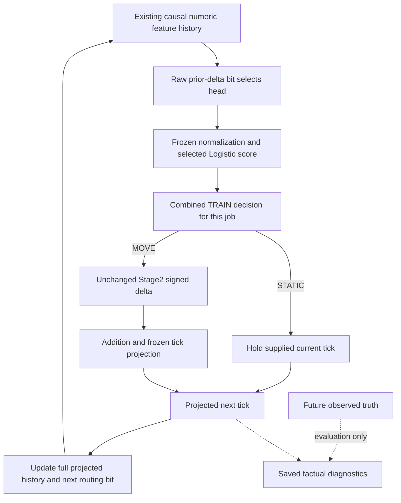

CyberPilot V4는 움직임을 구분하는 점수가 이전보다 개선된 구간이 있었지만, 실제 MOVE/STATIC 판단에서는 움직임 시작과 종료를 놓치는 문제가 발생했다.

특히 움직임을 종료해야 할 때도 MOVE로 판단했고, Fold B에서는 새 움직임을 거의 검출하지 못했다.
그런데 점수가 잘 구분되는 것과 그 점수를 기준으로 올바른 판단을 내리는 것은 서로 다르다.

이번 작업은 새로운 판단 기준을 만들지 않는다.
현재 저장·공개된 결과만으로 판단 기준의 전이 문제가 어디까지 확인되는지 검토하고,
앞으로 어떤 추가 증거와 승인이 있어야 실제 개선 실험으로 넘어갈 수 있는지 결정한다.
여기서 움직임은 source-grid tick 변화이며 물리적 EPS 움직임이 아니다.

# Stage1 decision transfer feasibility review

## 1. Executive summary

현재 frozen decision에서 어떤 오류가 났는지는 공개 자료로 설명할 수 있다.
하지만 다른 threshold, calibration 또는 context별 decision을 적용했을 때 개선되는지는 식별할 수 없다.
공통 decision이 각 전환 상태를 보호하도록 보장하지 않는다는 코드 계약과, 그 decision이 단독 원인이라는 주장은 다르다.

이번 feasibility 결론은 두 갈래다. Public-only 정책 요구사항 문서는 구체적으로 검토할 수 있다.
반면 실제 정책 효과 검증은 추가 증거·정책·실행 승인이 필요하다. 비공개 데이터 확보를 자동 시작하지 않는다.
NOT_IDENTIFIABLE인 효과가 있어도 이 식별 가능성 검토는 정상적인 결론에 도달한 것이다.
최종 feasibility states: PUBLIC_EVIDENCE_SUFFICIENT_FOR_DESCRIPTIVE_TRANSFER_REVIEW, POLICY_EFFECT_NOT_IDENTIFIABLE_FROM_PUBLIC_AGGREGATES, ADDITIONAL_EVIDENCE_AUTHORIZATION_REQUIRED, DECISION_POLICY_DESIGN_REVIEW_FEASIBLE_WITH_LIMITS, NO_POLICY_IMPLEMENTATION_AUTHORIZED.

## 2. Baseline / evidence lock
| Identity | Binding |
| --- | --- |
| Baseline | 3d2e77897f385565fe504937d77766dd73c4c6a9 |
| Original execution | bd8045ef2a0da62a92603439f38e7740f5923622 |
| Attribution | 42541f583f39dc16609dd207c84cfd366445c0df |
| Mixed review | 471537fc0d95d86e7b9f553af5a067a72951abdc |
| Original publication | 3943f5c2f4ef641e673ca6a47b24b44a359765c8 |
| Previous transition policy receipt | cb115d12addc97918bf5053c07fbb6f8017ae59e0da989f77198d965bc51615c |
| New feasibility policy receipt | 2fe02dcf43f83877bf494251781f56638240920aefd08d015963bf6ca71a33d0 |
| Inherited lock | 34 public files /32seals /15static sources and existing workflow verified unchanged |
| Current lock | 45 public files /42seals;17static sources, including public field-projection and null-denominator primitives |
| Publication HEAD / CI | Containing commit; actual exact SHA/CI confirmed in final handoff, never self-referentially fabricated |

추가 소스2개는 public aggregate publication 경로와 undefined confusion denominator 계약을 확인하기 위한 읽기 전용 근거다.
기존7scientific executor 파일은 original execution bytes와 일치한다. 전체 SHA/receipt는 [feasibility-policy](empirical-hurdle-stage1-v4-decision-transfer-feasibility-policy.json) /input_lock에 있다.
Private arrays, source logs, raw scores, threshold values와 기존 E actual evidence를 다시 열지 않았다. 기존 workflow도 변경하지 않는다.
근거: [empirical-hurdle-stage1-v4-transition-review-decision.json /recommendation](https://github.com/rownlvh8875-coder/CyberPilot/blob/3d2e77897f385565fe504937d77766dd73c4c6a9/docs/cyberpilot/changes/empirical-hurdle-stage1-v4-transition-review-decision.json); [empirical-hurdle-stage1-v4-transition-contract-policy.json /input_lock](https://github.com/rownlvh8875-coder/CyberPilot/blob/3d2e77897f385565fe504937d77766dd73c4c6a9/docs/cyberpilot/changes/empirical-hurdle-stage1-v4-transition-contract-policy.json); [empirical-hurdle-stage1-v4-mixed-architecture-evidence-ledger.json /facts/E1](https://github.com/rownlvh8875-coder/CyberPilot/blob/3d2e77897f385565fe504937d77766dd73c4c6a9/docs/cyberpilot/changes/empirical-hurdle-stage1-v4-mixed-architecture-evidence-ledger.json); [empirical-hurdle-stage1-v4-mixed-architecture-evidence-ledger.json /facts/E2](https://github.com/rownlvh8875-coder/CyberPilot/blob/3d2e77897f385565fe504937d77766dd73c4c6a9/docs/cyberpilot/changes/empirical-hurdle-stage1-v4-mixed-architecture-evidence-ledger.json); [empirical-hurdle-stage1-v4-mixed-architecture-evidence-ledger.json /facts/E3](https://github.com/rownlvh8875-coder/CyberPilot/blob/3d2e77897f385565fe504937d77766dd73c4c6a9/docs/cyberpilot/changes/empirical-hurdle-stage1-v4-mixed-architecture-evidence-ledger.json); [empirical-hurdle-stage1-v4-mixed-architecture-evidence-ledger.json /facts/E4](https://github.com/rownlvh8875-coder/CyberPilot/blob/3d2e77897f385565fe504937d77766dd73c4c6a9/docs/cyberpilot/changes/empirical-hurdle-stage1-v4-mixed-architecture-evidence-ledger.json); [empirical-hurdle-stage1-v4-mixed-architecture-evidence-ledger.json /facts/E5](https://github.com/rownlvh8875-coder/CyberPilot/blob/3d2e77897f385565fe504937d77766dd73c4c6a9/docs/cyberpilot/changes/empirical-hurdle-stage1-v4-mixed-architecture-evidence-ledger.json); [empirical-hurdle-stage1-v4-mixed-architecture-evidence-ledger.json /facts/E7](https://github.com/rownlvh8875-coder/CyberPilot/blob/3d2e77897f385565fe504937d77766dd73c4c6a9/docs/cyberpilot/changes/empirical-hurdle-stage1-v4-mixed-architecture-evidence-ledger.json); [empirical-hurdle-stage1-v4-mixed-architecture-evidence-ledger.json /facts/E9](https://github.com/rownlvh8875-coder/CyberPilot/blob/3d2e77897f385565fe504937d77766dd73c4c6a9/docs/cyberpilot/changes/empirical-hurdle-stage1-v4-mixed-architecture-evidence-ledger.json).
실제 소스: [empirical_hurdle_v4_execution.py:probability:20](https://github.com/rownlvh8875-coder/CyberPilot/blob/3d2e77897f385565fe504937d77766dd73c4c6a9/openpilot/tools/cyber_autotune/empirical_hurdle_v4_execution.py#L20) [empirical_hurdle_v4_execution.py:train:54](https://github.com/rownlvh8875-coder/CyberPilot/blob/3d2e77897f385565fe504937d77766dd73c4c6a9/openpilot/tools/cyber_autotune/empirical_hurdle_v4_execution.py#L54) [empirical_hurdle_v4_execution.py:save_train:247](https://github.com/rownlvh8875-coder/CyberPilot/blob/3d2e77897f385565fe504937d77766dd73c4c6a9/openpilot/tools/cyber_autotune/empirical_hurdle_v4_execution.py#L247) [empirical_hurdle_v4_execution.py:execute_job:267](https://github.com/rownlvh8875-coder/CyberPilot/blob/3d2e77897f385565fe504937d77766dd73c4c6a9/openpilot/tools/cyber_autotune/empirical_hurdle_v4_execution.py#L267) [empirical_hurdle_v4_execution.py:integrated:152](https://github.com/rownlvh8875-coder/CyberPilot/blob/3d2e77897f385565fe504937d77766dd73c4c6a9/openpilot/tools/cyber_autotune/empirical_hurdle_v4_execution.py#L152) [empirical_hurdle_v4_execution.py:development:164](https://github.com/rownlvh8875-coder/CyberPilot/blob/3d2e77897f385565fe504937d77766dd73c4c6a9/openpilot/tools/cyber_autotune/empirical_hurdle_v4_execution.py#L164) [empirical_hurdle_v4_execution.py:recursive:185](https://github.com/rownlvh8875-coder/CyberPilot/blob/3d2e77897f385565fe504937d77766dd73c4c6a9/openpilot/tools/cyber_autotune/empirical_hurdle_v4_execution.py#L185) [empirical_hurdle_fit_cv_math.py:threshold:157](https://github.com/rownlvh8875-coder/CyberPilot/blob/3d2e77897f385565fe504937d77766dd73c4c6a9/openpilot/tools/cyber_autotune/empirical_hurdle_fit_cv_math.py#L157) [empirical_hurdle_v4_io.py:finalized:127](https://github.com/rownlvh8875-coder/CyberPilot/blob/3d2e77897f385565fe504937d77766dd73c4c6a9/openpilot/tools/cyber_autotune/empirical_hurdle_v4_io.py#L127) [empirical_hurdle_v4_attribution.py:analyze_job:579](https://github.com/rownlvh8875-coder/CyberPilot/blob/3d2e77897f385565fe504937d77766dd73c4c6a9/openpilot/tools/cyber_autotune/empirical_hurdle_v4_attribution.py#L579) [empirical_hurdle_v4_attribution_math.py:rankings:35](https://github.com/rownlvh8875-coder/CyberPilot/blob/3d2e77897f385565fe504937d77766dd73c4c6a9/openpilot/tools/cyber_autotune/empirical_hurdle_v4_attribution_math.py#L35) [empirical_hurdle_v4_attribution_math.py:one_step:63](https://github.com/rownlvh8875-coder/CyberPilot/blob/3d2e77897f385565fe504937d77766dd73c4c6a9/openpilot/tools/cyber_autotune/empirical_hurdle_v4_attribution_math.py#L63) [empirical_hurdle_v2_attribution_math.py:ranking:9](https://github.com/rownlvh8875-coder/CyberPilot/blob/3d2e77897f385565fe504937d77766dd73c4c6a9/openpilot/tools/cyber_autotune/empirical_hurdle_v2_attribution_math.py#L9) [empirical_hurdle_v4_attribution_publication.py:_build:33](https://github.com/rownlvh8875-coder/CyberPilot/blob/3d2e77897f385565fe504937d77766dd73c4c6a9/openpilot/tools/cyber_autotune/empirical_hurdle_v4_attribution_publication.py#L33) [empirical_hurdle_attribution_math.py:confusion_counts:71](https://github.com/rownlvh8875-coder/CyberPilot/blob/3d2e77897f385565fe504937d77766dd73c4c6a9/openpilot/tools/cyber_autotune/empirical_hurdle_attribution_math.py#L71).

## 3. Frozen scientific facts
STATIC_HIT_LOSS=571,317; MOVE_HIT_GAIN=228,164; NET_EXACT_HIT_DELTA=-343,153. 모든32작업에서 loss>gain이다.
Gate FP=1,662,235는 projected HOLD=1,090,918와 harmful movement=571,317로 나뉜다. 기존 harmful fraction34.37%를 보전한다.
이들은 겹치는 candidate/job anchors의 합계이며 독립 sample 수가 아니다. Fitting/support/rank/separation/convergence failure로 설명하지 않는다.
아래 E3 전환 recall/FPR은 겹치는 anchors를 포함한 candidate/job confusion count 합계의 비율이며 job-mean rate가 아니다.
| Observed DEV transition — E3 summed-count ratios | Fold A | Fold B |
| --- | --- | --- |
| MOVE_ONSET recall | 40.195% | 2.147% |
| MOVE_CONTINUATION recall | 100.000% | 약99.999% |
| MOVE_TERMINATION gate FP | 100.000% | 100.000% |

| Population | TRAIN AUC job mean | DEV AUC job mean | V4DEV vs fixedV1DEV improved/equal/worse |
| --- | --- | --- | --- |
| OVERALL | 0.707438 | 0.702174 | 32/0/0 |
| PREV_STATIC | 0.554846 | 0.545865 | 13/0/19 |
| PREV_MOVE | 0.592356 | 0.574285 | 32/0/0 |

AUC는 기존 job 평균이며 pooled AUC나 통계적 유의성 결과가 아니다. Historical comparison은 matching DEV anchors의 V4DEV 대 fixedV1DEV이며 TRAIN→DEV 비교 건수가 아니다.

## 4. Actual decision contract

| Responsibility | Actual contract | Limit / source |
| --- | --- | --- |
| REPRESENTATION | Existing causal raw history/command/tick/speed feature vector. | Existing information does not prove representation sufficient. [empirical_s2_ri_fit_cv_math.py:features:31](https://github.com/rownlvh8875-coder/CyberPilot/blob/3d2e77897f385565fe504937d77766dd73c4c6a9/openpilot/tools/cyber_autotune/empirical_s2_ri_fit_cv_math.py#L31) |
| HEAD_ROUTING | Latest raw prior-delta nonzero bit before normalization. | Observed one-step routing differs from projected routing after recursion begins. [empirical_hurdle_v4_execution.py:probability:20](https://github.com/rownlvh8875-coder/CyberPilot/blob/3d2e77897f385565fe504937d77766dd73c4c6a9/openpilot/tools/cyber_autotune/empirical_hurdle_v4_execution.py#L20) |
| SCORE_RANKING | Conditioned linear Logistic score; published AUC describes ordering. | Ordering does not determine frozen-point confusion. [empirical_hurdle_v4_execution.py:probability:20](https://github.com/rownlvh8875-coder/CyberPilot/blob/3d2e77897f385565fe504937d77766dd73c4c6a9/openpilot/tools/cyber_autotune/empirical_hurdle_v4_execution.py#L20) [empirical_hurdle_v2_attribution_math.py:ranking:9](https://github.com/rownlvh8875-coder/CyberPilot/blob/3d2e77897f385565fe504937d77766dd73c4c6a9/openpilot/tools/cyber_autotune/empirical_hurdle_v2_attribution_math.py#L9) |
| CALIBRATION | Mean nominal score versus prevalence and Brier are descriptive. | No calibration function is fitted; mean bias is not full reliability. [empirical_hurdle_v2_attribution_math.py:ranking:9](https://github.com/rownlvh8875-coder/CyberPilot/blob/3d2e77897f385565fe504937d77766dd73c4c6a9/openpilot/tools/cyber_autotune/empirical_hurdle_v2_attribution_math.py#L9) |
| FROZEN_DECISION | One combined TRAIN decision per candidate/fold shared by two heads. | Not one common numerical value across32jobs; not a per-state guarantee. [empirical_hurdle_v4_execution.py:train:54](https://github.com/rownlvh8875-coder/CyberPilot/blob/3d2e77897f385565fe504937d77766dd73c4c6a9/openpilot/tools/cyber_autotune/empirical_hurdle_v4_execution.py#L54) [empirical_hurdle_fit_cv_math.py:threshold:157](https://github.com/rownlvh8875-coder/CyberPilot/blob/3d2e77897f385565fe504937d77766dd73c4c6a9/openpilot/tools/cyber_autotune/empirical_hurdle_fit_cv_math.py#L157) |
| GATE_CLASSIFICATION | Strict score greater than frozen decision; equality STATIC. | A gate flag is distinct from realized movement. [empirical_hurdle_v4_execution.py:integrated:152](https://github.com/rownlvh8875-coder/CyberPilot/blob/3d2e77897f385565fe504937d77766dd73c4c6a9/openpilot/tools/cyber_autotune/empirical_hurdle_v4_execution.py#L152) |
| STAGE2_MAGNITUDE | Unchanged V1 Stage2 signed delta on gated rows only. | True-STATIC gateFP can call Stage2; magnitude accuracy is not owned by Stage1 alone. [empirical_hurdle_v4_execution.py:integrated:152](https://github.com/rownlvh8875-coder/CyberPilot/blob/3d2e77897f385565fe504937d77766dd73c4c6a9/openpilot/tools/cyber_autotune/empirical_hurdle_v4_execution.py#L152) [empirical_hurdle_fit_cv_math.py:predict_delta:215](https://github.com/rownlvh8875-coder/CyberPilot/blob/3d2e77897f385565fe504937d77766dd73c4c6a9/openpilot/tools/cyber_autotune/empirical_hurdle_fit_cv_math.py#L215) |
| TICK_REALIZATION | Add delta to supplied current, finite/range-check and ties-to-even. | MOVE can HOLD; invalid output raises; no new deadband or forced movement. [empirical_hurdle_v4_execution.py:integrated:152](https://github.com/rownlvh8875-coder/CyberPilot/blob/3d2e77897f385565fe504937d77766dd73c4c6a9/openpilot/tools/cyber_autotune/empirical_hurdle_v4_execution.py#L152) [empirical_s2_ri_fit_cv_math.py:project:49](https://github.com/rownlvh8875-coder/CyberPilot/blob/3d2e77897f385565fe504937d77766dd73c4c6a9/openpilot/tools/cyber_autotune/empirical_s2_ri_fit_cv_math.py#L49) |
| RECURSIVE_STATE | Projected delta updates routing and full numeric history/current. | Full numeric feedback affects both models; no independent causal share identified. [empirical_hurdle_v4_execution.py:recursive:185](https://github.com/rownlvh8875-coder/CyberPilot/blob/3d2e77897f385565fe504937d77766dd73c4c6a9/openpilot/tools/cyber_autotune/empirical_hurdle_v4_execution.py#L185) |

한 job의 두 head가 공유하는 decision이지, 모든 candidate/fold의 numerical threshold가 같다는 뜻은 아니다.
Stage1에는 기존 history와 종료 negative label이 이미 있다. Feature/label 부재나 Logistic의 필연적 실패를 단정하지 않는다.
## 5. TRAIN / DEV observability inventory
| Evidence | TRAIN public / saved status | DEV public / saved status |
| --- | --- | --- |
| overall_move_prevalence | AVAILABLE_PUBLIC_JOB_LEVEL PUBLIC_FROZEN_AGGREGATE | AVAILABLE_PUBLIC_JOB_LEVEL PUBLIC_FROZEN_AGGREGATE |
| overall_predicted_move_prevalence | AVAILABLE_PUBLIC_JOB_LEVEL PUBLIC_FROZEN_AGGREGATE | AVAILABLE_PUBLIC_JOB_LEVEL PUBLIC_FROZEN_AGGREGATE |
| overall_confusion | AVAILABLE_PUBLIC_JOB_LEVEL PUBLIC_FROZEN_AGGREGATE | AVAILABLE_PUBLIC_JOB_LEVEL PUBLIC_FROZEN_AGGREGATE |
| overall_auc | AVAILABLE_PUBLIC_JOB_LEVEL PUBLIC_FROZEN_AGGREGATE | AVAILABLE_PUBLIC_JOB_LEVEL PUBLIC_FROZEN_AGGREGATE |
| previous_static_auc | AVAILABLE_PUBLIC_JOB_LEVEL PUBLIC_FROZEN_AGGREGATE | AVAILABLE_PUBLIC_JOB_LEVEL PUBLIC_FROZEN_AGGREGATE |
| previous_move_auc | AVAILABLE_PUBLIC_JOB_LEVEL PUBLIC_FROZEN_AGGREGATE | AVAILABLE_PUBLIC_JOB_LEVEL PUBLIC_FROZEN_AGGREGATE |
| mean_score | AVAILABLE_PUBLIC_JOB_LEVEL PUBLIC_FROZEN_AGGREGATE | AVAILABLE_PUBLIC_JOB_LEVEL PUBLIC_FROZEN_AGGREGATE |
| calibration_bias | AVAILABLE_PUBLIC_JOB_LEVEL PUBLIC_FROZEN_AGGREGATE | AVAILABLE_PUBLIC_JOB_LEVEL PUBLIC_FROZEN_AGGREGATE |
| brier | AVAILABLE_PUBLIC_JOB_LEVEL PUBLIC_FROZEN_AGGREGATE | AVAILABLE_PUBLIC_JOB_LEVEL PUBLIC_FROZEN_AGGREGATE |
| context_confusion | INPUT_INSUFFICIENT NOT_PUBLISHED_BY_CURRENT_ATTRIBUTION_CONTRACT | AVAILABLE_PUBLIC_JOB_LEVEL PUBLIC_FROZEN_AGGREGATE |
| rowwise_gate | INPUT_INSUFFICIENT NOT_SAVED_IN_V4_TRAIN_OUTPUT_CONTRACT | NOT_PUBLIC SAVED_PRIVATE_BY_SOURCE_CONTRACT_NOT_REOPENED |
| rowwise_scores | NOT_PUBLIC SAVED_PRIVATE_BY_SOURCE_CONTRACT_NOT_REOPENED | NOT_PUBLIC SAVED_PRIVATE_BY_SOURCE_CONTRACT_NOT_REOPENED |
| reliability_bins | INPUT_INSUFFICIENT NOT_EMITTED_BY_INSPECTED_FROZEN_SCHEMA_OTHER_SAVED_STATUS_UNKNOWN | INPUT_INSUFFICIENT NOT_EMITTED_BY_INSPECTED_FROZEN_SCHEMA_OTHER_SAVED_STATUS_UNKNOWN |
| boundary_distribution | INPUT_INSUFFICIENT NOT_EMITTED_BY_INSPECTED_FROZEN_SCHEMA_OTHER_SAVED_STATUS_UNKNOWN | INPUT_INSUFFICIENT NOT_EMITTED_BY_INSPECTED_FROZEN_SCHEMA_OTHER_SAVED_STATUS_UNKNOWN |

TRAIN overall confusion은 이미 있다. 부족한 것은 row-aligned gate와 state-specific gate confusion이다.
TRAIN combined probability와 DEV score/gate는 source contract상 private 저장 항목이다. 이번에 private manifest 존재나 contents를 재검증한 것은 아니다.
Reliability/bin/boundary 항목은 inspected frozen schema에서 산출되지 않는다. 다른 private 저장 여부까지 없다고 단정하지 않는다.
Fold의 histogram은 rollout event/streak 분포이고, min/median/p95/max는 job metric 분포다. 어느 것도 row-score distribution이나 reliability bin이 아니다.
각 TRAIN/DEV 항목의 정확한 파일·필드 pointer 및 저장 계약 근거: [evidence-inventory](empirical-hurdle-stage1-v4-decision-transfer-evidence-inventory.json).
근거: [empirical-hurdle-stage1-v4-score-transfer.json /jobs](https://github.com/rownlvh8875-coder/CyberPilot/blob/3d2e77897f385565fe504937d77766dd73c4c6a9/docs/cyberpilot/changes/empirical-hurdle-stage1-v4-score-transfer.json); [empirical-hurdle-stage1-v4-state-conditional-ranking.json /jobs](https://github.com/rownlvh8875-coder/CyberPilot/blob/3d2e77897f385565fe504937d77766dd73c4c6a9/docs/cyberpilot/changes/empirical-hurdle-stage1-v4-state-conditional-ranking.json); [empirical-hurdle-stage1-v4-stage1-confusion-attribution.json /jobs](https://github.com/rownlvh8875-coder/CyberPilot/blob/3d2e77897f385565fe504937d77766dd73c4c6a9/docs/cyberpilot/changes/empirical-hurdle-stage1-v4-stage1-confusion-attribution.json); [empirical-hurdle-stage1-v4-fold-asymmetry.json /folds](https://github.com/rownlvh8875-coder/CyberPilot/blob/3d2e77897f385565fe504937d77766dd73c4c6a9/docs/cyberpilot/changes/empirical-hurdle-stage1-v4-fold-asymmetry.json).
실제 소스: [empirical_hurdle_v4_attribution.py:analyze_job:579](https://github.com/rownlvh8875-coder/CyberPilot/blob/3d2e77897f385565fe504937d77766dd73c4c6a9/openpilot/tools/cyber_autotune/empirical_hurdle_v4_attribution.py#L579) [empirical_hurdle_v4_attribution_math.py:rankings:35](https://github.com/rownlvh8875-coder/CyberPilot/blob/3d2e77897f385565fe504937d77766dd73c4c6a9/openpilot/tools/cyber_autotune/empirical_hurdle_v4_attribution_math.py#L35) [empirical_hurdle_v4_attribution_math.py:one_step:63](https://github.com/rownlvh8875-coder/CyberPilot/blob/3d2e77897f385565fe504937d77766dd73c4c6a9/openpilot/tools/cyber_autotune/empirical_hurdle_v4_attribution_math.py#L63) [empirical_hurdle_v2_attribution_math.py:ranking:9](https://github.com/rownlvh8875-coder/CyberPilot/blob/3d2e77897f385565fe504937d77766dd73c4c6a9/openpilot/tools/cyber_autotune/empirical_hurdle_v2_attribution_math.py#L9) [empirical_hurdle_v4_attribution_publication.py:_build:33](https://github.com/rownlvh8875-coder/CyberPilot/blob/3d2e77897f385565fe504937d77766dd73c4c6a9/openpilot/tools/cyber_autotune/empirical_hurdle_v4_attribution_publication.py#L33) [empirical_hurdle_attribution_math.py:confusion_counts:71](https://github.com/rownlvh8875-coder/CyberPilot/blob/3d2e77897f385565fe504937d77766dd73c4c6a9/openpilot/tools/cyber_autotune/empirical_hurdle_attribution_math.py#L71).

## 6. Four transition populations
| Truth state | z_truth / y_true | Observed one-step head | AUC population | TRAIN conditional gate transfer |
| --- | --- | --- | --- | --- |
| STATIC_HOLD | 0 / 0 | STATIC_CONTEXT_HEAD | PREV_STATIC pair | INPUT_INSUFFICIENT |
| MOVE_ONSET | 0 / 1 | STATIC_CONTEXT_HEAD | PREV_STATIC pair | INPUT_INSUFFICIENT |
| MOVE_TERMINATION | 1 / 0 | MOVE_CONTEXT_HEAD | PREV_MOVE pair | INPUT_INSUFFICIENT |
| MOVE_CONTINUATION | 1 / 1 | MOVE_CONTEXT_HEAD | PREV_MOVE pair | INPUT_INSUFFICIENT |

delta_prev=t[k]-t[k-1], delta_true=t[k+1]-t[k], z_truth=1[delta_prev!=0], y_true=1[delta_true!=0].
네 truth label은 다음 tick이 관측된 뒤 확정한다. Future target은 inference 입력이 아니다. Recursive head는 projected prior delta로 정해져 observed truth population과 달라질 수 있다.
Onset/continuation은 true-MOVE 단일 class이므로 specificity/FPR가 정의되지 않는다. Hold/termination은 true-STATIC 단일 class이므로 recall/FNR가 정의되지 않는다.
Balanced accuracy와 pure-cell AUC도 양 class가 없어 정의되지 않는다. Precision은 predicted-MOVE support에 따라 null일 수 있다. Null을0으로 바꾸지 않는다.
DEV gate confusion은 공개되어 있지만 TRAIN 상태별 confusion을 만드는 권한은 없다. 기존 TRAIN overall confusion이나 이전-state ranking으로 이를 대신하지 않는다.
근거: [empirical-hurdle-stage1-v4-stage1-confusion-attribution.json /jobs/*/contexts](https://github.com/rownlvh8875-coder/CyberPilot/blob/3d2e77897f385565fe504937d77766dd73c4c6a9/docs/cyberpilot/changes/empirical-hurdle-stage1-v4-stage1-confusion-attribution.json); [empirical-hurdle-stage1-v4-score-transfer.json /jobs/*/decision_transfer/train_rowwise_gate](https://github.com/rownlvh8875-coder/CyberPilot/blob/3d2e77897f385565fe504937d77766dd73c4c6a9/docs/cyberpilot/changes/empirical-hurdle-stage1-v4-score-transfer.json); [empirical-hurdle-stage1-v4-mixed-architecture-evidence-ledger.json /facts/E3](https://github.com/rownlvh8875-coder/CyberPilot/blob/3d2e77897f385565fe504937d77766dd73c4c6a9/docs/cyberpilot/changes/empirical-hurdle-stage1-v4-mixed-architecture-evidence-ledger.json); [empirical-hurdle-stage1-v4-mixed-architecture-evidence-ledger.json /facts/E5](https://github.com/rownlvh8875-coder/CyberPilot/blob/3d2e77897f385565fe504937d77766dd73c4c6a9/docs/cyberpilot/changes/empirical-hurdle-stage1-v4-mixed-architecture-evidence-ledger.json).
실제 소스: [empirical_hurdle_v4_attribution.py:analyze_job:579](https://github.com/rownlvh8875-coder/CyberPilot/blob/3d2e77897f385565fe504937d77766dd73c4c6a9/openpilot/tools/cyber_autotune/empirical_hurdle_v4_attribution.py#L579) [empirical_hurdle_v4_attribution_math.py:rankings:35](https://github.com/rownlvh8875-coder/CyberPilot/blob/3d2e77897f385565fe504937d77766dd73c4c6a9/openpilot/tools/cyber_autotune/empirical_hurdle_v4_attribution_math.py#L35) [empirical_hurdle_v4_attribution_math.py:one_step:63](https://github.com/rownlvh8875-coder/CyberPilot/blob/3d2e77897f385565fe504937d77766dd73c4c6a9/openpilot/tools/cyber_autotune/empirical_hurdle_v4_attribution_math.py#L63) [empirical_hurdle_v2_attribution_math.py:ranking:9](https://github.com/rownlvh8875-coder/CyberPilot/blob/3d2e77897f385565fe504937d77766dd73c4c6a9/openpilot/tools/cyber_autotune/empirical_hurdle_v2_attribution_math.py#L9) [empirical_hurdle_v4_attribution_publication.py:_build:33](https://github.com/rownlvh8875-coder/CyberPilot/blob/3d2e77897f385565fe504937d77766dd73c4c6a9/openpilot/tools/cyber_autotune/empirical_hurdle_v4_attribution_publication.py#L33) [empirical_hurdle_attribution_math.py:confusion_counts:71](https://github.com/rownlvh8875-coder/CyberPilot/blob/3d2e77897f385565fe504937d77766dd73c4c6a9/openpilot/tools/cyber_autotune/empirical_hurdle_attribution_math.py#L71) [empirical_hurdle_v4_execution.py:probability:20](https://github.com/rownlvh8875-coder/CyberPilot/blob/3d2e77897f385565fe504937d77766dd73c4c6a9/openpilot/tools/cyber_autotune/empirical_hurdle_v4_execution.py#L20) [empirical_hurdle_v4_execution.py:recursive:185](https://github.com/rownlvh8875-coder/CyberPilot/blob/3d2e77897f385565fe504937d77766dd73c4c6a9/openpilot/tools/cyber_autotune/empirical_hurdle_v4_execution.py#L185).

## 7. Ranking vs calibration vs decision
| Area | What current evidence says | What it does not say |
| --- | --- | --- |
| Ranking | MOVE/STATIC score ordering; exact-tie AUC for overall/previous-state pairs. | No guarantee of recall/specificity at the frozen point. |
| Calibration | Mean score-prevalence bias and Brier, including conditioned summaries. | No full reliability curve, no unique correction or efficacy. |
| Decision | Stored gate results at one frozen TRAIN-derived operating point. | No confusion at another boundary or state-specific rule. |

PREV_MOVE ranking32/32개선과 terminationFP100%는 모순이 아니다. 상대적 순서가 개선돼도 종료 sample이 frozen decision의 MOVE 쪽에 남을 수 있다. Private 값이나 실제 margin을 복원한 주장은 아니다.
PREV_STATIC13개선/19악화는 representation을 경쟁 가설로 남긴다. Overall32개선으로 모든 상태가 해결됐다고 해석하지 않는다.
원리적 식별 가능성 설명: A positive affine score transform centered on its mean preserves ordering/AUC and the mean. At a fixed generic boundary different from that mean, admissible transforms may change crossings. Thus AUC and mean alone do not determine confusion. No V4 scores, boundary or alternative outputs are reconstructed.
이는 양 class와 비상수 score, 유효 domain 안의 변환 및 crossing 가능한 경우를 가정한 기호적 존재 설명이다. 모든 데이터/boundary에 대한 주장이 아니며 실제 V4 수치·counterfactual이나 threshold 계산은 없다.
근거: [empirical-hurdle-stage1-v4-score-transfer.json /jobs/*/decision_transfer](https://github.com/rownlvh8875-coder/CyberPilot/blob/3d2e77897f385565fe504937d77766dd73c4c6a9/docs/cyberpilot/changes/empirical-hurdle-stage1-v4-score-transfer.json); [empirical-hurdle-stage1-v4-state-conditional-ranking.json /summary](https://github.com/rownlvh8875-coder/CyberPilot/blob/3d2e77897f385565fe504937d77766dd73c4c6a9/docs/cyberpilot/changes/empirical-hurdle-stage1-v4-state-conditional-ranking.json); [empirical-hurdle-stage1-v4-stage1-confusion-attribution.json /jobs/*/contexts](https://github.com/rownlvh8875-coder/CyberPilot/blob/3d2e77897f385565fe504937d77766dd73c4c6a9/docs/cyberpilot/changes/empirical-hurdle-stage1-v4-stage1-confusion-attribution.json); [empirical-hurdle-stage1-v4-mixed-architecture-evidence-ledger.json /facts/E3](https://github.com/rownlvh8875-coder/CyberPilot/blob/3d2e77897f385565fe504937d77766dd73c4c6a9/docs/cyberpilot/changes/empirical-hurdle-stage1-v4-mixed-architecture-evidence-ledger.json); [empirical-hurdle-stage1-v4-mixed-architecture-evidence-ledger.json /facts/E4](https://github.com/rownlvh8875-coder/CyberPilot/blob/3d2e77897f385565fe504937d77766dd73c4c6a9/docs/cyberpilot/changes/empirical-hurdle-stage1-v4-mixed-architecture-evidence-ledger.json); [empirical-hurdle-stage1-v4-mixed-architecture-evidence-ledger.json /facts/E5](https://github.com/rownlvh8875-coder/CyberPilot/blob/3d2e77897f385565fe504937d77766dd73c4c6a9/docs/cyberpilot/changes/empirical-hurdle-stage1-v4-mixed-architecture-evidence-ledger.json).
실제 소스: [empirical_hurdle_v4_attribution.py:analyze_job:579](https://github.com/rownlvh8875-coder/CyberPilot/blob/3d2e77897f385565fe504937d77766dd73c4c6a9/openpilot/tools/cyber_autotune/empirical_hurdle_v4_attribution.py#L579) [empirical_hurdle_v4_attribution_math.py:rankings:35](https://github.com/rownlvh8875-coder/CyberPilot/blob/3d2e77897f385565fe504937d77766dd73c4c6a9/openpilot/tools/cyber_autotune/empirical_hurdle_v4_attribution_math.py#L35) [empirical_hurdle_v4_attribution_math.py:one_step:63](https://github.com/rownlvh8875-coder/CyberPilot/blob/3d2e77897f385565fe504937d77766dd73c4c6a9/openpilot/tools/cyber_autotune/empirical_hurdle_v4_attribution_math.py#L63) [empirical_hurdle_v2_attribution_math.py:ranking:9](https://github.com/rownlvh8875-coder/CyberPilot/blob/3d2e77897f385565fe504937d77766dd73c4c6a9/openpilot/tools/cyber_autotune/empirical_hurdle_v2_attribution_math.py#L9) [empirical_hurdle_v4_attribution_publication.py:_build:33](https://github.com/rownlvh8875-coder/CyberPilot/blob/3d2e77897f385565fe504937d77766dd73c4c6a9/openpilot/tools/cyber_autotune/empirical_hurdle_v4_attribution_publication.py#L33) [empirical_hurdle_attribution_math.py:confusion_counts:71](https://github.com/rownlvh8875-coder/CyberPilot/blob/3d2e77897f385565fe504937d77766dd73c4c6a9/openpilot/tools/cyber_autotune/empirical_hurdle_attribution_math.py#L71).

## 8. Fold A/B score and decision transfer
| Existing job-mean metric | Fold A | Fold B |
| --- | --- | --- |
| DEV FPR | 41.193% | 10.430% |
| DEV FNR | 33.041% | 54.098% |
| Mean-score shift | +0.017882 | -0.009916 |
| Calibration-bias shift | +0.022050 | -0.014084 |
| H200 gate MOVE | 44.512% | 4.041% |
| H200 true MOVE | 13.201% | 14.736% |

각 fold는 고유 frozen TRAIN/DEV cohort를 보전하며 공통 feature/label 정의로 기술적 비교를 한다. 같은 sample/anchor라는 뜻은 아니다.
V4와 V1 reference의 matching은 TRAIN끼리, DEV끼리 별도로 검증한 것이며 TRAIN=DEV라는 증거가 아니다.
Overall mean은 context weight와 context score mean의 혼합이고, 각 context mean도 MOVE/STATIC composition에 영향을 받는다. Opposite mean shift는 uniform row-score shift나 route 원인을 증명하지 않는다.
H200은 전체 numeric state와 supplied future command/speed에 조건부인 retrospective trajectory다. One-step operating point와 같은 관측으로 취급하지 않는다.
### Existing32job differences — exact copies, no new metrics
| Candidate / fold | Score shift | Bias shift | True-MOVE fraction Δ | Predicted-MOVE fraction Δ | Recall Δ | Specificity Δ |
| --- | --- | --- | --- | --- | --- | --- |
| HRI_D00_L01 / FOLD_A | +0.017945 | +0.016403 | +0.001542 | +0.197169 | +0.126715 | -0.208435 |
| HRI_D00_L01 / FOLD_B | -0.010800 | -0.009258 | -0.001542 | -0.015225 | -0.027840 | +0.012459 |
| HRI_D00_L05 / FOLD_A | +0.015996 | +0.019024 | -0.003028 | +0.201372 | +0.121849 | -0.216049 |
| HRI_D00_L05 / FOLD_B | -0.008523 | -0.011551 | +0.003028 | -0.018332 | -0.031285 | +0.017414 |
| HRI_D00_L15 / FOLD_A | +0.017381 | +0.021397 | -0.004016 | +0.213365 | +0.127546 | -0.229398 |
| HRI_D00_L15 / FOLD_B | -0.009468 | -0.013483 | +0.004016 | -0.018968 | -0.030826 | +0.018651 |
| HRI_D00_L45 / FOLD_A | +0.019062 | +0.024662 | -0.005600 | +0.230121 | +0.131095 | -0.248864 |
| HRI_D00_L45 / FOLD_B | -0.010720 | -0.016320 | +0.005600 | -0.022820 | -0.029787 | +0.023992 |
| HRI_D05_L01 / FOLD_A | +0.016002 | +0.019029 | -0.003028 | +0.202612 | +0.127255 | -0.216581 |
| HRI_D05_L01 / FOLD_B | -0.008763 | -0.011791 | +0.003028 | -0.012828 | -0.022228 | +0.012497 |
| HRI_D05_L05 / FOLD_A | +0.016776 | +0.020212 | -0.003436 | +0.205008 | +0.124817 | -0.219932 |
| HRI_D05_L05 / FOLD_B | -0.008877 | -0.012313 | +0.003436 | -0.019167 | -0.031569 | +0.018515 |
| HRI_D05_L15 / FOLD_A | +0.017695 | +0.021987 | -0.004291 | +0.211471 | +0.128204 | -0.227163 |
| HRI_D05_L15 / FOLD_B | -0.009799 | -0.014091 | +0.004291 | -0.020926 | -0.032323 | +0.020801 |
| HRI_D05_L45 / FOLD_A | +0.019211 | +0.024888 | -0.005677 | +0.217604 | +0.125794 | -0.235173 |
| HRI_D05_L45 / FOLD_B | -0.010795 | -0.016473 | +0.005677 | -0.025845 | -0.034004 | +0.026850 |
| HRI_D10_L01 / FOLD_A | +0.016893 | +0.020415 | -0.003522 | +0.210913 | +0.132755 | -0.225503 |
| HRI_D10_L01 / FOLD_B | -0.009246 | -0.012768 | +0.003522 | -0.014218 | -0.023153 | +0.014169 |
| HRI_D10_L05 / FOLD_A | +0.017402 | +0.021256 | -0.003854 | +0.214899 | +0.132101 | -0.230371 |
| HRI_D10_L05 / FOLD_B | -0.009317 | -0.013171 | +0.003854 | -0.017215 | -0.029577 | +0.016744 |
| HRI_D10_L15 / FOLD_A | +0.018144 | +0.022889 | -0.004745 | +0.223889 | +0.137402 | -0.240252 |
| HRI_D10_L15 / FOLD_B | -0.010098 | -0.014842 | +0.004745 | -0.021689 | -0.033614 | +0.021670 |
| HRI_D10_L45 / FOLD_A | +0.019339 | +0.025256 | -0.005917 | +0.235811 | +0.135102 | -0.254910 |
| HRI_D10_L45 / FOLD_B | -0.010932 | -0.016849 | +0.005917 | -0.027068 | -0.035428 | +0.028142 |
| HRI_D20_L01 / FOLD_A | +0.018017 | +0.022442 | -0.004425 | +0.223855 | +0.141975 | -0.239337 |
| HRI_D20_L01 / FOLD_B | -0.009874 | -0.014299 | +0.004425 | -0.014070 | -0.022843 | +0.014416 |
| HRI_D20_L05 / FOLD_A | +0.018262 | +0.023007 | -0.004745 | +0.228575 | +0.143081 | -0.244761 |
| HRI_D20_L05 / FOLD_B | -0.010006 | -0.014751 | +0.004745 | -0.017916 | -0.029904 | +0.017881 |
| HRI_D20_L15 / FOLD_A | +0.018600 | +0.023855 | -0.005255 | +0.238171 | +0.145522 | -0.255712 |
| HRI_D20_L15 / FOLD_B | -0.010364 | -0.015619 | +0.005255 | -0.019332 | -0.030512 | +0.019651 |
| HRI_D20_L45 / FOLD_A | +0.019388 | +0.026084 | -0.006696 | +0.232573 | +0.132286 | -0.251818 |
| HRI_D20_L45 / FOLD_B | -0.011072 | -0.017768 | +0.006696 | -0.027003 | -0.032666 | +0.028861 |

원래 공개 job 순서를 유지하며 성능 정렬·후보 선택을 하지 않았다. 위 차이는 기존 /jobs/*/decision_transfer/dev_minus_train와 score_transfer 필드의 복사다.

### Existing fold/context distributions of job shifts
| Fold / context / metric | min | median | mean | p95 | max |
| --- | --- | --- | --- | --- | --- |
| FOLD_A / OVERALL / mean_probability | +0.015996 | +0.017981 | +0.017882 | +0.019351 | +0.019388 |
| FOLD_A / OVERALL / calibration_bias | +0.016403 | +0.022214 | +0.022050 | +0.025463 | +0.026084 |
| FOLD_A / PREV_STATIC / mean_probability | +0.012881 | +0.015212 | +0.015286 | +0.017742 | +0.018017 |
| FOLD_A / PREV_STATIC / calibration_bias | +0.013233 | +0.018292 | +0.018204 | +0.021484 | +0.021914 |
| FOLD_A / PREV_MOVE / mean_probability | +0.041092 | +0.044365 | +0.043958 | +0.045227 | +0.045801 |
| FOLD_A / PREV_MOVE / calibration_bias | +0.035189 | +0.045765 | +0.045156 | +0.050432 | +0.051511 |
| FOLD_B / OVERALL / mean_probability | -0.011072 | -0.009940 | -0.009916 | -0.008703 | -0.008523 |
| FOLD_B / OVERALL / calibration_bias | -0.017768 | -0.014195 | -0.014084 | -0.010978 | -0.009258 |
| FOLD_B / PREV_STATIC / mean_probability | -0.007376 | -0.006379 | -0.006453 | -0.005769 | -0.005743 |
| FOLD_B / PREV_STATIC / calibration_bias | -0.011273 | -0.009418 | -0.009371 | -0.007796 | -0.006751 |
| FOLD_B / PREV_MOVE / mean_probability | -0.048100 | -0.040708 | -0.040196 | -0.033132 | -0.032057 |
| FOLD_B / PREV_MOVE / calibration_bias | -0.055272 | -0.041870 | -0.041393 | -0.029547 | -0.024217 |

위 범위도 기존 fold summary를 그대로 표시한 것이다. Score vector 분포·independent sampling uncertainty가 아니다.
근거: [empirical-hurdle-stage1-v4-fold-asymmetry.json /folds](https://github.com/rownlvh8875-coder/CyberPilot/blob/3d2e77897f385565fe504937d77766dd73c4c6a9/docs/cyberpilot/changes/empirical-hurdle-stage1-v4-fold-asymmetry.json); [empirical-hurdle-stage1-v4-fold-asymmetry.json /patterns](https://github.com/rownlvh8875-coder/CyberPilot/blob/3d2e77897f385565fe504937d77766dd73c4c6a9/docs/cyberpilot/changes/empirical-hurdle-stage1-v4-fold-asymmetry.json); [empirical-hurdle-stage1-v4-mixed-architecture-evidence-ledger.json /facts/E3](https://github.com/rownlvh8875-coder/CyberPilot/blob/3d2e77897f385565fe504937d77766dd73c4c6a9/docs/cyberpilot/changes/empirical-hurdle-stage1-v4-mixed-architecture-evidence-ledger.json); [empirical-hurdle-stage1-v4-mixed-architecture-evidence-ledger.json /facts/E4](https://github.com/rownlvh8875-coder/CyberPilot/blob/3d2e77897f385565fe504937d77766dd73c4c6a9/docs/cyberpilot/changes/empirical-hurdle-stage1-v4-mixed-architecture-evidence-ledger.json); [empirical-hurdle-stage1-v4-mixed-architecture-evidence-ledger.json /facts/E5](https://github.com/rownlvh8875-coder/CyberPilot/blob/3d2e77897f385565fe504937d77766dd73c4c6a9/docs/cyberpilot/changes/empirical-hurdle-stage1-v4-mixed-architecture-evidence-ledger.json).
실제 소스: [empirical_hurdle_v4_attribution.py:analyze_job:579](https://github.com/rownlvh8875-coder/CyberPilot/blob/3d2e77897f385565fe504937d77766dd73c4c6a9/openpilot/tools/cyber_autotune/empirical_hurdle_v4_attribution.py#L579) [empirical_hurdle_v4_attribution_math.py:rankings:35](https://github.com/rownlvh8875-coder/CyberPilot/blob/3d2e77897f385565fe504937d77766dd73c4c6a9/openpilot/tools/cyber_autotune/empirical_hurdle_v4_attribution_math.py#L35) [empirical_hurdle_v4_attribution_math.py:one_step:63](https://github.com/rownlvh8875-coder/CyberPilot/blob/3d2e77897f385565fe504937d77766dd73c4c6a9/openpilot/tools/cyber_autotune/empirical_hurdle_v4_attribution_math.py#L63) [empirical_hurdle_v2_attribution_math.py:ranking:9](https://github.com/rownlvh8875-coder/CyberPilot/blob/3d2e77897f385565fe504937d77766dd73c4c6a9/openpilot/tools/cyber_autotune/empirical_hurdle_v2_attribution_math.py#L9) [empirical_hurdle_v4_attribution_publication.py:_build:33](https://github.com/rownlvh8875-coder/CyberPilot/blob/3d2e77897f385565fe504937d77766dd73c4c6a9/openpilot/tools/cyber_autotune/empirical_hurdle_v4_attribution_publication.py#L33) [empirical_hurdle_attribution_math.py:confusion_counts:71](https://github.com/rownlvh8875-coder/CyberPilot/blob/3d2e77897f385565fe504937d77766dd73c4c6a9/openpilot/tools/cyber_autotune/empirical_hurdle_attribution_math.py#L71) [empirical_hurdle_v4_execution.py:recursive:185](https://github.com/rownlvh8875-coder/CyberPilot/blob/3d2e77897f385565fe504937d77766dd73c4c6a9/openpilot/tools/cyber_autotune/empirical_hurdle_v4_execution.py#L185) [empirical_hurdle_v4_execution.py:rollout:212](https://github.com/rownlvh8875-coder/CyberPilot/blob/3d2e77897f385565fe504937d77766dd73c4c6a9/openpilot/tools/cyber_autotune/empirical_hurdle_v4_execution.py#L212).

## 9. Operating-point identifiability
| Question | Status | Basis / limit |
| --- | --- | --- |
| Current frozen overall TRAIN and DEV gate confusion and rates? | IDENTIFIABLE_FROM_PUBLIC_EVIDENCE | Saved public per-job aggregates directly describe this operating point. No row alignment or state gate decomposition is implied. |
| Current DEV onset/termination/hold/continuation gate outcomes? | IDENTIFIABLE_FROM_PUBLIC_EVIDENCE | Four public DEV confusion populations exist. Pure truth cells have undefined ratios/AUC; recursive routing can differ from observed truth. |
| TRAIN-to-DEV four-transition gate transfer? | INPUT_INSUFFICIENT | TRAIN rowwise gates were not saved in the current TRAIN output contract and context gate confusion is not published. Overall counts and conditional score ranking cannot replace these gates. |
| Current overall and previous-state score/ranking transfer? | IDENTIFIABLE_FROM_PUBLIC_EVIDENCE | Published per-job exact AUC and score summaries exist for both roles. Job means are not pooled AUC, significance or operating-point efficacy. |
| Full probability calibration reliability? | INPUT_INSUFFICIENT | Bias/Brier are available; reliability bins/support are not public. Mean bias and Brier do not identify conditional reliability. |
| Scores and labels near the private frozen boundary? | INPUT_INSUFFICIENT | No public margin/bin/boundary distribution is emitted. Do not infer or reconstruct the private decision or score distribution. |
| Confusion at a different decision or state-specific rule? | NOT_IDENTIFIABLE | No alternative is evaluated; finite public moments/rank summaries do not identify crossings. Even private saved scores would require separate authorized processing, not automatic application. |
| Effect of a fitted calibration correction? | NOT_IDENTIFIABLE | No correction or independent intervention evidence exists in this review. A bias sign does not specify an effective correction or prove benefit. |
| Changed-policy tick accuracy and recursive terminal error? | NOT_IDENTIFIABLE | Saved evidence describes only the frozen factual path and Stage2 realization. Factual arrays alone do not provide all alternative branch magnitudes or recursive states; new execution would require separate authority. |
| Is the global TRAIN decision the sole cause? | NOT_IDENTIFIABLE | The rule does not guarantee each transition, but that is not a unique-cause attribution. Previous-STATIC ranking worsened19/32; magnitude and full-state recursion remain unresolved. |
| Scope and root cause of opposite fold behavior? | PARTIALLY_IDENTIFIABLE | Opposite public mean/bias shifts and DEV gate results are observed. No uniform row-score translation, transport mechanism or route root cause is identified. |
| Factual STATIC loss and FP-to-HOLD distinction? | IDENTIFIABLE_FROM_PUBLIC_EVIDENCE | Exact-hit identity and harmful/HOLD counts are already public. Gate error is not tick error; job anchors overlap; no changed-policy tradeoff is inferred. |

새 threshold confusion, calibration correction 효과, state-specific tradeoff나 recursive counterfactual을 계산하지 않는다. Public aggregate로 private decision을 추정하지 않는다.
## 10. STATIC loss / onset miss tradeoff
Candidate exact-hit = HOLD exact-hit - STATIC_HIT_LOSS + MOVE_HIT_GAIN이라는 기존 정수 항등식을 보전한다.
현재32작업의 STATIC loss571,317이 MOVE gain228,164보다 크다. 하지만 이 사실은 두 오류를 동시에 줄일 새 operating point가 존재한다는 증명이 아니다.
Gate FP 중1,090,918건은 tickHOLD였다. Gate를 줄이거나 늘릴 때 어느 sample이 바뀌는지 모르므로 gate confusion만으로 tick exact-hit 변화도 결정할 수 없다.
MOVE를 무조건 nonzero tick으로 강제하면 기존 FP-to-HOLD cases를 harmful movement로 바꿀 위험이 있다. 기존 Stage2와 ties-to-even projection을 그대로 보전한다.
FN은 supplied-current HOLD이며 TP도 magnitude/rounding residual이 가능하다. Recursive에서는 기존 base offset과 full history까지 달라지므로 downstream 효과를 gate 하나의 효과로 확정하지 않는다.
STATIC 보호/onset 보호/termination 판단/continuation을 양 fold에서 함께 검증해야 한다. 이번에 sweep, upper bound 또는 개선 percentage를 생성하지 않았다.
## 11. Existing decision policy audit
| Contract | Observed source requirement |
| --- | --- |
| acceptance_relation | Existing32clause gate evaluates downstream candidate/fold metrics separately; it is not the TRAIN threshold objective. |
| ba_num_definition | TP*N_negative+TN*N_positive |
| binary_ba_objective_equals_tick_exact_hit_objective | False |
| candidate_set_contract | ZERO_ONE_AND_UNIQUE_FINITE_TRAIN_PROBABILITIES |
| combined_order | ORIGINAL_TRAIN_ROWS_ONE_SELECTED_HEAD_ASSIGNMENT_EACH |
| comparison | MOVE_IFF_SCORE_GT_FROZEN_T_EQUALITY_STATIC |
| decision_scope | ONE_PER_CANDIDATE_FOLD_SHARED_BY_TWO_HEADS |
| dev_application | SAME_IN_MEMORY_FIT_DECISION_AFTER_DURABLE_TRAIN_FINALIZATION |
| dev_reselection | False |
| objective_order | BA_NUM TN LARGER_TRAIN_DECISION |
| receipt_verification | io.finalized verifies saved manifest/receipt lineage before DEV opening; active path does not reload or reselect a numerical decision. |
| resume | Existing verify-only contract verifies saved evidence; no recomputation authorized here. |
| score_assembly | Raw routing mask indexes selected head; result[mask] fills original TRAIN order. |
| selection_population | TRAIN_ONLY_COMBINED_V4_SCORES; DEV_AFTER_DURABLE_FINALIZATION |
| stage2_rollout_gate | integrated uses same frozen job decision for one-step and each recursive step. |
| storage | save_train seals candidate/fold/authorization/anchor/policy/normalizer identity and model-decision receipt; no TRAIN row gate array. |

BA_NUM=TP*N_negative+TN*N_positive; MAX(BA_NUM,TN,larger TRAIN decision), strict score>decision, equality STATIC 계약을 보전한다.
이 목적은 binary aggregate BA이며 STATIC exact-hit/Stage2 magnitude/long rollout 목적과 동일하지 않다.
Save/manifest finalization 뒤 active path는 동일 in-memory fit decision을 DEV와 rollout에 전달한다. 별도 numerical threshold reload나 DEV reselection이 있었다고 쓰지 않는다.
Saved receipt lineage는 io.finalized가 검증한다. 이번 검토에서는 selector, model loader, actual value load를 실행하지 않았다.
실제 소스: [empirical_hurdle_v4_execution.py:probability:20](https://github.com/rownlvh8875-coder/CyberPilot/blob/3d2e77897f385565fe504937d77766dd73c4c6a9/openpilot/tools/cyber_autotune/empirical_hurdle_v4_execution.py#L20) [empirical_hurdle_v4_execution.py:train:54](https://github.com/rownlvh8875-coder/CyberPilot/blob/3d2e77897f385565fe504937d77766dd73c4c6a9/openpilot/tools/cyber_autotune/empirical_hurdle_v4_execution.py#L54) [empirical_hurdle_v4_execution.py:save_train:247](https://github.com/rownlvh8875-coder/CyberPilot/blob/3d2e77897f385565fe504937d77766dd73c4c6a9/openpilot/tools/cyber_autotune/empirical_hurdle_v4_execution.py#L247) [empirical_hurdle_v4_execution.py:execute_job:267](https://github.com/rownlvh8875-coder/CyberPilot/blob/3d2e77897f385565fe504937d77766dd73c4c6a9/openpilot/tools/cyber_autotune/empirical_hurdle_v4_execution.py#L267) [empirical_hurdle_v4_execution.py:integrated:152](https://github.com/rownlvh8875-coder/CyberPilot/blob/3d2e77897f385565fe504937d77766dd73c4c6a9/openpilot/tools/cyber_autotune/empirical_hurdle_v4_execution.py#L152) [empirical_hurdle_v4_execution.py:development:164](https://github.com/rownlvh8875-coder/CyberPilot/blob/3d2e77897f385565fe504937d77766dd73c4c6a9/openpilot/tools/cyber_autotune/empirical_hurdle_v4_execution.py#L164) [empirical_hurdle_v4_execution.py:recursive:185](https://github.com/rownlvh8875-coder/CyberPilot/blob/3d2e77897f385565fe504937d77766dd73c4c6a9/openpilot/tools/cyber_autotune/empirical_hurdle_v4_execution.py#L185) [empirical_hurdle_fit_cv_math.py:threshold:157](https://github.com/rownlvh8875-coder/CyberPilot/blob/3d2e77897f385565fe504937d77766dd73c4c6a9/openpilot/tools/cyber_autotune/empirical_hurdle_fit_cv_math.py#L157) [empirical_hurdle_v4_io.py:finalized:127](https://github.com/rownlvh8875-coder/CyberPilot/blob/3d2e77897f385565fe504937d77766dd73c4c6a9/openpilot/tools/cyber_autotune/empirical_hurdle_v4_io.py#L127) [empirical_hurdle_fit_cv_gates.py:fold_gate:10](https://github.com/rownlvh8875-coder/CyberPilot/blob/3d2e77897f385565fe504937d77766dd73c4c6a9/openpilot/tools/cyber_autotune/empirical_hurdle_fit_cv_gates.py#L10) [empirical_hurdle_fit_cv_gates.py:select:75](https://github.com/rownlvh8875-coder/CyberPilot/blob/3d2e77897f385565fe504937d77766dd73c4c6a9/openpilot/tools/cyber_autotune/empirical_hurdle_fit_cv_gates.py#L75).
## 12. Alternative feasibility matrix
### Option A — Existing global decision 유지
| Field | Assessment |
| --- | --- |
| adopted_as_policy | False |
| contradicting_evidence | The original32jobs fail exact-hit and no candidate is admissible; preserving it is not a remedy. |
| data_sufficiency | Public evidence sufficient to describe and preserve the existing contract. |
| future_authorization | No new execution granted; any implementation or promotion remains unauthorized. |
| identifiability | Current behavior identifiable; improved efficacy not claimed. |
| integration_risks | Mistaking a preserved comparator for an admitted production policy. |
| predicted_gain | None |
| review_feasibility | REVIEW_SUPPORTED |
| supporting_evidence | Per-job combined TRAIN rule is frozen, deterministic and applies without DEV reselection. |
| target_problem | Preserve the verified factual baseline and comparability. |
| validation | Keep32clauses, both-fold semantics, source/normalizer/Stage2 identity and authority unchanged. |

### Option B — Calibration/decision responsibility 분리
| Field | Assessment |
| --- | --- |
| adopted_as_policy | False |
| contradicting_evidence | PREV_STATIC ranking worsened19/32; calibration summaries alone do not establish a decision-only remedy. |
| data_sufficiency | Sufficient for responsibility requirements; insufficient for calibration or decision efficacy. |
| future_authorization | Separate data-access, new-summary, calibration-fitting/policy and execution approval if later attempted. |
| identifiability | Conditional reliability and correction effects remain unknown. |
| integration_risks | A correction beneficial to one cohort can exchange STATIC false movement for onset misses elsewhere. |
| predicted_gain | None |
| review_feasibility | REVIEW_SUPPORTED_WITH_LIMITS |
| supporting_evidence | Previous-MOVE AUC gains coexist with termination FP100%; mean/bias transfer differs by fold. |
| target_problem | Separate ordering, probability reliability and gate choice. |
| validation | Both folds, observed contexts, undefined ratios, STATIC loss/MOVE gain and downstream risks. |

### Option C — Context-aware decision requirements
| Field | Assessment |
| --- | --- |
| adopted_as_policy | False |
| contradicting_evidence | TRAIN transition-conditioned gate confusion is missing; current rule is not proven sole cause. |
| data_sufficiency | Public evidence supports requirements only; it does not identify suitable state cutoffs. |
| future_authorization | New acceptance criteria or changed rules require future policy approval; no cutoff chosen now. |
| identifiability | Alternative state decision tradeoffs are not identifiable. |
| integration_risks | Confusing future truth labels with routing inputs; projected routing differs after recursive drift. |
| predicted_gain | None |
| review_feasibility | REVIEW_SUPPORTED_WITH_LIMITS |
| supporting_evidence | DEV transition failures differ sharply while two context heads share one per-job decision. |
| target_problem | Explicit protection requirements for onset, termination, hold and continuation. |
| validation | All four truth populations, actual routing context and gate/realization separately. |

### Option D — Representation-first review
| Field | Assessment |
| --- | --- |
| adopted_as_policy | False |
| contradicting_evidence | History and termination negatives already exist; PREV_MOVE ranking improved32/32 and feature absence is not proven. |
| data_sufficiency | Enough to retain representation as a competing hypothesis; not to prove a new model superior. |
| future_authorization | Separate representation/model policy and implementation/execution approval. |
| identifiability | Representation sufficiency and exclusive cause remain unknown. |
| integration_risks | Changing shared feature semantics can affect Stage2 compatibility, normalization and recursion. |
| predicted_gain | None |
| review_feasibility | REVIEW_SUPPORTED_AS_COMPETING_HYPOTHESIS |
| supporting_evidence | PREV_STATIC13improved/19worse versus fixedV1DEV; onset detection remains weak. |
| target_problem | Possible insufficient within-state score discrimination. |
| validation | Causal fields, both-class support, both folds and frozen downstream protections. |

### Option E — Evidence-first review
| Field | Assessment |
| --- | --- |
| adopted_as_policy | False |
| contradicting_evidence | Public evidence already suffices for bounded policy requirements; private access is not required to write those requirements. |
| data_sufficiency | This review specifies a minimum evidence gate; no data are acquired or generated. |
| future_authorization | Explicit input/manifest scope, read-only saved processing, privacy protocol and any new execution/policy approval. |
| identifiability | Additional factual summaries do not automatically establish counterfactual or independent policy benefit. |
| integration_risks | Privacy leakage, adaptive bins/criteria and reuse of retrospective evidence as independent proof. |
| predicted_gain | None |
| review_feasibility | REVIEW_SUPPORTED_AS_PREREQUISITE_TO_EFFECT_EVALUATION |
| supporting_evidence | TRAIN row gates, reliability and boundary behavior are unavailable publicly. |
| target_problem | Close specific observability gaps before an efficacy experiment. |
| validation | Immutable inputs, replica proof, repeatability, support and no HOLDOUT admission. |

이 분류는 상호 배타적이지 않다. REVIEW_SUPPORTED는 검토 가능성이지 실제 정책 채택·우수성·성능 개선의 판정이 아니다.
## 13. Minimum additional evidence — no collection or generation
| ID / category | Why / question | Existing / missing | Minimum unit | Approval |
| --- | --- | --- | --- | --- |
| M1 / A | Describe the actual frozen overall operating point without new science. Current TRAIN/DEV recall, specificity, prevalence and FP/FN. | PUBLIC_JOB_LEVEL_AVAILABLE NONE_FOR_DESCRIPTIVE_OVERALL_REVIEW | Candidate/fold/role with fixed population identity. | WITHIN_CURRENT_PUBLIC_REVIEW_SCOPE |
| M2 / A | Separate state score evidence from actual gate outcomes. PREV_STATIC/PREV_MOVE ranking versus DEV four-transition confusion. | PUBLIC_JOB_LEVEL_AVAILABLE NONE_FOR_EXISTING_OBSERVATIONS | Candidate/fold/role/observed previous-state pair; DEV truth cell separately. | WITHIN_CURRENT_PUBLIC_REVIEW_SCOPE |
| M3 / B | Prevent hiding job variation behind fold/global averages. Already-public job differences and fold metric ranges. | EXISTS_IN_PUBLIC_SCORE_TRANSFER_AND_FOLD_SUMMARIES OMITTED_FROM_SHORT_PRIOR_SUMMARIES_ONLY | Original32job order plus existing per-fold/context min/median/p95/max. | WITHIN_CURRENT_PUBLIC_REVIEW_SCOPE |
| M4 / C | Establish feasibility of any later saved-score diagnostic without guessing private contents. Exact immutable combined TRAIN probability, DEV score/gate and reference label/context bindings. | SAVED_PRIVATE_BY_SOURCE_CONTRACT_LIVE_MANIFEST_NOT_REOPENED CURRENT_PRIVATE_MANIFEST_EXISTENCE_AND_ALIGNMENT_NOT_REVERIFIED | Manifest-bound candidate/fold/role population and matched anchors; no broad root search. | SEPARATE_DATA_ACCESS_AUTHORIZATION_REQUIRED |
| M5 / D | TRAIN transition gate transfer cannot be inferred from overall counts. Frozen TRAIN gate confusion by observed previous-state and next truth class. | TRAIN_ROW_GATES_NOT_SAVED_CONTEXT_GATE_TABLE_NOT_PUBLIC INPUT_INSUFFICIENT_NO_CURRENT_RECONSTRUCTION | Candidate/fold/TRAIN/four truth cells with explicit denominators and nulls. | SEPARATE_SAVED_INPUT_PROCESSING_AUTHORIZATION_REQUIRED; applying even the existing private decision is forbidden here. |
| M6 / D | Mean bias/Brier do not establish full conditional reliability. Reliability evidence with support by role/context. | NOT_EMITTED_BY_INSPECTED_FROZEN_SCHEMA_OTHER_SAVED_STATUS_UNKNOWN INPUT_INSUFFICIENT | Candidate/fold/role/previous-state pair; bin/small-cell rules require prior protocol approval, no numbers chosen now. | SEPARATE_DATA_ACCESS_AND_NEW_AGGREGATE_EXECUTION_AUTHORIZATION_REQUIRED; any calibration fitting separately authorized. |
| M7 / D | Operating-point crossing/tail behavior is not identified by moments and AUC. Decision-boundary support without reconstructing or publishing its value. | NO_PUBLIC_FROZEN_BOUNDARY_DISTRIBUTION_OTHER_SAVED_STATUS_UNKNOWN INPUT_INSUFFICIENT | Candidate/fold/role/context with predeclared questions and privacy protocol; no threshold curve or margins generated now. | SEPARATE_DATA_ACCESS_AND_NEW_DIAGNOSTIC_AUTHORIZATION_REQUIRED; no alternative-policy experiment implied. |
| M8 / E | A changed decision affects Stage2 branches, tick realization and full recursive state. Actual alternative-policy performance and downstream effects. | NO_AUTHORIZED_ALTERNATIVE_OR_INDEPENDENT_EFFICACY_EVIDENCE NOT_IDENTIFIABLE_FROM_FROZEN_EVIDENCE | Preapproved complete evaluation populations, both folds and all frozen horizons; factual arrays alone are insufficient for missing alternative branches. | SEPARATE_POLICY_AND_EXECUTION_AUTHORIZATION_REQUIRED_BEFORE_ANY_EXPERIMENT |
| M9 / E | Observed retrospective tradeoffs cannot prove generalization or vehicle readiness. Independent validation and authority-boundary evidence. | NO_NEW_INDEPENDENT_VALIDATION_AUTHORIZED INPUT_INSUFFICIENT_FOR_NEW_POLICY_OR_VEHICLE_APPROVAL | Predeclared independent populations and ordered replay/simulation/shadow requirements if vehicle work is ever proposed. | FUTURE_POLICY_AND_DATA_AND_EXECUTION_APPROVAL_REQUIRED; no future HOLDOUT admission granted. |

각 요구의 privacy·repeatability·HOLDOUT impact까지 포함한 상세 계약은 [next-evidence-gate](empirical-hurdle-stage1-v4-decision-transfer-next-evidence-gate.json) /minimum_evidence에 있다.
M1-M3은 기존 공개 자료로 충분하다. M4의 private saved status는 source 계약이며 live private manifest를 열어 확인한 것이 아니다.
M5는 저장되지 않은 TRAIN gate를 무단 복원하라는 지시가 아니다. 기존 private decision을 단순 적용해도 별도 saved-processing 승인이 필요하다.
M6/M7의 새 bin, histogram, reliability diagram, margin/boundary summary는 실제 데이터에서 생성하지 않았다. Protocol과 privacy를 먼저 고정할 미래 승인 대상이다.
M8은 factual saved arrays만으로 대체 gate의 Stage2 branch나 recursive path가 모두 제공되지 않는다는 한계를 포함한다. Changed-policy 효과는 별도 policy/execution 승인과 독립 evidence가 필요하다.
Row-level 공개를 요구하지 않는다. 필요한 private 정렬은 private에 남기고, 충분하고 승인된 집계만 공개한다. 익명 aggregate 출력은 input access/processing 권한을 대신하지 않는다.
현재 read-only review는 data access, new summary generation 또는 다음 increment 승인을 mint하지 않는다.
## 14. Future validation boundaries
| Axis | Classification | Existing clause / limit |
| --- | --- | --- |
| STATIC exact-hit | EXISTING_FROZEN_GATE_UNCHANGED EXISTING_DESCRIPTIVE_DIAGNOSTIC FUTURE_EXECUTION_AUTHORIZATION_REQUIRED FUTURE_POLICY_APPROVAL_REQUIRED | ONE_STEP_EXACT_HIT STATIC loss remains a descriptive decomposition of the overall clause. |
| MOVE onset | EXISTING_DESCRIPTIVE_DIAGNOSTIC FUTURE_EXECUTION_AUTHORIZATION_REQUIRED FUTURE_POLICY_APPROVAL_REQUIRED | Existing DEV recall; TRAIN conditional gates missing. |
| MOVE termination | EXISTING_DESCRIPTIVE_DIAGNOSTIC FUTURE_EXECUTION_AUTHORIZATION_REQUIRED FUTURE_POLICY_APPROVAL_REQUIRED | Existing DEV gate FP; TRAIN conditional gates missing. |
| MOVE continuation | EXISTING_DESCRIPTIVE_DIAGNOSTIC FUTURE_EXECUTION_AUTHORIZATION_REQUIRED FUTURE_POLICY_APPROVAL_REQUIRED | Recall must be read together with termination, not alone. |
| Gate FP/FN by state | EXISTING_DESCRIPTIVE_DIAGNOSTIC FUTURE_EXECUTION_AUTHORIZATION_REQUIRED FUTURE_POLICY_APPROVAL_REQUIRED | Pure truth-cell denominators and actual recursive routing are explicit. |
| Harmful false projected movement | EXISTING_FROZEN_GATE_UNCHANGED EXISTING_DESCRIPTIVE_DIAGNOSTIC FUTURE_EXECUTION_AUTHORIZATION_REQUIRED FUTURE_POLICY_APPROVAL_REQUIRED | ONE_STEP_EXACT_HIT Gate FP differs from realized tick movement. |
| Gate MOVE to projected HOLD | EXISTING_DESCRIPTIVE_DIAGNOSTIC FUTURE_EXECUTION_AUTHORIZATION_REQUIRED FUTURE_POLICY_APPROVAL_REQUIRED | Permitted interface case; no forced nonzero projection. |
| State-conditioned AUC | EXISTING_DESCRIPTIVE_DIAGNOSTIC FUTURE_EXECUTION_AUTHORIZATION_REQUIRED FUTURE_POLICY_APPROVAL_REQUIRED | Previous-state pairs only, no pure-cell AUC or significance cutoff. |
| Calibration and Brier | EXISTING_DESCRIPTIVE_DIAGNOSTIC FUTURE_EXECUTION_AUTHORIZATION_REQUIRED FUTURE_POLICY_APPROVAL_REQUIRED | Conditional reliability evidence absent; no calibration fit. |
| TRAIN to DEV operating-point transfer | EXISTING_DESCRIPTIVE_DIAGNOSTIC FUTURE_EXECUTION_AUTHORIZATION_REQUIRED FUTURE_POLICY_APPROVAL_REQUIRED | Overall saved confusion available; conditional TRAIN gates unavailable. |
| Fold A/B asymmetry | EXISTING_DESCRIPTIVE_DIAGNOSTIC FUTURE_EXECUTION_AUTHORIZATION_REQUIRED FUTURE_POLICY_APPROVAL_REQUIRED | Both unique frozen cohorts retained; no averaging away opposite shifts. |
| TRUE MOVE protection | EXISTING_FROZEN_GATE_UNCHANGED EXISTING_DESCRIPTIVE_DIAGNOSTIC FUTURE_EXECUTION_AUTHORIZATION_REQUIRED FUTURE_POLICY_APPROVAL_REQUIRED | MOVE_RMSE MOVE_MAE MOVE_P95 Existing one-step integrated continuous error on trueMOVE includes FN; not projected gateTP-only magnitude. |
| Stage2 magnitude error | EXISTING_DESCRIPTIVE_DIAGNOSTIC FUTURE_EXECUTION_AUTHORIZATION_REQUIRED FUTURE_POLICY_APPROVAL_REQUIRED | Factual TP magnitude residual is descriptive, not isolated model/projection causal share. |
| Recursive context drift | EXISTING_DESCRIPTIVE_DIAGNOSTIC FUTURE_EXECUTION_AUTHORIZATION_REQUIRED FUTURE_POLICY_APPROVAL_REQUIRED | Projected movement determines next bit; full numeric state feeds both models; association only. |
| OVERALL rollout25/50/100/200 | EXISTING_FROZEN_GATE_UNCHANGED EXISTING_DESCRIPTIVE_DIAGNOSTIC FUTURE_EXECUTION_AUTHORIZATION_REQUIRED | OVERALL_25_RMSE OVERALL_25_MAE OVERALL_25_P95 OVERALL_50_RMSE OVERALL_50_MAE OVERALL_50_P95 OVERALL_100_RMSE OVERALL_100_MAE OVERALL_100_P95 OVERALL_200_RMSE OVERALL_200_MAE OVERALL_200_P95 Existing exact terminal-error populations and12clauses unchanged; no new rollout. |
| PATH_MOVED rollout25/50/100/200 | EXISTING_FROZEN_GATE_UNCHANGED EXISTING_DESCRIPTIVE_DIAGNOSTIC FUTURE_EXECUTION_AUTHORIZATION_REQUIRED | PATH_MOVED_25_RMSE PATH_MOVED_25_MAE PATH_MOVED_25_P95 PATH_MOVED_50_RMSE PATH_MOVED_50_MAE PATH_MOVED_50_P95 PATH_MOVED_100_RMSE PATH_MOVED_100_MAE PATH_MOVED_100_P95 PATH_MOVED_200_RMSE PATH_MOVED_200_MAE PATH_MOVED_200_P95 Existing12clauses and comparator unchanged; long gate-perfect moved support remains limited. |
| Repeatability | EXISTING_DESCRIPTIVE_DIAGNOSTIC FUTURE_EXECUTION_AUTHORIZATION_REQUIRED | Existing integrity contract preserved; any new execution needs its own proof. |
| Untouched future HOLDOUT | EXISTING_DESCRIPTIVE_DIAGNOSTIC FUTURE_EXECUTION_AUTHORIZATION_REQUIRED | Closed/no admission; independent future evidence cannot be optimized here. |
| Vehicle authority | EXISTING_DESCRIPTIVE_DIAGNOSTIC FUTURE_EXECUTION_AUTHORIZATION_REQUIRED | NONE/NOT_READY; source-grid conditional rollout is not a closed-loop road validation. |

기존32clauses와 both-fold requirement는 변경하지 않았다. Receipt 1a5198475b7a3843381762078475915a389b2898e950effc171a3df58219ca60; clauses SHA 570e39ff35dfc8716069ac055e00bc3cd343d694f954077e464d02acaf540682.
TRUE_MOVE 기존 gates는 one-step integrated continuous error에 FN도 포함한다. Projected gateTP magnitude 진단과 같은 population/primitive로 취급하지 않는다.
Descriptive diagnostic을 acceptance gate로 승격하지 않는다. 새 수치 onset/termination/calibration criterion이 필요하면 FUTURE_POLICY_APPROVAL_REQUIRED다.
이 retrospective 데이터에서 만든 가설은 independent proof가 아니다. Future HOLDOUT 기준을 여기서 최적화하지 않는다.
## 15. Final feasibility decision
| State | Meaning |
| --- | --- |
| PUBLIC_EVIDENCE_SUFFICIENT_FOR_DESCRIPTIVE_TRANSFER_REVIEW | Current frozen transfer behavior, score/ranking/calibration summaries and DEV transition failures are descriptively reviewable. |
| POLICY_EFFECT_NOT_IDENTIFIABLE_FROM_PUBLIC_AGGREGATES | New policy efficacy, boundary crossings and downstream counterfactuals remain unidentifiable. |
| ADDITIONAL_EVIDENCE_AUTHORIZATION_REQUIRED | Applies to M4-M9 private/new-diagnostic/effect work; no access or execution authorized. |
| DECISION_POLICY_DESIGN_REVIEW_FEASIBLE_WITH_LIMITS | Public-only responsibility/protection/evidence requirements can be specified after separate review approval; no cutoff or policy selected. |
| NO_POLICY_IMPLEMENTATION_AUTHORIZED | No new model, calibration, decision implementation, selection or admission. |

Decision-only 개선 가설은 STRUCTURALLY_PLAUSIBLE_BUT_NOT_EXCLUSIVE_OR_EFFICACY_VALIDATED다. Termination 실패와 opposite fold shift는 검토 근거지만 원인의 단독 책임은 아니다.
PREV_STATIC19/32ranking 악화, 기존 정보의 충분성 미증명, Stage2 residual과 full-state feedback이 반대 근거·잔여 불확실성이다.
H100/H200 gate-perfect PATH_MOVED에 FULL support가 없고 H200은 일부 EMPTY다. STATIC-heavy ALL subset으로 Stage2 단독 대규모 실패를 확정하지 않는다.
공개 자료만으로 다음 요구사항 검토는 가능하다. 효과 평가에는 추가 aligned evidence나 별도로 승인된 충분한 public aggregates가 필요하며, downstream 대체 실행 효과는 별도 독립 평가 없이는 입증되지 않는다.
근거: [empirical-hurdle-stage1-v4-score-transfer.json /jobs/*/decision_transfer](https://github.com/rownlvh8875-coder/CyberPilot/blob/3d2e77897f385565fe504937d77766dd73c4c6a9/docs/cyberpilot/changes/empirical-hurdle-stage1-v4-score-transfer.json); [empirical-hurdle-stage1-v4-state-conditional-ranking.json /summary](https://github.com/rownlvh8875-coder/CyberPilot/blob/3d2e77897f385565fe504937d77766dd73c4c6a9/docs/cyberpilot/changes/empirical-hurdle-stage1-v4-state-conditional-ranking.json); [empirical-hurdle-stage1-v4-mixed-architecture-evidence-ledger.json /facts/E1](https://github.com/rownlvh8875-coder/CyberPilot/blob/3d2e77897f385565fe504937d77766dd73c4c6a9/docs/cyberpilot/changes/empirical-hurdle-stage1-v4-mixed-architecture-evidence-ledger.json); [empirical-hurdle-stage1-v4-mixed-architecture-evidence-ledger.json /facts/E2](https://github.com/rownlvh8875-coder/CyberPilot/blob/3d2e77897f385565fe504937d77766dd73c4c6a9/docs/cyberpilot/changes/empirical-hurdle-stage1-v4-mixed-architecture-evidence-ledger.json); [empirical-hurdle-stage1-v4-mixed-architecture-evidence-ledger.json /facts/E3](https://github.com/rownlvh8875-coder/CyberPilot/blob/3d2e77897f385565fe504937d77766dd73c4c6a9/docs/cyberpilot/changes/empirical-hurdle-stage1-v4-mixed-architecture-evidence-ledger.json); [empirical-hurdle-stage1-v4-mixed-architecture-evidence-ledger.json /facts/E4](https://github.com/rownlvh8875-coder/CyberPilot/blob/3d2e77897f385565fe504937d77766dd73c4c6a9/docs/cyberpilot/changes/empirical-hurdle-stage1-v4-mixed-architecture-evidence-ledger.json); [empirical-hurdle-stage1-v4-mixed-architecture-evidence-ledger.json /facts/E5](https://github.com/rownlvh8875-coder/CyberPilot/blob/3d2e77897f385565fe504937d77766dd73c4c6a9/docs/cyberpilot/changes/empirical-hurdle-stage1-v4-mixed-architecture-evidence-ledger.json); [empirical-hurdle-stage1-v4-mixed-architecture-evidence-ledger.json /facts/E7](https://github.com/rownlvh8875-coder/CyberPilot/blob/3d2e77897f385565fe504937d77766dd73c4c6a9/docs/cyberpilot/changes/empirical-hurdle-stage1-v4-mixed-architecture-evidence-ledger.json).
실제 소스: [empirical_hurdle_v4_execution.py:probability:20](https://github.com/rownlvh8875-coder/CyberPilot/blob/3d2e77897f385565fe504937d77766dd73c4c6a9/openpilot/tools/cyber_autotune/empirical_hurdle_v4_execution.py#L20) [empirical_hurdle_v4_execution.py:train:54](https://github.com/rownlvh8875-coder/CyberPilot/blob/3d2e77897f385565fe504937d77766dd73c4c6a9/openpilot/tools/cyber_autotune/empirical_hurdle_v4_execution.py#L54) [empirical_hurdle_v4_execution.py:save_train:247](https://github.com/rownlvh8875-coder/CyberPilot/blob/3d2e77897f385565fe504937d77766dd73c4c6a9/openpilot/tools/cyber_autotune/empirical_hurdle_v4_execution.py#L247) [empirical_hurdle_v4_execution.py:execute_job:267](https://github.com/rownlvh8875-coder/CyberPilot/blob/3d2e77897f385565fe504937d77766dd73c4c6a9/openpilot/tools/cyber_autotune/empirical_hurdle_v4_execution.py#L267) [empirical_hurdle_v4_execution.py:integrated:152](https://github.com/rownlvh8875-coder/CyberPilot/blob/3d2e77897f385565fe504937d77766dd73c4c6a9/openpilot/tools/cyber_autotune/empirical_hurdle_v4_execution.py#L152) [empirical_hurdle_v4_execution.py:development:164](https://github.com/rownlvh8875-coder/CyberPilot/blob/3d2e77897f385565fe504937d77766dd73c4c6a9/openpilot/tools/cyber_autotune/empirical_hurdle_v4_execution.py#L164) [empirical_hurdle_v4_execution.py:recursive:185](https://github.com/rownlvh8875-coder/CyberPilot/blob/3d2e77897f385565fe504937d77766dd73c4c6a9/openpilot/tools/cyber_autotune/empirical_hurdle_v4_execution.py#L185) [empirical_hurdle_fit_cv_math.py:threshold:157](https://github.com/rownlvh8875-coder/CyberPilot/blob/3d2e77897f385565fe504937d77766dd73c4c6a9/openpilot/tools/cyber_autotune/empirical_hurdle_fit_cv_math.py#L157) [empirical_hurdle_v4_io.py:finalized:127](https://github.com/rownlvh8875-coder/CyberPilot/blob/3d2e77897f385565fe504937d77766dd73c4c6a9/openpilot/tools/cyber_autotune/empirical_hurdle_v4_io.py#L127) [empirical_hurdle_v4_attribution.py:analyze_job:579](https://github.com/rownlvh8875-coder/CyberPilot/blob/3d2e77897f385565fe504937d77766dd73c4c6a9/openpilot/tools/cyber_autotune/empirical_hurdle_v4_attribution.py#L579) [empirical_hurdle_v4_attribution_math.py:rankings:35](https://github.com/rownlvh8875-coder/CyberPilot/blob/3d2e77897f385565fe504937d77766dd73c4c6a9/openpilot/tools/cyber_autotune/empirical_hurdle_v4_attribution_math.py#L35) [empirical_hurdle_v4_attribution_math.py:one_step:63](https://github.com/rownlvh8875-coder/CyberPilot/blob/3d2e77897f385565fe504937d77766dd73c4c6a9/openpilot/tools/cyber_autotune/empirical_hurdle_v4_attribution_math.py#L63) [empirical_hurdle_v2_attribution_math.py:ranking:9](https://github.com/rownlvh8875-coder/CyberPilot/blob/3d2e77897f385565fe504937d77766dd73c4c6a9/openpilot/tools/cyber_autotune/empirical_hurdle_v2_attribution_math.py#L9) [empirical_hurdle_v4_attribution_publication.py:_build:33](https://github.com/rownlvh8875-coder/CyberPilot/blob/3d2e77897f385565fe504937d77766dd73c4c6a9/openpilot/tools/cyber_autotune/empirical_hurdle_v4_attribution_publication.py#L33) [empirical_hurdle_attribution_math.py:confusion_counts:71](https://github.com/rownlvh8875-coder/CyberPilot/blob/3d2e77897f385565fe504937d77766dd73c4c6a9/openpilot/tools/cyber_autotune/empirical_hurdle_attribution_math.py#L71).

## 16. Recommended ONE next review
**STAGE1_DECISION_POLICY_REQUIREMENTS_REVIEW**
| Field | Reason / limit |
| --- | --- |
| contradicting_evidence | PREV_STATIC ranking worsened19/32; a decision-only remedy is not established. Existing history/termination negatives do not prove representation sufficient. Stage2 realization and full-state recursion retain independent unresolved risks. |
| execution_authorized | False |
| remaining_uncertainty | TRAIN state-specific gate transfer, reliability and boundary distributions are unavailable. No alternative-policy effect, causal share or simultaneous STATIC/onset improvement is proved. |
| required_approval | Separate user approval for the next public-only requirements review. Private access/new summaries, policy criteria, calibration fitting or experiments require distinct explicit approvals; no such approval is minted here. |
| started | False |
| stop_boundary | Requirements and evidence sufficiency only; no numerical cutoff, model/decision selection, private arrays, calibration fit, inference, rollout, HOLDOUT or vehicle. |
| supporting_evidence | Frozen DEV onset/termination failures and opposite fold score/bias shifts. Previous-MOVE ranking gains coexist with termination FP100%; one combined decision does not guarantee each state. Existing public overall TRAIN/DEV confusion and state score summaries support concrete requirements. |
| why_now | This feasibility review has resolved which observations exist and which effects are not identifiable; a bounded requirements specification can proceed without reopening private data. |
| why_this_review | Public evidence suffices to predeclare responsibilities, failure protections and evidence gates; it does not suffice to select a cutoff or prove policy benefit. |

구체적 다음 산출물은 전환별 보호 책임, 양 fold tradeoff, gate/realization 경계와 필요한 evidence/approval을 사전 고정하는 요구사항 문서다.
새 numerical cutoff, correction, state decision 또는 모델을 선정하지 않는다. Public-only 검토에 private input은 필요하지 않지만 다음 검토 자체도 별도 사용자 승인이 필요하다.
다음 검토는 시작하지 않았다.
## 17. Validation and independent reviews
Local validation: **PASS**.
| Check | Exit / count |
| --- | --- |
| attribution | 0 / 95 |
| combined | 0 / 2337 |
| compileall | 0 / None |
| diff-check | 0 / None |
| feasibility_focused | 0 / 31 |
| final_public_source_workflow_scope | 0 / metadata proof |
| full | 0 / 5101 |
| json | 0 / 789 |
| lateral | 0 / 16 |
| previous_mixed | 0 / 24 |
| previous_transition | 0 / 28 |
| public_report_links | 0 / 121 |
| public_source_workflow_integrity_and_scope | 0 / metadata proof |
| publication | 0 / None |
| review_clarification_focused | 0 / metadata proof |
| review_clarification_publication | 0 / metadata proof |
| review_clarification_ruff | 0 / metadata proof |
| review_clarification_whitespace | 0 / metadata proof |
| ruff | 0 / None |
| scons | 0 / None |
| validation_driver | 0 / metadata proof |

| Independent review | Status / receipt |
| --- | --- |
| authority | APPROVED / afc4ea88c1990f6f1ce65d2450d680a2da317b0fac6abe5cbabe82f03600dc73 |
| numerical | APPROVED / d5f442599a65deb8a3a6ab7d94e7cc2de065365628bef5948ed505ed2306a8b0 |

새 test는 stdlib public schema/receipt/AST/정수 identity와 작은 synthetic truth mapping만 검사한다. Actual fitting/inference/threshold/calibration/rollout은 import하거나 실행하지 않는다.
Existing historical synthetic regression은 actual private scientific operation과 별도로 기록한다. Model/prediction regression PASS를 실제 성능 개선으로 해석하지 않는다.
두 independent reviewer의 실제 원문 receipt/status만 기록한다. 검증되지 않은 것을 PASS나 APPROVED로 쓰지 않는다.
최종 exact-head CI는 containing publication commit GitHub Actions와 final handoff에서 확인한다. Cancellation/timeout은 SUCCESS가 아니며 workflow 변경은 별도 승인 없이는 금지한다.
## 18. Preserved authority, semantics and stop
HURDLE_STAGE1_V4_NO_ADMISSIBLE_CANDIDATE / MODEL_SELECTION_FAILED_CLOSED / selected_candidate=null.
HOLDOUT CLOSED; opening_count=0; holdout_discovery=0.
FUTURE_UNTOUCHED_HOLDOUT_REQUIRED; NO_MODEL_ADMITTED_FOR_FUTURE_HOLDOUT;
FINAL_POOLED_REFIT_NOT_AUTHORIZED; COMPOSITION_NOT_AUTHORIZED.
Vehicle NOT_READY / REAL_VEHICLE_UNVERIFIED / VEHICLE_ACTIVATION_BLOCKED; authority NONE.
Hugging Face NOT_REQUIRED / NOT_USED.

이번 actual scientific forbidden-operation counters16개는 모두0이다. Calibration fitting도 별도 counter로 포함한다.
calibration_fit_calls, candidate_search_calls, holdout_discovery, holdout_openings, model_refit_calls, normalizer_refit_calls, prediction_replay_calls, private_array_openings, qlog_openings, raw_log_openings, rollout_regeneration_calls, selection_calls, source_write_count, stage2_refit_calls, threshold_reselection_calls, vehicle_activation_calls.
Source writes는 기존 봉인 scientific source/evidence 쓰기다. 신규 허용 문서/schema test 작성과 구분한다.
delta_tick=SOURCE_GRID_TICK_INCREMENT_CHANGE; 물리적 EPS movement가 아니다.
logged command=POST_CARCONTROLLER_NORMALIZED_COMMAND; 실제 applied EPS torque가 아니다.
steeringRateDeg=SOURCE_NATIVE_RATE_CODE_ONLY / RATE_SOURCE_CONTRACT_PARTIAL; signed physical steering rate로 입증되지 않았다.
Retrospective rollout은 supplied command/speed에 조건부이며 실제 controller closed-loop나 차량 검증 결과가 아니다.

필수 baseline/source/receipt 충돌은 STAGE1_DECISION_TRANSFER_INPUT_CONFLICT로 fail closed한다.
관측 자료 부족은 INPUT_INSUFFICIENT 또는 NOT_IDENTIFIABLE로 기록하며 개선 효과를 꾸미지 않는다.
실제 local checks, 두 independent approvals, exact-publicationHEAD CI SUCCESS와 freshfetch equalityclean/input integrity가 확인된 뒤에만
HURDLE_STAGE1_V4_DECISION_TRANSFER_FEASIBILITY_REVIEW_COMPLETE를 최종 보고한다.
FEASIBILITY_REVIEW_ONLY / REPORT_ONLY / NO_NEW_MODEL_EXECUTION / NO_THRESHOLD_CHANGE /
NO_V5_IMPLEMENTATION / NO_FUTURE_EXECUTION_AUTHORIZED.

비전문가를 위한 답: 점수를 더 잘 정렬한 구간이 있어도 실제 판단에서는 종료를 놓치고, 특히 Fold B에서 시작을 놓쳤다.
현재 자료는 이 실패를 보여주지만 어느 판단 기준으로 바꾸면 좋아질지는 알려주지 않는다.
개선하려면 상태별 TRAIN 판단, 신뢰도와 경계 주변 정보, 양 fold tradeoff 및 downstream 효과를 독립적으로 검증할 승인된 증거가 더 필요하다.
먼저 무엇을 보호하고 어떤 증거로 검증할지를 정할 수 있다. 이번에는 그 다음 작업도 자동 시작하지 않고 여기서 중지한다.
