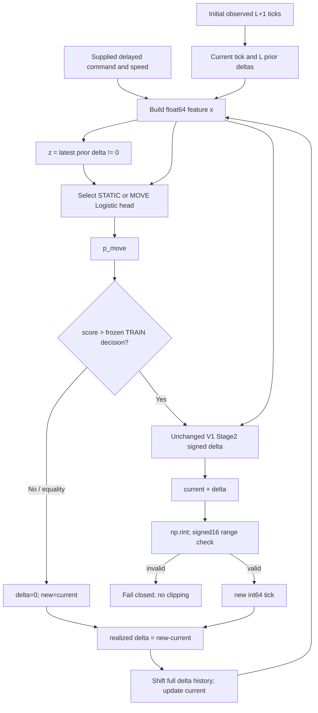

CyberPilot V4는 학습 과정이 정상적으로 끝났지만 실제 예측에서는 정지 상태의 잘못된 움직임과 움직임 시작·종료 판단 문제가 나타났다.

특히 움직임이 끝나야 할 때 MOVE로 판단하는 문제와, 새로 움직여야 할 때 MOVE를 놓치는 문제가 확인됐다.
여기에 연속 delta를 실제 tick으로 바꾸는 과정과 recursive context feedback 경로가 함께 존재한다.
각 경로의 성능 저하 기여율이 확인됐다는 뜻은 아니다.

이번 작업은 V5를 만드는 것이 아니라 기존 코드와 검증된 결과를 바탕으로 어떤 구조를 왜 검토해야 하는지 결정하는 작업이다.
새 모델·threshold·calibration·prediction·rollout·counterfactual은 실행하지 않았다. Private arrays도 다시 열지 않았다.

## 1. Executive summary

직접 확인된 실패는 STATIC hit loss가 MOVE hit gain보다 크다는 것, previous-MOVE 종료 판단이 실패한다는 것,
Fold B의 onset 검출이 매우 낮다는 것이다. 학습 support/rank/separation/convergence는 실패 원인이 아니다.

Overall AUC 개선은 모든 상태 내부의 개선을 의미하지 않는다. Gate MOVE와 projected movement는 다르며,
현재 구현은 그 차이를 명시적으로 허용한다. 따라서 이를 곧바로 구현 bug라고 선언하지 않는다.

Stage2/magnitude 잔여 위험과 recursive drift association을 무시할 수는 없지만, Stage2 단독 원인이나
context 개입의 효과 크기는 식별되지 않았다. 특히 긴 horizon의 gate-perfect MOVE support가 작다.

권고하는 다음 단일 검토는 **STAGE1_TRANSITION_AND_DECISION_CONTRACT_REVIEW**다.
이것은 A/B를 우수 모델로 채택하는 결정이 아니다. C의 gate-realization 경계와 D/E 위험은 검증 제약으로 남기고,
큰 F joint redesign의 구현은 보류한다. 어떤 후속 실행도 자동 승인하지 않는다.

[E1: empirical-hurdle-stage1-v4-exact-hit-decomposition.json /summary/exact_hit](https://github.com/rownlvh8875-coder/CyberPilot/blob/42541f583f39dc16609dd207c84cfd366445c0df/docs/cyberpilot/changes/empirical-hurdle-stage1-v4-exact-hit-decomposition.json), [E1: empirical-hurdle-stage1-v4-exact-hit-decomposition.json /summary/loss_vs_gain_jobs](https://github.com/rownlvh8875-coder/CyberPilot/blob/42541f583f39dc16609dd207c84cfd366445c0df/docs/cyberpilot/changes/empirical-hurdle-stage1-v4-exact-hit-decomposition.json), [E3: empirical-hurdle-stage1-v4-stage1-confusion-attribution.json /jobs/*/contexts](https://github.com/rownlvh8875-coder/CyberPilot/blob/42541f583f39dc16609dd207c84cfd366445c0df/docs/cyberpilot/changes/empirical-hurdle-stage1-v4-stage1-confusion-attribution.json), [E3: empirical-hurdle-stage1-v4-causal-rollout-error-attribution.md ## Onset / continuation와 MOVE 오류](https://github.com/rownlvh8875-coder/CyberPilot/blob/42541f583f39dc16609dd207c84cfd366445c0df/docs/cyberpilot/changes/empirical-hurdle-stage1-v4-causal-rollout-error-attribution.md), [E5: empirical-hurdle-stage1-v4-state-conditional-ranking.json /summary](https://github.com/rownlvh8875-coder/CyberPilot/blob/42541f583f39dc16609dd207c84cfd366445c0df/docs/cyberpilot/changes/empirical-hurdle-stage1-v4-state-conditional-ranking.json), [E5: empirical-hurdle-stage1-v4-score-transfer.json /summary](https://github.com/rownlvh8875-coder/CyberPilot/blob/42541f583f39dc16609dd207c84cfd366445c0df/docs/cyberpilot/changes/empirical-hurdle-stage1-v4-score-transfer.json), [E7: empirical-hurdle-stage1-v4-mechanism-summary.json /overall/rollout](https://github.com/rownlvh8875-coder/CyberPilot/blob/42541f583f39dc16609dd207c84cfd366445c0df/docs/cyberpilot/changes/empirical-hurdle-stage1-v4-mechanism-summary.json), [E7: empirical-hurdle-stage1-v4-gate-perfect-rollout.json /jobs/*/rollout](https://github.com/rownlvh8875-coder/CyberPilot/blob/42541f583f39dc16609dd207c84cfd366445c0df/docs/cyberpilot/changes/empirical-hurdle-stage1-v4-gate-perfect-rollout.json), [E7: empirical-hurdle-stage1-v4-projected-movement-perfect-rollout.json /jobs/*/rollout](https://github.com/rownlvh8875-coder/CyberPilot/blob/42541f583f39dc16609dd207c84cfd366445c0df/docs/cyberpilot/changes/empirical-hurdle-stage1-v4-projected-movement-perfect-rollout.json), [E7: empirical-hurdle-stage1-v4-causal-rollout-error-attribution.md ## Gate-perfect / projected-movement-perfect support와 잔여 위험](https://github.com/rownlvh8875-coder/CyberPilot/blob/42541f583f39dc16609dd207c84cfd366445c0df/docs/cyberpilot/changes/empirical-hurdle-stage1-v4-causal-rollout-error-attribution.md), [E8: empirical-hurdle-stage1-v4-rollout-step-error.json /jobs/*/rollout/200/tp_magnitude](https://github.com/rownlvh8875-coder/CyberPilot/blob/42541f583f39dc16609dd207c84cfd366445c0df/docs/cyberpilot/changes/empirical-hurdle-stage1-v4-rollout-step-error.json), [E8: empirical-hurdle-stage1-v4-causal-rollout-error-attribution.md ## TP magnitude와 disjoint step errors](https://github.com/rownlvh8875-coder/CyberPilot/blob/42541f583f39dc16609dd207c84cfd366445c0df/docs/cyberpilot/changes/empirical-hurdle-stage1-v4-causal-rollout-error-attribution.md), [E9: empirical-hurdle-stage1-v4-mechanism-summary.json /mechanism](https://github.com/rownlvh8875-coder/CyberPilot/blob/42541f583f39dc16609dd207c84cfd366445c0df/docs/cyberpilot/changes/empirical-hurdle-stage1-v4-mechanism-summary.json), [E9: empirical-hurdle-stage1-v4-mechanism-summary.json /evidence](https://github.com/rownlvh8875-coder/CyberPilot/blob/42541f583f39dc16609dd207c84cfd366445c0df/docs/cyberpilot/changes/empirical-hurdle-stage1-v4-mechanism-summary.json), [E9: empirical-hurdle-stage1-v4-next-design-trigger.json /recommended_one_review](https://github.com/rownlvh8875-coder/CyberPilot/blob/42541f583f39dc16609dd207c84cfd366445c0df/docs/cyberpilot/changes/empirical-hurdle-stage1-v4-next-design-trigger.json)

## 2. 기존 V4 상태

기존 결과는 HURDLE_STAGE1_V4_NO_ADMISSIBLE_CANDIDATE / MODEL_SELECTION_FAILED_CLOSED,
selected_candidate=null이다. Attribution 완료 상태와 여섯 mechanism state를 그대로 보전한다.
두 STATIC/MOVE head는 32개 작업에서 모두 support/rank/NO_SEPARATION/convergence를 통과했다.
이번 검토로 candidate를 선택하거나 HOLDOUT admission으로 승격하지 않는다.

[E9: empirical-hurdle-stage1-v4-mechanism-summary.json /mechanism](https://github.com/rownlvh8875-coder/CyberPilot/blob/42541f583f39dc16609dd207c84cfd366445c0df/docs/cyberpilot/changes/empirical-hurdle-stage1-v4-mechanism-summary.json), [E9: empirical-hurdle-stage1-v4-mechanism-summary.json /evidence](https://github.com/rownlvh8875-coder/CyberPilot/blob/42541f583f39dc16609dd207c84cfd366445c0df/docs/cyberpilot/changes/empirical-hurdle-stage1-v4-mechanism-summary.json), [E9: empirical-hurdle-stage1-v4-next-design-trigger.json /recommended_one_review](https://github.com/rownlvh8875-coder/CyberPilot/blob/42541f583f39dc16609dd207c84cfd366445c0df/docs/cyberpilot/changes/empirical-hurdle-stage1-v4-next-design-trigger.json), [E10: empirical-hurdle-stage1-v4-attribution-readiness.json /source_immutability](https://github.com/rownlvh8875-coder/CyberPilot/blob/42541f583f39dc16609dd207c84cfd366445c0df/docs/cyberpilot/changes/empirical-hurdle-stage1-v4-attribution-readiness.json), [E10: empirical-hurdle-stage1-v4-attribution-repeatability.json /repeatability](https://github.com/rownlvh8875-coder/CyberPilot/blob/42541f583f39dc16609dd207c84cfd366445c0df/docs/cyberpilot/changes/empirical-hurdle-stage1-v4-attribution-repeatability.json), [E10: empirical-hurdle-stage1-v4-attribution-resume.json /resume](https://github.com/rownlvh8875-coder/CyberPilot/blob/42541f583f39dc16609dd207c84cfd366445c0df/docs/cyberpilot/changes/empirical-hurdle-stage1-v4-attribution-resume.json), [E10: empirical-hurdle-stage1-v4-attribution-validation.json /validation](https://github.com/rownlvh8875-coder/CyberPilot/blob/42541f583f39dc16609dd207c84cfd366445c0df/docs/cyberpilot/changes/empirical-hurdle-stage1-v4-attribution-validation.json), [E10: empirical-hurdle-stage1-v4-causal-rollout-error-attribution.md ## 결과와 범위](https://github.com/rownlvh8875-coder/CyberPilot/blob/42541f583f39dc16609dd207c84cfd366445c0df/docs/cyberpilot/changes/empirical-hurdle-stage1-v4-causal-rollout-error-attribution.md), [E10: empirical-hurdle-stage1-v4-causal-rollout-error-attribution.md ## Saved input coverage and regression risks](https://github.com/rownlvh8875-coder/CyberPilot/blob/42541f583f39dc16609dd207c84cfd366445c0df/docs/cyberpilot/changes/empirical-hurdle-stage1-v4-causal-rollout-error-attribution.md)

## 3. Source/evidence identity

유일한 정량 근거는 고정된 V4 공개 attribution이다. 기존 비교·정책은 context/contract 확인용으로만 읽었다.
Receipt는 기존 empirical_plant_policy.py의 canonical JSON/SHA256 규약과 동일하게 stdlib로 검사했다.
실행 함수를 import하거나 호출하지 않고 AST/텍스트로 source를 조사했다.

| Identity | Binding |
| --- | --- |
| Attribution baseline HEAD | 42541f583f39dc16609dd207c84cfd366445c0df |
| Original V4 EXECUTION_HEAD | bd8045ef2a0da62a92603439f38e7740f5923622 |
| Original V4 publication HEAD | 3943f5c2f4ef641e673ca6a47b24b44a359765c8 |
| Review evidence ledger receipt | fdfa702b46587d7fcb4ace773acc1364453f34bcbc524fa2bbcf47e94a98535b |
| Verified inputs | 18 attribution JSON + 5 policy JSON + 1 historical comparison JSON + primary Markdown |
| Source integrity | 10 current Git blob/source SHA; 7 execution-path files byte-identical to original execution HEAD |
| Current result publication HEAD | Containing Git commit; final handoff and exact-head CI resolve it without self-reference |

모든 입력의 file SHA256, receipt SHA256, 고정 Git SHA와 주요 field pointer는 [evidence ledger](empirical-hurdle-stage1-v4-mixed-architecture-evidence-ledger.json)에 있다.

수치 합계는 겹치는 candidate/job anchor를 포함한다. AUC와 rate/metric 평균은 기존 job 평균이며 pooled 독립 표본의 성능이 아니다.
기존 public confusion count 합계와 exact-hit 항등식의 단순 산술만 대조했다. AUC나 새로운 성능 통계는 다시 계산하지 않았다.

## 4. Current architecture map

HOLD branch는 Stage2와 quantizer를 호출하지 않는다. 다음 state에는 gate가 아니라 realized delta가 들어간다.
Projected current tick와 full history도 두 stage의 feature로 돌아간다. Feedback은 z 한 bit에만 국한되지 않는다.

| Contract | 실제 코드 계약 | 고정 source |
| --- | --- | --- |
| C1 Observed feature history | P=2L+3: intercept, L delayed commands u[k-d-L+1..k-d], L prior tick increments through tick[k]-tick[k-1], current tick[k], speed[k]. One-step target tick[k+1] is not a feature. Existing history/termination negative labels already exist. | [empirical_s2_ri_fit_cv_math.py:features L31](https://github.com/rownlvh8875-coder/CyberPilot/blob/42541f583f39dc16609dd207c84cfd366445c0df/openpilot/tools/cyber_autotune/empirical_s2_ri_fit_cv_math.py#L31) [empirical_hurdle_fit_cv_data.py:design L76](https://github.com/rownlvh8875-coder/CyberPilot/blob/42541f583f39dc16609dd207c84cfd366445c0df/openpilot/tools/cyber_autotune/empirical_hurdle_fit_cv_data.py#L76) |
| C2 Context and head routing | Raw x[:, -3] != 0 selects MOVE head; equality selects STATIC head. Routing precedes normalization. STATIC basis removes only the latest prior-delta structural column; MOVE keeps all V1 effective columns. These conditioned binary heads can encode onset/hold and continuation/stop outcomes; no separate four-class output is implemented. | [empirical_hurdle_v4_execution.py:probability L20](https://github.com/rownlvh8875-coder/CyberPilot/blob/42541f583f39dc16609dd207c84cfd366445c0df/openpilot/tools/cyber_autotune/empirical_hurdle_v4_execution.py#L20) [empirical_hurdle_v4_fitting_policy.py:basis L84](https://github.com/rownlvh8875-coder/CyberPilot/blob/42541f583f39dc16609dd207c84cfd366445c0df/openpilot/tools/cyber_autotune/empirical_hurdle_v4_fitting_policy.py#L84) |
| C3 Score and frozen TRAIN decision | Each head applies the same V1 TRAIN normalizer, its own retained-basis linear score and sigmoid. Combined original-order TRAIN scores used one global threshold with exact BA_NUM/TN/threshold tie order. Existing decision remains frozen; its private value is neither read nor copied. | [empirical_hurdle_v4_execution.py:probability L20](https://github.com/rownlvh8875-coder/CyberPilot/blob/42541f583f39dc16609dd207c84cfd366445c0df/openpilot/tools/cyber_autotune/empirical_hurdle_v4_execution.py#L20) [empirical_hurdle_v4_execution.py:train L54](https://github.com/rownlvh8875-coder/CyberPilot/blob/42541f583f39dc16609dd207c84cfd366445c0df/openpilot/tools/cyber_autotune/empirical_hurdle_v4_execution.py#L54) [empirical_hurdle_fit_cv_math.py:threshold L157](https://github.com/rownlvh8875-coder/CyberPilot/blob/42541f583f39dc16609dd207c84cfd366445c0df/openpilot/tools/cyber_autotune/empirical_hurdle_fit_cv_math.py#L157) |
| C4 Gate and HOLD branch | MOVE iff score > frozen TRAIN decision; equality is STATIC. Validated callers supply integer current ticks. Integrated output initializes delta=0 and projected=current; only gated rows invoke Stage2 and projection. STATIC cannot move on a successful frozen caller path. | [empirical_hurdle_v4_execution.py:integrated L152](https://github.com/rownlvh8875-coder/CyberPilot/blob/42541f583f39dc16609dd207c84cfd366445c0df/openpilot/tools/cyber_autotune/empirical_hurdle_v4_execution.py#L152) [empirical_hurdle_v4_execution.py:development L164](https://github.com/rownlvh8875-coder/CyberPilot/blob/42541f583f39dc16609dd207c84cfd366445c0df/openpilot/tools/cyber_autotune/empirical_hurdle_v4_execution.py#L164) |
| C5 Stage2 continuous signed delta | Unchanged V1 Stage2 was OLS on TRAIN true-MOVE rows with its own frozen normalizer. predict_delta transforms the same feature vector then applies its linear model. Output is finite signed source-grid tick increment; no nonzero constraint or physical-rate integration exists. integrated_delta is gate-conditioned delta, not torque integration. | [empirical_hurdle_fit_cv_math.py:fit_stage2 L189](https://github.com/rownlvh8875-coder/CyberPilot/blob/42541f583f39dc16609dd207c84cfd366445c0df/openpilot/tools/cyber_autotune/empirical_hurdle_fit_cv_math.py#L189) [empirical_hurdle_fit_cv_math.py:predict_delta L215](https://github.com/rownlvh8875-coder/CyberPilot/blob/42541f583f39dc16609dd207c84cfd366445c0df/openpilot/tools/cyber_autotune/empirical_hurdle_fit_cv_math.py#L215) [empirical_hurdle_v4_io.py:load_models L104](https://github.com/rownlvh8875-coder/CyberPilot/blob/42541f583f39dc16609dd207c84cfd366445c0df/openpilot/tools/cyber_autotune/empirical_hurdle_v4_io.py#L104) |
| C6 Tick addition and projection | For gated rows project(current_float64 + delta). np.rint rounds to nearest with ties-to-even; projected values outside signed16 range fail instead of clipping; successful output is int64. A nonzero continuous delta may still realize the current tick. No new deadband or quantization policy is proposed. | [empirical_hurdle_v4_execution.py:integrated L152](https://github.com/rownlvh8875-coder/CyberPilot/blob/42541f583f39dc16609dd207c84cfd366445c0df/openpilot/tools/cyber_autotune/empirical_hurdle_v4_execution.py#L152) [empirical_s2_ri_fit_cv_math.py:project L49](https://github.com/rownlvh8875-coder/CyberPilot/blob/42541f583f39dc16609dd207c84cfd366445c0df/openpilot/tools/cyber_autotune/empirical_s2_ri_fit_cv_math.py#L49) |
| C7 Realized movement semantics | Projected movement is new-current != 0, not the gate. MOVE→HOLD therefore yields zero next prior delta, while a missed observed MOVE also leaves projected STATIC state. The implementation explicitly permits gate/realization disagreement. | [empirical_hurdle_v4_execution.py:recursive L185](https://github.com/rownlvh8875-coder/CyberPilot/blob/42541f583f39dc16609dd207c84cfd366445c0df/openpilot/tools/cyber_autotune/empirical_hurdle_v4_execution.py#L185) [empirical_hurdle_v4_attribution_math.py:PathAccumulator L206](https://github.com/rownlvh8875-coder/CyberPilot/blob/42541f583f39dc16609dd207c84cfd366445c0df/openpilot/tools/cyber_autotune/empirical_hurdle_v4_attribution_math.py#L206) |
| C8 Recursive feedback and reset | Initial L+1 ticks are observed; np.diff gives initial past deltas. Every step builds features from projected current and full delta history, logs context from the latest delta, calls integrated, shifts history and stores new-current. Both Stage1 score inputs and Stage2 inputs change with projected state. Every path/horizon starts fresh; H steps produce H+1 ticks. Final movement influences only a hypothetical next context outside that horizon. | [empirical_hurdle_v4_execution.py:recursive L185](https://github.com/rownlvh8875-coder/CyberPilot/blob/42541f583f39dc16609dd207c84cfd366445c0df/openpilot/tools/cyber_autotune/empirical_hurdle_v4_execution.py#L185) |
| C9 Horizon admission and supplied exogenous inputs | Anchors enforce full eligible causal history and a continuous horizon within admitted segments. rollout supplies logged delayed command and speed sequences and retrieves future observed ticks only outside recursive for evaluation. This retrospective conditional rollout is not a controller/vehicle closed-loop forecast; observed future tick truth never sets recursive context. | [empirical_s2_ri_fit_cv_math.py:anchors L20](https://github.com/rownlvh8875-coder/CyberPilot/blob/42541f583f39dc16609dd207c84cfd366445c0df/openpilot/tools/cyber_autotune/empirical_s2_ri_fit_cv_math.py#L20) [empirical_hurdle_fit_cv_data.py:load_route L10](https://github.com/rownlvh8875-coder/CyberPilot/blob/42541f583f39dc16609dd207c84cfd366445c0df/openpilot/tools/cyber_autotune/empirical_hurdle_fit_cv_data.py#L10) [empirical_hurdle_v4_execution.py:rollout L212](https://github.com/rownlvh8875-coder/CyberPilot/blob/42541f583f39dc16609dd207c84cfd366445c0df/openpilot/tools/cyber_autotune/empirical_hurdle_v4_execution.py#L212) |
| C10 Comparator and error primitives | One-step RMSE/MAE/p95 use continuous integrated delta minus observed increment; exact-hit/within-one use projected tick versus target. HOLD delta is zero/current tick. Rollout candidate error is terminal projected tick minus terminal observed tick; HOLD keeps initial tick for the whole horizon. PATH_MOVED means any observed departure from initial, including return paths; it is not a physical actuator command. | [empirical_hurdle_v4_execution.py:development L164](https://github.com/rownlvh8875-coder/CyberPilot/blob/42541f583f39dc16609dd207c84cfd366445c0df/openpilot/tools/cyber_autotune/empirical_hurdle_v4_execution.py#L164) [empirical_hurdle_v4_execution.py:rollout L212](https://github.com/rownlvh8875-coder/CyberPilot/blob/42541f583f39dc16609dd207c84cfd366445c0df/openpilot/tools/cyber_autotune/empirical_hurdle_v4_execution.py#L212) [empirical_hurdle_fit_cv_data.py:pair L84](https://github.com/rownlvh8875-coder/CyberPilot/blob/42541f583f39dc16609dd207c84cfd366445c0df/openpilot/tools/cyber_autotune/empirical_hurdle_fit_cv_data.py#L84) [empirical_hurdle_fit_cv_math.py:metrics L253](https://github.com/rownlvh8875-coder/CyberPilot/blob/42541f583f39dc16609dd207c84cfd366445c0df/openpilot/tools/cyber_autotune/empirical_hurdle_fit_cv_math.py#L253) |

## 5. Stage1 state-transition failure

Head 이름은 이전 상태를 의미하며 이번 step의 정답이나 gate를 보장하지 않는다.

| Truth population | Selected head | 확인된 결과 |
| --- | --- | --- |
| PREV_STATIC_TRUE_STATIC | STATIC | 잘못된 gate MOVE와 harmful projected movement를 별도 집계한다. |
| PREV_STATIC_MOVE_ONSET | STATIC | Onset recall A 40.195%, B 2.147%. |
| PREV_MOVE_TRUE_STATIC | MOVE | 두 fold 모두 gate FP 100%. |
| PREV_MOVE_MOVE_CONTINUATION | MOVE | Recall A 100%, B 약 99.999%. |

왜 종료 FP가 100%였는가? 관측된 종료 row에서 저장된 score가 frozen decision의 MOVE 쪽에 있었다는 사실까지는 확정된다.
Previous-MOVE이면 무조건 MOVE를 반환하는 hardcoded 분기는 없다. Fitted score, global decision, 입력 분포의 단독 책임은 식별되지 않는다.

왜 Fold B onset을 놓쳤는가? 해당 population의 대부분이 저장된 STATIC gate였다는 직접 증거가 있다.
현재 representation에 cue가 부족한지, score/calibration/operating point transfer가 주원인인지는 분리되지 않는다.
현재 feature에는 이미 L개 과거 delta와 command history가 있고, MOVE head는 종료 negative label도 받았다.
두 conditional binary head는 네 전환 집단을 원리상 다룰 수 있으므로, 별도 four-class 출력이 없다는 사실을 전환 표현 불가능의 증거로 삼지 않는다.

Ranking은 score 순서에 관한 사실이고 gate는 frozen operating-point를 적용한 결과다. Ranking이 일부 좋아져도
전환 decision이 좋아진다는 논리적 보장은 없다. 현재 증거는 representation과 decision transfer를 모두 검토할 근거지만,
둘 중 하나를 유일한 원인으로 확정하지는 못한다.

H1의 score discrimination은 complete/quasi-separation numerical certificate와 다른 뜻이다.
NO_SEPARATION이라는 정상 학습 조건을 실패 원인으로 부르지 않는다.

[E3: empirical-hurdle-stage1-v4-stage1-confusion-attribution.json /jobs/*/contexts](https://github.com/rownlvh8875-coder/CyberPilot/blob/42541f583f39dc16609dd207c84cfd366445c0df/docs/cyberpilot/changes/empirical-hurdle-stage1-v4-stage1-confusion-attribution.json), [E3: empirical-hurdle-stage1-v4-causal-rollout-error-attribution.md ## Onset / continuation와 MOVE 오류](https://github.com/rownlvh8875-coder/CyberPilot/blob/42541f583f39dc16609dd207c84cfd366445c0df/docs/cyberpilot/changes/empirical-hurdle-stage1-v4-causal-rollout-error-attribution.md), [E5: empirical-hurdle-stage1-v4-state-conditional-ranking.json /summary](https://github.com/rownlvh8875-coder/CyberPilot/blob/42541f583f39dc16609dd207c84cfd366445c0df/docs/cyberpilot/changes/empirical-hurdle-stage1-v4-state-conditional-ranking.json), [E5: empirical-hurdle-stage1-v4-score-transfer.json /summary](https://github.com/rownlvh8875-coder/CyberPilot/blob/42541f583f39dc16609dd207c84cfd366445c0df/docs/cyberpilot/changes/empirical-hurdle-stage1-v4-score-transfer.json), [E11: empirical-hurdle-stage1-v4-current-feature-contract.json /ordered_vector](https://github.com/rownlvh8875-coder/CyberPilot/blob/42541f583f39dc16609dd207c84cfd366445c0df/docs/cyberpilot/changes/empirical-hurdle-stage1-v4-current-feature-contract.json), [E11: empirical-hurdle-stage1-v4-causal-state-contract.json /context](https://github.com/rownlvh8875-coder/CyberPilot/blob/42541f583f39dc16609dd207c84cfd366445c0df/docs/cyberpilot/changes/empirical-hurdle-stage1-v4-causal-state-contract.json), [E11: empirical-hurdle-stage1-v4-rollout-state-contract.json /gate_is_not_state](https://github.com/rownlvh8875-coder/CyberPilot/blob/42541f583f39dc16609dd207c84cfd366445c0df/docs/cyberpilot/changes/empirical-hurdle-stage1-v4-rollout-state-contract.json), [E11: empirical-hurdle-stage1-v4-rollout-state-contract.json /logged_future_command_vego](https://github.com/rownlvh8875-coder/CyberPilot/blob/42541f583f39dc16609dd207c84cfd366445c0df/docs/cyberpilot/changes/empirical-hurdle-stage1-v4-rollout-state-contract.json)

| Hypothesis | 판정 | 주요 반대 근거 / confounding |
| --- | --- | --- |
| H1 상태 내부 score discrimination의 제한 | DESCRIPTIVELY_SUPPORTED_NOT_UNIQUE_CAUSE | Previous-MOVE ranking은 32/32 개선됐다. 모든 head의 정상 학습과 NO_SEPARATION은 numerical precondition이며 낮은 ranking의 원인 증명이 아니다. 임의의 good-AUC cutoff나 유의성 주장은 하지 않는다. head 사이 prevalence 차이가 overall AUC를 높일 수 있어 within-state 개선과 동일하지 않다; ranking, calibration, operating point와 feature distribution이 함께 변한다 |
| H2 전환 시점 representation의 한계 | HYPOTHESIZED_CAUSAL_MECHANISM | 현재 feature에는 L개 과거 tick delta, delayed command history, current tick, speed가 이미 있다. MOVE head도 true-STATIC 종료 label을 TRAIN에서 받는다. 이 정보를 전혀 표현할 수 없거나 종료 label이 없다는 주장은 코드와 다르다. route distribution 및 score transfer; linear basis의 한계와 입력 정보의 부족은 구분되지 않는다; label을 추가하는 것만으로 미래 성능이 좋아진다는 근거는 없다 |
| H3 TRAIN→DEV frozen operating-point transfer 불안정 | DESCRIPTIVELY_SUPPORTED_NOT_THRESHOLD_CAUSAL_IDENTIFICATION | Ranking transfer와 gate transfer는 같은 현상이 아니다. Fold B overall DEV-TRAIN AUC가 증가해도 onset decision은 실패한다. 반대로 representation 문제도 19개 previous-STATIC ranking 감소로 남아 있다. score scale, prevalence, ranking, calibration과 route가 함께 달라진다; TRAIN BA와 STATIC hit 보전은 다른 objective이며 objective의 단독 기여는 식별되지 않는다 |
| H4 previous-MOVE 집단의 gate MOVE 편향 | DIRECT_OBSERVATION_WITH_UNIDENTIFIED_UNIQUE_CAUSE | 코드는 previous-MOVE이면 무조건 MOVE를 반환하지 않는다. 해당 logistic head score를 global frozen decision과 비교한다. 다른 입력 전체에서 항상 MOVE라는 보편 명제나 hardcoded rule bug는 증명되지 않았다. 잘못된 projected movement는 다음 routing과 full numerical history를 함께 바꾼다; Gate-perfect subset은 이러한 상태 오류가 적은 선택된 경로다 |
| H5 Gate label과 tick realization 사이의 semantic interface tension | CONTRACT_DIRECTLY_SUPPORTED_COMPONENT_CAUSE_NOT_IDENTIFIABLE | Gate is not state는 이미 frozen contract가 허용하는 동작이다. MOVE→HOLD를 implementation defect로 단정할 수 없다. FP HOLD는 tick에는 무해해도 continuous error가 0이라는 뜻은 아니다. STATIC false-positive rows는 Stage2의 original true-MOVE fitting population과 다르다; projection, feature-state error와 Stage2 model residual이 함께 섞인다 |
| H6 Fold별 distribution / route-transfer asymmetry | DESCRIPTIVELY_SUPPORTED_ROOT_CAUSE_NOT_IDENTIFIABLE | One-step gate prevalence는 두 fold 모두 true MOVE보다 높다. 모든 단계에서 A 과활성/B 과억제라는 단일 명칭은 부정확하다. 기존 formal fold-opposition flag가 미발동한 사실도 유지한다. candidate eligibility와 겹치는 anchors; state prevalence, command/speed sequence와 projected state가 함께 다르다; 물리 EPS 원인, driver 특성 또는 vehicle 차이로 귀속할 자료가 없다 |

각 가설의 supporting/contradicting/missing evidence, actual C1–C10 contract, identifiability, confounding, 미래 실험 필요성은 [hypothesis matrix](empirical-hurdle-stage1-v4-mixed-architecture-hypothesis-matrix.json)에 별도로 기록했다. 미래 실험 필요성은 이번 실행 권한이 아니다.

## 6. Gate / projected movement distinction

| Branch | 허용 여부 / 의미 |
| --- | --- |
| FAILURE | Nonfinite or out-of-range outputs fail; no clipping or model fallback. |
| MOVE_TO_HOLD | finite Stage2 result realizes current tick; next context STATIC |
| MOVE_TO_MOVE | finite projected tick differs; next context MOVE |
| STATIC_TO_HOLD | delta zero; projected=current; next latest delta zero |
| STATIC_TO_MOVE | Current integer tick is copied and no Stage2 call is made. Malformed input, corruption and execution failure are outside successful branch semantics. |

Gate FP 1,662,235 = projected HOLD 1,090,918 + harmful projected movement 571,317.

STATIC hit loss 571,317, MOVE hit gain 228,164, net -343,153; 32/32 loss>gain.

Gate FP의 harmful fraction은 기존 공개값 34.37%다. FP HOLD는 tick hit를 유지하지만 continuous error가 0임을 뜻하지 않는다.
Stage2 출력은 nonzero로 강제되지 않는다. Source-grid rounding 후 HOLD가 되는 것도 허용된다.
이는 표현/의사결정/realization의 의미를 더 명확히 검토할 이유지만, frozen contract 위반이나 quantizer bug의 증거는 아니다.
새 rounding/deadband/nonzero constraint를 제안 정책으로 확정하거나 실행하지 않았다.

[E1: empirical-hurdle-stage1-v4-exact-hit-decomposition.json /summary/exact_hit](https://github.com/rownlvh8875-coder/CyberPilot/blob/42541f583f39dc16609dd207c84cfd366445c0df/docs/cyberpilot/changes/empirical-hurdle-stage1-v4-exact-hit-decomposition.json), [E1: empirical-hurdle-stage1-v4-exact-hit-decomposition.json /summary/loss_vs_gain_jobs](https://github.com/rownlvh8875-coder/CyberPilot/blob/42541f583f39dc16609dd207c84cfd366445c0df/docs/cyberpilot/changes/empirical-hurdle-stage1-v4-exact-hit-decomposition.json), [E2: empirical-hurdle-stage1-v4-exact-hit-decomposition.json /summary/static](https://github.com/rownlvh8875-coder/CyberPilot/blob/42541f583f39dc16609dd207c84cfd366445c0df/docs/cyberpilot/changes/empirical-hurdle-stage1-v4-exact-hit-decomposition.json), [E11: empirical-hurdle-stage1-v4-current-feature-contract.json /ordered_vector](https://github.com/rownlvh8875-coder/CyberPilot/blob/42541f583f39dc16609dd207c84cfd366445c0df/docs/cyberpilot/changes/empirical-hurdle-stage1-v4-current-feature-contract.json), [E11: empirical-hurdle-stage1-v4-causal-state-contract.json /context](https://github.com/rownlvh8875-coder/CyberPilot/blob/42541f583f39dc16609dd207c84cfd366445c0df/docs/cyberpilot/changes/empirical-hurdle-stage1-v4-causal-state-contract.json), [E11: empirical-hurdle-stage1-v4-rollout-state-contract.json /gate_is_not_state](https://github.com/rownlvh8875-coder/CyberPilot/blob/42541f583f39dc16609dd207c84cfd366445c0df/docs/cyberpilot/changes/empirical-hurdle-stage1-v4-rollout-state-contract.json), [E11: empirical-hurdle-stage1-v4-rollout-state-contract.json /logged_future_command_vego](https://github.com/rownlvh8875-coder/CyberPilot/blob/42541f583f39dc16609dd207c84cfd366445c0df/docs/cyberpilot/changes/empirical-hurdle-stage1-v4-rollout-state-contract.json)

## 7. Fold A/B transfer

| Fold | One-step FPR | One-step FNR | Mean score shift | Calibration-bias shift | H200 gate MOVE / true MOVE |
| --- | --- | --- | --- | --- | --- |
| FOLD_A | 41.193% | 33.041% | +0.017882 | +0.022050 | 44.512% / 13.201% |
| FOLD_B | 10.430% | 54.098% | -0.009916 | -0.014084 | 4.041% / 14.736% |

| Population | TRAIN AUC job mean | DEV AUC job mean | V4 DEV vs frozen V1 DEV: improved/equal/worse |
| --- | --- | --- | --- |
| OVERALL | 0.707438 | 0.702174 | 32/0/0 |
| PREV_MOVE | 0.592356 | 0.574285 | 32/0/0 |
| PREV_STATIC | 0.554846 | 0.545865 | 13/0/19 |

개선/동일/악화 건수는 exact-matching anchors의 V4 DEV와 historical fixed V1 DEV score를 비교한 기존 결과다. TRAIN→DEV AUC 변화 건수가 아니다.

A. Ranking transfer: overall 개선과 previous-STATIC 19개 악화는 별개다. AUC 유의성이나 good-AUC threshold는 정하지 않는다.

B. Calibration transfer: 반대 방향 score/bias 이동은 관측됐지만 새로운 correction/calibration function은 fitting하지 않았다.

C. Decision transfer: one-step gate prevalence는 두 fold 모두 true MOVE보다 높다. 따라서 one-step 전체를 A 과활성/B 과억제로 단순화하지 않는다.
기존 formal fold-opposition flag가 미발동한 사실과 opposite score/recursive pattern이 남은 사실을 함께 유지한다.

D. Recursive transfer: A에서 잘못 실현된 움직임은 다음 MOVE context를 만들 수 있고, B의 missed onset/HOLD는 다음 STATIC context를 유지할 수 있다.
Exogenous command/speed와 나머지 history도 변하므로 이것은 고정 absorbing state라는 증명이 아니다.
Gate MOVE가 HOLD로 실현되면 다음 context는 STATIC이다. Gate 비율만으로 context persistence를 단정할 수 없다.

A의 false MOVE를 줄이는 일방적 변경이 B onset을 더 놓칠 위험, B onset을 늘리는 변경이 A STATIC loss를 키울 위험을 검토해야 한다.
어떤 수치 correction이나 threshold 비교도 이번에 계산하지 않았다. Route 분포의 근본 원인은 NOT_IDENTIFIABLE_FROM_FROZEN_EVIDENCE다.

[E4: empirical-hurdle-stage1-v4-fold-asymmetry.json /folds](https://github.com/rownlvh8875-coder/CyberPilot/blob/42541f583f39dc16609dd207c84cfd366445c0df/docs/cyberpilot/changes/empirical-hurdle-stage1-v4-fold-asymmetry.json), [E4: empirical-hurdle-stage1-v4-fold-asymmetry.json /patterns](https://github.com/rownlvh8875-coder/CyberPilot/blob/42541f583f39dc16609dd207c84cfd366445c0df/docs/cyberpilot/changes/empirical-hurdle-stage1-v4-fold-asymmetry.json), [E4: empirical-hurdle-stage1-v4-fold-asymmetry.json /opposite_pattern_supported](https://github.com/rownlvh8875-coder/CyberPilot/blob/42541f583f39dc16609dd207c84cfd366445c0df/docs/cyberpilot/changes/empirical-hurdle-stage1-v4-fold-asymmetry.json), [E5: empirical-hurdle-stage1-v4-state-conditional-ranking.json /summary](https://github.com/rownlvh8875-coder/CyberPilot/blob/42541f583f39dc16609dd207c84cfd366445c0df/docs/cyberpilot/changes/empirical-hurdle-stage1-v4-state-conditional-ranking.json), [E5: empirical-hurdle-stage1-v4-score-transfer.json /summary](https://github.com/rownlvh8875-coder/CyberPilot/blob/42541f583f39dc16609dd207c84cfd366445c0df/docs/cyberpilot/changes/empirical-hurdle-stage1-v4-score-transfer.json), [E6: empirical-hurdle-stage1-v4-mechanism-summary.json /overall/rollout](https://github.com/rownlvh8875-coder/CyberPilot/blob/42541f583f39dc16609dd207c84cfd366445c0df/docs/cyberpilot/changes/empirical-hurdle-stage1-v4-mechanism-summary.json), [E6: empirical-hurdle-stage1-v4-rollout-context-drift.json /jobs/*/rollout](https://github.com/rownlvh8875-coder/CyberPilot/blob/42541f583f39dc16609dd207c84cfd366445c0df/docs/cyberpilot/changes/empirical-hurdle-stage1-v4-rollout-context-drift.json), [E6: empirical-hurdle-stage1-v4-rollout-streaks.json /jobs/*/rollout](https://github.com/rownlvh8875-coder/CyberPilot/blob/42541f583f39dc16609dd207c84cfd366445c0df/docs/cyberpilot/changes/empirical-hurdle-stage1-v4-rollout-streaks.json), [E6: empirical-hurdle-stage1-v4-causal-rollout-error-attribution.md ## Feedback association과 streaks](https://github.com/rownlvh8875-coder/CyberPilot/blob/42541f583f39dc16609dd207c84cfd366445c0df/docs/cyberpilot/changes/empirical-hurdle-stage1-v4-causal-rollout-error-attribution.md)

## 8. Stage2 magnitude residual

H200 gate TP에서 saved projected step-delta error의 기존 job 평균은 다음과 같다. Label은 observed onset/continuation이다.

| Condition | RMSE | MAE | p95 |
| --- | --- | --- | --- |
| CONTINUATION | 1.661738 | 1.220998 | 3.312500 |
| ONSET | 1.256243 | 0.893839 | 2.406250 |

Continuation에서 더 큰 residual이 관측됐지만 이것은 Stage2 고유 오차만의 측정값이 아니다.
Stage2는 projected history/current feature를 받으며, 위 오차는 tick projection 이후의 delta다.
One-step continuous delta error와 quantized tick error가 다른 것은 코드로 확인되지만,
rollout의 continuous branch delta가 저장돼 있지 않아 각 구성요소를 독립 분해할 수 없다.

| Component | 판정 / 이유 |
| --- | --- |
| DELTA_INTEGRATION | NOT_IDENTIFIABLE_FROM_FROZEN_EVIDENCE: The code specifies addition/gate composition; no independent integration-error magnitude is available. |
| QUANTIZATION_PROJECTION | NOT_IDENTIFIABLE_FROM_FROZEN_EVIDENCE: np.rint/range semantics are known; rollout continuous branch delta is unavailable. |
| RECURSIVE_CONTEXT | NOT_IDENTIFIABLE_FROM_FROZEN_EVIDENCE: Exact next-state link and association are known; controlled intervention effect is absent. |
| STAGE2_MODEL | NOT_IDENTIFIABLE_FROM_FROZEN_EVIDENCE: Projected delta residual mixes model, projected input distribution and rounding; no isolated reference error trace. |
| UNALLOCATED | NOT_IDENTIFIABLE_FROM_FROZEN_EVIDENCE: Do not assign a percentage or exclusive cause from these observational aggregates. |

Terminal error는 step delta error의 signed sum이라는 항등식이 있다. Step SAE/SSE는 descriptive 진단이며
terminal RMSE에 단순 가산할 수 없다. Cross terms와 선택된 path distribution이 남는다.
Gate-perfect도 강제 gate 교체 실험이 아니므로 Stage2 단독 책임을 확정하지 않는다.

[E7: empirical-hurdle-stage1-v4-mechanism-summary.json /overall/rollout](https://github.com/rownlvh8875-coder/CyberPilot/blob/42541f583f39dc16609dd207c84cfd366445c0df/docs/cyberpilot/changes/empirical-hurdle-stage1-v4-mechanism-summary.json), [E7: empirical-hurdle-stage1-v4-gate-perfect-rollout.json /jobs/*/rollout](https://github.com/rownlvh8875-coder/CyberPilot/blob/42541f583f39dc16609dd207c84cfd366445c0df/docs/cyberpilot/changes/empirical-hurdle-stage1-v4-gate-perfect-rollout.json), [E7: empirical-hurdle-stage1-v4-projected-movement-perfect-rollout.json /jobs/*/rollout](https://github.com/rownlvh8875-coder/CyberPilot/blob/42541f583f39dc16609dd207c84cfd366445c0df/docs/cyberpilot/changes/empirical-hurdle-stage1-v4-projected-movement-perfect-rollout.json), [E7: empirical-hurdle-stage1-v4-causal-rollout-error-attribution.md ## Gate-perfect / projected-movement-perfect support와 잔여 위험](https://github.com/rownlvh8875-coder/CyberPilot/blob/42541f583f39dc16609dd207c84cfd366445c0df/docs/cyberpilot/changes/empirical-hurdle-stage1-v4-causal-rollout-error-attribution.md), [E8: empirical-hurdle-stage1-v4-rollout-step-error.json /jobs/*/rollout/200/tp_magnitude](https://github.com/rownlvh8875-coder/CyberPilot/blob/42541f583f39dc16609dd207c84cfd366445c0df/docs/cyberpilot/changes/empirical-hurdle-stage1-v4-rollout-step-error.json), [E8: empirical-hurdle-stage1-v4-causal-rollout-error-attribution.md ## TP magnitude와 disjoint step errors](https://github.com/rownlvh8875-coder/CyberPilot/blob/42541f583f39dc16609dd207c84cfd366445c0df/docs/cyberpilot/changes/empirical-hurdle-stage1-v4-causal-rollout-error-attribution.md), [E11: empirical-hurdle-stage1-v4-current-feature-contract.json /ordered_vector](https://github.com/rownlvh8875-coder/CyberPilot/blob/42541f583f39dc16609dd207c84cfd366445c0df/docs/cyberpilot/changes/empirical-hurdle-stage1-v4-current-feature-contract.json), [E11: empirical-hurdle-stage1-v4-causal-state-contract.json /context](https://github.com/rownlvh8875-coder/CyberPilot/blob/42541f583f39dc16609dd207c84cfd366445c0df/docs/cyberpilot/changes/empirical-hurdle-stage1-v4-causal-state-contract.json), [E11: empirical-hurdle-stage1-v4-rollout-state-contract.json /gate_is_not_state](https://github.com/rownlvh8875-coder/CyberPilot/blob/42541f583f39dc16609dd207c84cfd366445c0df/docs/cyberpilot/changes/empirical-hurdle-stage1-v4-rollout-state-contract.json), [E11: empirical-hurdle-stage1-v4-rollout-state-contract.json /logged_future_command_vego](https://github.com/rownlvh8875-coder/CyberPilot/blob/42541f583f39dc16609dd207c84cfd366445c0df/docs/cyberpilot/changes/empirical-hurdle-stage1-v4-rollout-state-contract.json)

## 9. Recursive feedback

| 분류 | 현재 말할 수 있는 내용 |
| --- | --- |
| MECHANICALLY_DETERMINED | Projected delta[h] != 0가 다음 z[h+1]를 결정한다. h>=1 context divergence는 h-1 movement mismatch와 같다. Initial observed context는 공통이다. |
| OBSERVED_ASSOCIATION | Early divergence subset의 terminal error가 큰 descriptive 패턴과 fold별 gate/streak/feedback association이 기존 attribution에 있다. |
| HYPOTHESIZED_CAUSAL_MECHANISM | False realized movement 또는 missed onset이 head routing과 full projected feature를 바꾸며 오류 상태가 지속될 수 있다. |
| NOT_IDENTIFIABLE | 그 feedback의 개입 효과, terminal error 기여율, 원인별 우선순위의 성능 영향은 식별되지 않았다. |

| H | Gate mismatch | Movement mismatch | Context divergence |
| --- | --- | --- | --- |
| 100 | 29.830% | 17.636% | 17.641% |
| 200 | 29.966% | 17.283% | 17.284% |
| 25 | 28.936% | 17.775% | 17.758% |
| 50 | 29.426% | 17.869% | 17.871% |

Rollout caller는 context_path를 반환받지만 저장하지 않는다. Direct saved context trace는 INPUT_INSUFFICIENT다.
기존 attribution은 saved projected path와 initial history에서 context를 기계적으로 확인했으며, 이번에는 그 공개 결과만 인용한다.
새 path, 가상 context 주입 또는 counterfactual gate를 만들지 않았다.

미래 observed ticks는 평가 target이며 recursive head 입력이 아니다. 반면 logged command/speed sequence는 frozen retrospective rollout의 supplied input이다.
이 계산을 미래 command까지 자체 생성하는 controller closed-loop 또는 실차 robustness 증거로 확대하지 않는다.

[E6: empirical-hurdle-stage1-v4-mechanism-summary.json /overall/rollout](https://github.com/rownlvh8875-coder/CyberPilot/blob/42541f583f39dc16609dd207c84cfd366445c0df/docs/cyberpilot/changes/empirical-hurdle-stage1-v4-mechanism-summary.json), [E6: empirical-hurdle-stage1-v4-rollout-context-drift.json /jobs/*/rollout](https://github.com/rownlvh8875-coder/CyberPilot/blob/42541f583f39dc16609dd207c84cfd366445c0df/docs/cyberpilot/changes/empirical-hurdle-stage1-v4-rollout-context-drift.json), [E6: empirical-hurdle-stage1-v4-rollout-streaks.json /jobs/*/rollout](https://github.com/rownlvh8875-coder/CyberPilot/blob/42541f583f39dc16609dd207c84cfd366445c0df/docs/cyberpilot/changes/empirical-hurdle-stage1-v4-rollout-streaks.json), [E6: empirical-hurdle-stage1-v4-causal-rollout-error-attribution.md ## Feedback association과 streaks](https://github.com/rownlvh8875-coder/CyberPilot/blob/42541f583f39dc16609dd207c84cfd366445c0df/docs/cyberpilot/changes/empirical-hurdle-stage1-v4-causal-rollout-error-attribution.md), [E10: empirical-hurdle-stage1-v4-attribution-readiness.json /source_immutability](https://github.com/rownlvh8875-coder/CyberPilot/blob/42541f583f39dc16609dd207c84cfd366445c0df/docs/cyberpilot/changes/empirical-hurdle-stage1-v4-attribution-readiness.json), [E10: empirical-hurdle-stage1-v4-attribution-repeatability.json /repeatability](https://github.com/rownlvh8875-coder/CyberPilot/blob/42541f583f39dc16609dd207c84cfd366445c0df/docs/cyberpilot/changes/empirical-hurdle-stage1-v4-attribution-repeatability.json), [E10: empirical-hurdle-stage1-v4-attribution-resume.json /resume](https://github.com/rownlvh8875-coder/CyberPilot/blob/42541f583f39dc16609dd207c84cfd366445c0df/docs/cyberpilot/changes/empirical-hurdle-stage1-v4-attribution-resume.json), [E10: empirical-hurdle-stage1-v4-attribution-validation.json /validation](https://github.com/rownlvh8875-coder/CyberPilot/blob/42541f583f39dc16609dd207c84cfd366445c0df/docs/cyberpilot/changes/empirical-hurdle-stage1-v4-attribution-validation.json), [E10: empirical-hurdle-stage1-v4-causal-rollout-error-attribution.md ## 결과와 범위](https://github.com/rownlvh8875-coder/CyberPilot/blob/42541f583f39dc16609dd207c84cfd366445c0df/docs/cyberpilot/changes/empirical-hurdle-stage1-v4-causal-rollout-error-attribution.md), [E10: empirical-hurdle-stage1-v4-causal-rollout-error-attribution.md ## Saved input coverage and regression risks](https://github.com/rownlvh8875-coder/CyberPilot/blob/42541f583f39dc16609dd207c84cfd366445c0df/docs/cyberpilot/changes/empirical-hurdle-stage1-v4-causal-rollout-error-attribution.md), [E11: empirical-hurdle-stage1-v4-current-feature-contract.json /ordered_vector](https://github.com/rownlvh8875-coder/CyberPilot/blob/42541f583f39dc16609dd207c84cfd366445c0df/docs/cyberpilot/changes/empirical-hurdle-stage1-v4-current-feature-contract.json), [E11: empirical-hurdle-stage1-v4-causal-state-contract.json /context](https://github.com/rownlvh8875-coder/CyberPilot/blob/42541f583f39dc16609dd207c84cfd366445c0df/docs/cyberpilot/changes/empirical-hurdle-stage1-v4-causal-state-contract.json), [E11: empirical-hurdle-stage1-v4-rollout-state-contract.json /gate_is_not_state](https://github.com/rownlvh8875-coder/CyberPilot/blob/42541f583f39dc16609dd207c84cfd366445c0df/docs/cyberpilot/changes/empirical-hurdle-stage1-v4-rollout-state-contract.json), [E11: empirical-hurdle-stage1-v4-rollout-state-contract.json /logged_future_command_vego](https://github.com/rownlvh8875-coder/CyberPilot/blob/42541f583f39dc16609dd207c84cfd366445c0df/docs/cyberpilot/changes/empirical-hurdle-stage1-v4-rollout-state-contract.json)

## 10. Gate-perfect support limitation

기존 기준은 full>=201, small=1..200, empty=0이며 acceptance 기준을 새로 만든 것이 아니다.
아래 count는 job 합계이며 독립 경로 수가 아니다.

| H | Moved gate-perfect count sum | Full/small/empty jobs |
| --- | --- | --- |
| 100 | 1023 | 0/32/0 |
| 200 | 60 | 0/25/7 |
| 25 | 17310 | 32/0/0 |
| 50 | 4645 | 5/27/0 |

H100/H200에는 moved gate-perfect full-support job이 없다. H200 ALL gate-perfect는 26,510 경로 합계이며 그중 moved는 60뿐이다.
ALL의 full support를 MOVE magnitude의 충분한 support로 대체할 수 없다. H200 gate-perfect metrics는 HOLD와 같고,
이를 Stage2 단독 대규모 실패의 근거로 쓰지 않는다.

H25 moved gate-perfect는 32개 모두 full support에서 기존 HOLD보다 개선된 반대 근거도 있다.
Perfect subsets는 모델이 실제로 gate/movement pattern을 맞힌 관찰 집단이다. Counterfactual perfect rollout이 아니다.
Gate-perfect와 projected-movement-perfect는 서로 일반적으로 포함되지 않는다. Gate MOVE→HOLD 때문에 두 정의가 다르다.

[E7: empirical-hurdle-stage1-v4-mechanism-summary.json /overall/rollout](https://github.com/rownlvh8875-coder/CyberPilot/blob/42541f583f39dc16609dd207c84cfd366445c0df/docs/cyberpilot/changes/empirical-hurdle-stage1-v4-mechanism-summary.json), [E7: empirical-hurdle-stage1-v4-gate-perfect-rollout.json /jobs/*/rollout](https://github.com/rownlvh8875-coder/CyberPilot/blob/42541f583f39dc16609dd207c84cfd366445c0df/docs/cyberpilot/changes/empirical-hurdle-stage1-v4-gate-perfect-rollout.json), [E7: empirical-hurdle-stage1-v4-projected-movement-perfect-rollout.json /jobs/*/rollout](https://github.com/rownlvh8875-coder/CyberPilot/blob/42541f583f39dc16609dd207c84cfd366445c0df/docs/cyberpilot/changes/empirical-hurdle-stage1-v4-projected-movement-perfect-rollout.json), [E7: empirical-hurdle-stage1-v4-causal-rollout-error-attribution.md ## Gate-perfect / projected-movement-perfect support와 잔여 위험](https://github.com/rownlvh8875-coder/CyberPilot/blob/42541f583f39dc16609dd207c84cfd366445c0df/docs/cyberpilot/changes/empirical-hurdle-stage1-v4-causal-rollout-error-attribution.md)

## 11. Identifiability

| Question | Status | Answer |
| --- | --- | --- |
| 1. STATIC false movement가 exact-hit 손실에 기여했는가? | DIRECTLY_SUPPORTED | Harmful static movement와 STATIC hit loss가 동일하며 frozen exact-hit accounting으로 순손실을 설명한다. Stage1 parameter의 단독 원인을 식별한 것은 아니다. |
| 2. 특정 parameter 또는 threshold가 단독 원인인가? | NOT_IDENTIFIABLE | Parameter/threshold counterfactual이나 독립 개입이 없다. 비공개 값을 열거나 대체 threshold를 계산하지 않는다. |
| 3. Stage2 고유 오차와 tick projection 오차를 분리할 수 있는가? | NOT_IDENTIFIABLE | 코드는 두 단계를 구분하지만 공개 rollout aggregate에는 joint continuous branch delta/rounding residual이 없다. One-step continuous/integer metric 구분만으로 causal allocation은 불가능하다. |
| 4. Gate-perfect selection bias를 제거할 수 있는가? | NOT_IDENTIFIABLE | 실제로 gate가 맞았던 선택된 경로이며 forced-perfect-gate intervention이 아니다. 독립 표본으로 해석하지 않는다. |
| 5. H100/H200 perfect PATH_MOVED support는 충분한가? | INPUT_INSUFFICIENT | 두 horizon 모두 full descriptive support job이 없다. H200은 25 small/7 empty이며 ALL 집단은 STATIC에 지배된다. |
| 6. Context divergence가 terminal error를 늘린 인과효과를 정량화할 수 있는가? | ASSOCIATION_ONLY | Movement→next context는 MECHANICALLY_DETERMINED. Early divergence와 큰 오차는 OBSERVED_ASSOCIATION. 효과 크기는 NOT_IDENTIFIABLE_FROM_FROZEN_EVIDENCE. |
| 7. Fold A/B distribution 변화의 근본 원인을 확정할 수 있는가? | NOT_IDENTIFIABLE | 반대 score/calibration 이동과 recursive gate 패턴은 관측됐지만 route의 근본 요인과 causal share는 식별되지 않았다. |
| 8. 새 구조가 기존 모델보다 우수한가? | NOT_IDENTIFIABLE | 새 구조를 실행하지 않았고 independent improvement evidence가 없다. REVIEW_SUPPORTED는 모델 채택이나 성능 승인이 아니다. |

확인된 계약과 관찰은 원인 가설이나 미래 성능 약속으로 변환하지 않는다. 필요한 입력이 없으면 INPUT_INSUFFICIENT, 원인 분리가 불가능하면 NOT_IDENTIFIABLE_FROM_FROZEN_EVIDENCE다.

## 12. Architecture options

모든 대안은 문서상 검토이며 상호 배타적이지 않다. REVIEW_SUPPORTED는 성능 우수·구현 가능 확정·모델 채택을 뜻하지 않는다. 예측 개선율은 전부 미지정이다.

### Option A — Transition-aware Stage1 representation

| 검토 필드 | 평가 |
| --- | --- |
| Problem addressed | E3 E5 |
| Mechanism hypothesis | 시작·유지·종료의 관측 가능 cue와 label 목적을 명시적으로 검토하면 현재 binary target/context routing에서 놓친 구분을 드러낼 수 있다. 개선 효과는 미검증이다. |
| Supporting evidence | H2 H4 |
| Contradicting evidence | 현재 이미 L개 delta history와 종료 negative label이 존재한다. 정보 부재 또는 특정 새 표현의 우월성이 확인된 것은 아니다. |
| Evidence gap | 입력 정보 한계와 linear representation 한계 및 decision transfer의 분리가 안 된다. |
| Implementation scope | 향후 별도 승인 시 features/basis/target definition과 TRAIN fitting contract가 영향받을 수 있다. 현재 어떤 새 head 수나 모델 family도 정하지 않는다. |
| Integration risk | 현재 두 stage는 같은 x를 받으므로 Stage1 feature 변경이 Stage2 input dimension/normalizer 계약에도 파급될 수 있다. 독립 호환성을 가정하지 않는다. 새 label/head는 support 분할, causal eligibility, artifact schema와 selector 비교 가능성도 바꿀 수 있다. |
| Validation requirement | V1 V2 V3 V5 V6 V7 V8 V9 V11 V14 V15 V16 V17 |
| Safety / authority impact | Offline review만 지지한다. 배포·controller·vehicle 권한은 생기지 않으며 실제 runtime 적용은 별도 safety validation과 승인 대상이다. |
| Complexity | MEDIUM_TO_HIGH |
| Decision | REVIEW_SUPPORTED |

### Option B — Stage1 score / decision-policy separation

| 검토 필드 | 평가 |
| --- | --- |
| Problem addressed | E3 E4 E5 |
| Mechanism hypothesis | Ranking 품질, score calibration과 실제 action cost/operating-point transfer를 별도 계약으로 검토한다. 현재 threshold는 변경하지 않는다. |
| Supporting evidence | H1 H3 H6 |
| Contradicting evidence | Previous-STATIC ranking이 19개 작업에서 악화돼 decision policy만으로 모든 문제가 해결된다는 근거는 없다. |
| Evidence gap | 어떤 미래 decision rule이 두 fold와 전환 집단을 동시에 개선하는지 알 수 없다. 현재 수치로 대체 threshold를 고르지 않는다. |
| Implementation scope | 향후 승인된 decision objective/calibration/operating-point contract의 검토 범위다. global TRAIN-only rule을 실제로 바꾸거나 calibration을 fitting하지 않는다. |
| Integration risk | Fold A false movement를 억제하는 일방적 수정이 Fold B onset miss를 악화시킬 수 있다. 새로운 정책은 provenance와 freeze/repeatability를 다시 요구한다. |
| Validation requirement | V1 V3 V4 V5 V7 V8 V9 V10 V11 V14 V15 V16 V17 V18 |
| Safety / authority impact | 새 수치 기준과 action tradeoff는 FUTURE_POLICY_APPROVAL_REQUIRED. Vehicle 권한 NONE을 유지한다. |
| Complexity | MEDIUM_WITH_HIGH_POLICY_VALIDATION_COST |
| Decision | REVIEW_SUPPORTED |

### Option C — Gate / tick-realization consistency

| 검토 필드 | 평가 |
| --- | --- |
| Problem addressed | E1 E2 E8 E11 |
| Mechanism hypothesis | Gate가 예측하는 사건과 Stage2 signed delta 및 정수 realization의 의미를 명시적으로 맞추는 계약을 검토한다. 결합 objective나 output semantics는 대안일 뿐 채택하지 않는다. |
| Supporting evidence | H5 |
| Contradicting evidence | 현재 gate MOVE→HOLD는 허용된 contract이고 FP HOLD는 실제 tick hit를 유지한다. 이를 무조건 없애면 현재 무해한 FP를 harmful movement로 만들 위험도 있다. |
| Evidence gap | continuous branch output과 quantization residual의 rollout joint evidence가 없다. |
| Implementation scope | 향후 integrated interface, target meaning, projected error reporting 계약이 영향을 받을 수 있다. 현재 rounding, range, hold semantics를 바꾸지 않는다. |
| Integration risk | nonzero movement를 강제로 만드는 수정은 STATIC loss를 키울 수 있다. source-grid 의미와 기존 frozen metric/normalizer/model identity가 달라질 수 있다. |
| Validation requirement | V1 V2 V3 V4 V11 V12 V13 V14 V15 V17 |
| Safety / authority impact | Tick 변화는 physical EPS actuation 보장이 아니다. 미래 controller interface 변경은 별도 safety 승인 범위다. |
| Complexity | MEDIUM_TO_HIGH |
| Decision | REVIEW_SUPPORTED |

### Option D — Stage2 conditional magnitude representation

| 검토 필드 | 평가 |
| --- | --- |
| Problem addressed | E7 E8 |
| Mechanism hypothesis | Onset/continuation과 projected-state 노출에 따른 magnitude representation을 분리해서 검토할 수 있다. 새 Stage2 model이나 conditional split을 선택하지 않는다. |
| Supporting evidence | H5 |
| Contradicting evidence | Stage2도 이미 prior delta/current/history를 입력받아 조건 정보를 일부 가진다. H25 gate-perfect moved 경로는 full support에서 개선한다. H100/H200 moved support가 작고 H200 gate-perfect metrics는 HOLD와 같아 Stage2 단독 대규모 실패를 입증하지 않는다. |
| Evidence gap | Stage2 고유 model error, integrated error, rounding error와 projected-feature error의 causal share는 식별 불가다. |
| Implementation scope | 향후 conditional target/features 및 model/normalizer 계약의 검토 범위다. byte-identical V1 Stage2와 normalizer는 이번에 그대로 둔다. |
| Integration risk | 조건 분할은 support를 줄이고 gate 오류가 들어오는 population을 더 바꿀 수 있다. 방향 혼합과 conditional mean 문제는 가설이며 현재 확인된 원인이 아니다. |
| Validation requirement | V2 V11 V12 V13 V14 V15 V17 |
| Safety / authority impact | TRUE MOVE 보호와 source-grid semantics를 보전해야 한다. 실제 control parameter 적용 권한은 없다. |
| Complexity | HIGH_WITH_IDENTIFIABILITY_LIMIT |
| Decision | REVIEW_SUPPORTED |

### Option E — Recursive-state feedback robustness

| 검토 필드 | 평가 |
| --- | --- |
| Problem addressed | E4 E6 E11 |
| Mechanism hypothesis | Observed TRAIN history와 projected rollout history의 exposure 차이, head routing, current tick/full delta-history feedback을 함께 검토한다. 상태 uncertainty나 persistence를 다루는 접근도 성능 미검증 대안이다. |
| Supporting evidence | H4 H6 |
| Contradicting evidence | Context divergence는 이전 movement mismatch의 기계적 결과이므로 독립 원인처럼 볼 수 없다. Early divergence subset 차이는 선택/분포 confounding을 제거하지 못한다. |
| Evidence gap | Context 개입 효과와 terminal error의 기여율은 현재 자료로 식별 불가다. 새 context 주입/rollout 실험은 금지된다. |
| Implementation scope | 향후 recursive state ownership, reset, causal input/uncertainty 계약을 검토할 수 있으나 지금 recursive 함수나 head routing을 변경하지 않는다. |
| Integration risk | State smoothing/persistence 변경은 onset 지연과 종료 지속을 동시에 악화시킬 수 있다. Oracle future truth나 gate를 state로 쓰는 shortcuts는 허용되지 않는다. |
| Validation requirement | V5 V7 V8 V11 V13 V14 V15 V16 V17 V19 |
| Safety / authority impact | 현재 rollout은 supplied logged command/speed에 조건부인 retrospective 계산이다. Closed-loop controller/vehicle robustness를 증명하지 않는다. |
| Complexity | HIGH |
| Decision | REVIEW_SUPPORTED |

### Option F — Mixed Stage1/Stage2 redesign

| 검토 필드 | 평가 |
| --- | --- |
| Problem addressed | E1 E3 E6 E8 E9 |
| Mechanism hypothesis | 복수 경계의 문제가 관측되므로 joint redesign을 장기 대안으로 검토할 수 있다. 여러 변화의 성능 효과를 한꺼번에 식별할 수 있다는 뜻은 아니다. |
| Supporting evidence | H1 H2 H3 H4 H5 H6 |
| Contradicting evidence | 단계별 causal allocation이 없고 강한 직접 증거는 Stage1 전환 집단에 집중된다. 큰 joint 변경은 어떤 요소가 이득/손실을 만들었는지 더 불명확하게 할 수 있다. |
| Evidence gap | 새 구조의 feasibility, support, policy compatibility와 독립 성능 개선은 모두 미검증이다. |
| Implementation scope | Stage1, Stage2, integrated projection, recursive state, artifact identity와 모든 fitting/selection 정책에 파급될 수 있다. 구체 V5 구조와 실행 코드는 정하지 않는다. |
| Integration risk | 다중 변경 confounding, 큰 검증 비용, 비교 population/normalizer/authority drift가 크다. 대안들은 상호 배타적이지 않다. |
| Validation requirement | V1 V2 V3 V4 V5 V6 V7 V8 V9 V10 V11 V12 V13 V14 V15 V16 V17 V18 V19 |
| Safety / authority impact | 구현/실행/생산 적용은 전부 별도 승인이다. 현재 HOLDOUT CLOSED 및 vehicle NONE을 보전한다. |
| Complexity | VERY_HIGH |
| Decision | DEFERRED |

E1–E11은 evidence ledger, H1–H6은 hypothesis matrix, V1–V19는 아래 future requirements를 참조한다. 모든 대안에는 기존 32-clause gate와 authority 제약이 공통으로 적용된다.

## 13. Trade-off / safety assessment

직접 전환 실패의 근거가 가장 구체적이므로 A/B의 계약 분리를 먼저 검토하는 것이 여러 변화를 한 번에 넣는 F보다
원인과 검증 의무를 명료하게 유지한다. 이것은 효능 ranking이 아니라 검토 순서 권고다.
D의 magnitude와 E의 recursive risk는 보류해서 없애는 문제가 아니라 후속 검증에서 반드시 보전할 축이다.

새 numerical cutoff, AUC 기준, threshold/calibration function 또는 HOLDOUT acceptance criterion을 정하지 않았다.
기존 32개 clause는 두 fold에서 모두 충족해야 하며, epsilon/support/comparator/anchors/selector를 바꾸지 않는다.
ONE_STEP_RMSE는 strict <, 나머지 one-step error/TRUE MOVE/rollout error는 기존 <=, hit 계열은 기존 >= 계약이다.
새 진단 축을 acceptance criterion으로 삼으려면 FUTURE_POLICY_APPROVAL_REQUIRED다.

| ID | Future evaluation axis | Policy | Requirement |
| --- | --- | --- | --- |
| V1 | STATIC exact-hit | FUTURE_POLICY_APPROVAL_REQUIRED | 기존 전체 ONE_STEP_EXACT_HIT gate와 별도로 STATIC 조건부 설명을 유지하되 새 STATIC acceptance cutoff는 만들지 않는다. |
| V2 | MOVE exact-hit | FUTURE_POLICY_APPROVAL_REQUIRED | 기존 TRUE MOVE 보호 및 전체 exact-hit과 함께 기록한다. 새 조건부 hit 기준은 별도 정책 승인이다. |
| V3 | Static hit loss / Move hit gain | FUTURE_POLICY_APPROVAL_REQUIRED | 기존 accounting identity를 유지하고 새 순손실 acceptance criterion은 만들지 않는다. |
| V4 | Harmful false projected movement | FUTURE_POLICY_APPROVAL_REQUIRED | Gate FP와 projected HOLD를 분리한 진단을 보전한다. |
| V5 | MOVE onset recall | FUTURE_POLICY_APPROVAL_REQUIRED | Fold별 previous-STATIC onset population과 분모를 고정해 검토한다. |
| V6 | MOVE continuation recall | FUTURE_POLICY_APPROVAL_REQUIRED | Previous-MOVE continuation과 종료를 혼합하지 않는다. |
| V7 | MOVE to STATIC termination | FUTURE_POLICY_APPROVAL_REQUIRED | Previous-MOVE true-STATIC에서 false gate와 harmful movement를 함께 구분한다. |
| V8 | Fold A/B transfer | FUTURE_POLICY_APPROVAL_REQUIRED | Ranking/calibration/decision/recursive transfer를 fold별로 별도 보고한다. |
| V9 | State-conditioned AUC | FUTURE_POLICY_APPROVAL_REQUIRED | Exact tie semantics와 matching populations를 유지한다. 임의의 good-AUC 기준을 정하지 않는다. |
| V10 | Calibration / Brier | FUTURE_POLICY_APPROVAL_REQUIRED | 기존 저장 집계 정의를 유지하며 새 calibration fitting은 별도 실행 승인이다. |
| V11 | True MOVE protection | EXISTING_FROZEN_GATE_UNCHANGED | 기존 MOVE_RMSE/MAE/P95와 동일 anchor/support/comparator를 유지한다. |
| V12 | Gate vs projected movement consistency | FUTURE_POLICY_APPROVAL_REQUIRED | 허용 branch 조합과 continuous/rounded error primitive를 명확히 검토한다. |
| V13 | Stage2 conditional delta error | FUTURE_POLICY_APPROVAL_REQUIRED | Onset/continuation support 및 continuous/projection 구분을 사전 정의해야 한다. |
| V14 | 25/50/100/200-step OVERALL rollout | EXISTING_FROZEN_GATE_UNCHANGED | 기존 12개 OVERALL rollout clauses, immutable anchors와 HOLD comparator를 변경하지 않는다. |
| V15 | 25/50/100/200-step PATH_MOVED rollout | EXISTING_FROZEN_GATE_UNCHANGED | 기존 12개 PATH_MOVED rollout clauses와 support를 변경하지 않는다. |
| V16 | Recursive context divergence | FUTURE_POLICY_APPROVAL_REQUIRED | 기계적 lag와 descriptive association을 구분한다. 초기 observed history, projected feedback, supplied command/speed와 reset 계약을 보전하며 새 intervention은 별도 승인한다. |
| V17 | Determinism / repeatability | EXISTING_AUTHORITY_OR_INTEGRITY_CONTRACT_UNCHANGED | 기존 byte/canonical identity 및 verify-only resume 규칙을 바꾸지 않는다. 새 모델 실행 권한은 생기지 않는다. |
| V18 | Holdout integrity | EXISTING_AUTHORITY_OR_INTEGRITY_CONTRACT_UNCHANGED | FUTURE_UNTOUCHED_HOLDOUT_REQUIRED. 현재 retrospective 가설 검토는 독립 입증이 아니며 holdout 기준을 이 결과로 최적화하지 않는다. |
| V19 | Vehicle safety / authority boundary | EXISTING_AUTHORITY_OR_INTEGRITY_CONTRACT_UNCHANGED | 향후 별도 승인된 runtime 변경은 replay→closed-loop simulation→shadow의 ordered evidence와 명시적 실차 승인을 요구한다. 지금은 NONE이다. |

고정 gate: [empirical-hurdle-acceptance-gate-v1.json /clauses](https://github.com/rownlvh8875-coder/CyberPilot/blob/42541f583f39dc16609dd207c84cfd366445c0df/docs/cyberpilot/changes/empirical-hurdle-acceptance-gate-v1.json); receipt `1a5198475b7a3843381762078475915a389b2898e950effc171a3df58219ca60`. 기존 selector도 호출하지 않았다.

동일 retrospective data에서 만든 가설은 독립적인 성능 입증이 아니다. 이 결과를 보고 future holdout 기준을 최적화하지 않는다.
현재 어떤 대안도 controller/planner/actuator와 연결하지 않는다. 향후 별도 승인된 runtime 적용은 기존 안전 한계와
replay→closed-loop simulation→shadow 순서의 증거 및 실차의 별도 명시적 승인이 필요하다.

## 14. Decision matrix

| Type | 내용 | 근거 / 한계 |
| --- | --- | --- |
| Finding | STATIC loss와 전환 gate 실패가 확인됐다. | E1/E2/E3; 모델 parameter의 단독 원인은 미식별. |
| Finding | Overall과 within-state ranking 개선 범위는 다르다. | E5; previous-STATIC 13 improved/19 worse. |
| Finding | Gate와 realized movement, continuous와 quantized error가 다르다. | E2/E8/C4–C7/C10; 허용 계약이며 bug 확정 아님. |
| Hypothesis | Representation / operating-point transfer / projected feature feedback이 함께 관여할 수 있다. | H1–H6; 독립 intervention이 없고 causal share는 미식별. |
| Recommendation | A/B transition·decision 계약 검토를 하나의 다음 주제로 둔다. | E3 직접 근거 우선; C 경계와 D/E 위험 유지; F 구현은 보류. |

Stage2-only 원인, 단일 threshold 원인, 모든 state ranking 해결, 새로운 구조의 성능 개선은 결론으로 채택하지 않았다.
대안 선택을 candidate selection이나 reference promotion으로 전환하지 않는다.

## 15. Recommended ONE next increment

**STAGE1_TRANSITION_AND_DECISION_CONTRACT_REVIEW**

Deliverable은 새 모델이 아니라 onset/continuation/termination의 target·관측 cue·허용 decision/realization 관계를 정의하는 문서다.
기존 history가 제공하는 정보, ranking/calibration/decision의 책임, 두 fold의 tradeoff와 새 policy 승인 필요 부분을 분리한다.
새 threshold를 찾거나 calibration을 fitting하는 실행 지시가 아니다. 현재 전환 실패의 직접 증거가 우선순위의 근거다.

반대 근거와 한계: MOVE ranking은 개선됐고 현재 history/종료 label도 이미 있다. D/E 위험은 A/B만으로 해결됐다는 근거가 없다.
H100/H200 moved perfect-path support도 부족하다. 미래 실험·구현·policy 변경은 모두 별도 승인이며 이 검토는 자동으로 시작하지 않는다.

## 16. Validation / independent review

Local validation: **PASS**.

| Check | Exit | Tests/items |
| --- | --- | --- |
| combined | 0 | 2278 |
| compileall | 0 | None |
| diff-check | 0 | None |
| existing_attribution | 0 | 95 |
| final_public_reference_and_scope | 0 | - |
| full | 0 | 5042 |
| json | 0 | 770 |
| lateral | 0 | 16 |
| mixed_review_focused | 0 | 24 |
| original_source_evidence_and_change_scope | 0 | - |
| publication | 0 | None |
| review_clarification_focused | 0 | - |
| review_clarification_publication | 0 | - |
| review_clarification_ruff | 0 | - |
| review_clarification_whitespace | 0 | - |
| ruff | 0 | None |
| scons | 0 | None |
| validation_driver | 0 | - |

| Independent review | Status / receipt |
| --- | --- |
| architecture | {"report_sha256": "3efa435240a21845b7af14694cf8dba2c121f698da7d6faf6c0e761ecc5910ff", "status": "APPROVED"} |
| authority | {"report_sha256": "98cead109dd9b5d19daf1967a20dc7a2831b81c92a1ccae87b7973b05f818217", "status": "APPROVED"} |

새 test는 stdlib/unittest로 문서·seal·pointer·AST/source SHA·privacy·scope만 검사한다. Model 함수는 import하거나 실행하지 않는다.
기존 regression에서 수행되는 historical synthetic fixture fit/inference/rollout은 actual private execution과 분리해 기록한다.
검사를 실행하기 전에는 PASS로 표시하지 않는다. Exact publication-head CI는 containing commit의 GitHub Actions와 최종 handoff에서 확인한다.
Self-referential commit SHA나 미실행 CI success를 문서에 만들어 넣지 않는다.

## 17. Preserved authority / stop conditions

HURDLE_STAGE1_V4_NO_ADMISSIBLE_CANDIDATE / MODEL_SELECTION_FAILED_CLOSED / selected_candidate=null.
기존 attribution 완료 상태와 여섯 scoped mechanism state를 보전했다.

HOLDOUT CLOSED; opening_count=0; holdout_discovery=0.
FUTURE_UNTOUCHED_HOLDOUT_REQUIRED; NO_MODEL_ADMITTED_FOR_FUTURE_HOLDOUT;
FINAL_POOLED_REFIT_NOT_AUTHORIZED; COMPOSITION_NOT_AUTHORIZED.

Vehicle NOT_READY / REAL_VEHICLE_UNVERIFIED / VEHICLE_ACTIVATION_BLOCKED; authority NONE.
Hugging Face NOT_REQUIRED / NOT_USED. 새로운 model download나 dependency 설치를 하지 않았다.

이번 review의 actual forbidden-operation counters는 모두 0이다:
model_refit_calls, normalizer_refit_calls, stage2_refit_calls, threshold_reselection_calls,
prediction_replay_calls, rollout_regeneration_calls, selection_calls, candidate_search_calls,
raw_log_openings, qlog_openings, holdout_openings, holdout_discovery, source_write_count, vehicle_activation_calls.
Private array openings도 0이다. Source writes는 기존 봉인 scientific source/evidence에 대한 쓰기이며 신규 허용 문서·schema test와 구분한다.

delta_tick은 SOURCE-GRID TICK INCREMENT / CHANGE이며 physical EPS movement로 입증되지 않았다.
Logged command는 POST-CARCONTROLLER NORMALIZED COMMAND이며 physical applied EPS torque가 아니다.
steeringRateDeg는 SOURCE_NATIVE_RATE_CODE_ONLY / RATE_SOURCE_CONTRACT_PARTIAL이며 signed physical rate로 입증되지 않았다.
현재 결과는 실차 성능이나 사용 가능 상태를 입증하지 않는다.

필수 source/evidence 충돌은 V4_MIXED_ARCHITECTURE_REVIEW_INPUT_CONFLICT로 fail closed한다.
자료 부족과 식별 불가능은 해당 상태로 남기며 추정으로 메우지 않는다.
정확한 final-head CI와 clean/equality를 확인한 뒤 여기서 중지한다. V5, refit, threshold 변경,
prediction/rollout, pooled refit, HOLDOUT, controller 또는 vehicle 작업을 자동 시작하지 않는다.
