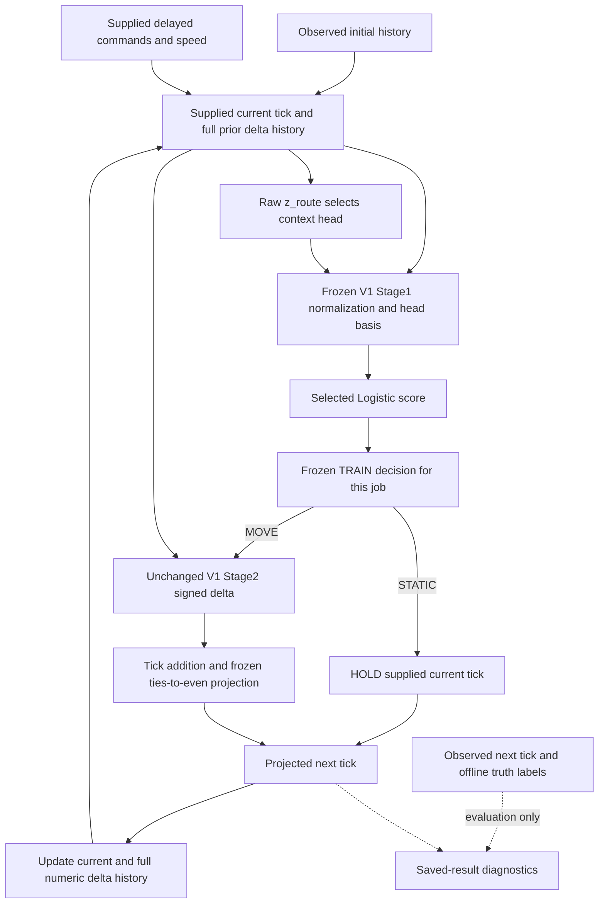

CyberPilot V4는 움직여야 하는 상황과 움직이지 않아야 하는 상황을 구분하는 데 문제가 있었다.

그런데 기존 Stage1에는 이미 과거 움직임 정보가 있고, 움직임 종료를 나타내는 학습 라벨도 있다.
따라서 입력이나 라벨이 부족하다고 단정할 수 없다.

이번 작업은 움직임 시작·유지·종료·정지의 의미를 다시 명확히 정의하고,
Stage1 모델의 점수 계산과 실제 판단 책임을 구분하여 다음 개발에 필요한 계약을 정리하는 작업이다.
이번에도 새 모델은 만들지 않는다. 여기서 움직임은 source-grid tick 변화이며 물리적 EPS 움직임을 뜻하지 않는다.

# Stage1 transition and decision contract review

## 1. 범위와 source/evidence identity

CONTRACT_REVIEW_ONLY / DESIGN_REVIEW_ONLY / REPORT_ONLY / NO_NEW_MODEL_EXECUTION.
이 문서는 이미 실행된 V4의 의미와 허용 경계를 설명한다. 새로운 독립 과학적 evidence, 새 prediction,
threshold/calibration/architecture 선택 또는 성능 개선 결과가 아니다.

| Identity | Binding |
| --- | --- |
| Architecture review baseline | 471537fc0d95d86e7b9f553af5a067a72951abdc |
| Original EXECUTION_HEAD | bd8045ef2a0da62a92603439f38e7740f5923622 |
| Attribution HEAD | 42541f583f39dc16609dd207c84cfd366445c0df |
| Original publication HEAD | 3943f5c2f4ef641e673ca6a47b24b44a359765c8 |
| Prior evidence-ledger receipt | fdfa702b46587d7fcb4ace773acc1364453f34bcbc524fa2bbcf47e94a98535b |
| Transition policy receipt | cb115d12addc97918bf5053c07fbb6f8017ae59e0da989f77198d965bc51615c |
| Locked public inputs | 34 files: prior mixed8JSON+MD, upstream24JSON+MD;32 seals verified |
| Static code | 15 Python source files;7 named scientific executor files byte-identical to original execution |
| Workflow | Existing workflow SHA pinned; no modification authorized |
| Publication HEAD / final CI | Containing Git commit; exact SHA and actual GitHub Actions result are resolved in final handoff |

전체 file SHA·receipt·source AST line은 [contract-policy](empirical-hurdle-stage1-v4-transition-contract-policy.json)의 /input_lock에 고정했다. 기존 mixed decision은 이 작업만 권고했으며 미래 실행은 승인하지 않았다.

## 2. 보전한 V4 결과와 정량 근거

HURDLE_STAGE1_V4_NO_ADMISSIBLE_CANDIDATE / MODEL_SELECTION_FAILED_CLOSED / selected_candidate=null.
기존 attribution과 mixed review 완료 상태를 변경하지 않는다.
STATIC/MOVE 두 head의 support/rank/NO_SEPARATION/convergence가 각32작업 모두 PASS였으므로 fitting failure로 설명하지 않는다.

32작업 합계 STATIC_HIT_LOSS=571,317, MOVE_HIT_GAIN=228,164, NET_EXACT_HIT_DELTA=-343,153이다.
모든32작업에서 loss>gain이며 candidate_exact_hits=HOLD_exact_hits-loss+gain identity를 보전했다.
Gate FP1,662,235=projected HOLD1,090,918+harmful projected false movement571,317이며 harmful fraction은 기존34.37%다.
이 합계는 서로 겹치는 job anchors를 포함하므로 독립 sample 수로 해석하지 않는다.

근거 E1, E2, E10: [empirical-hurdle-stage1-v4-exact-hit-decomposition.json /summary/exact_hit](https://github.com/rownlvh8875-coder/CyberPilot/blob/471537fc0d95d86e7b9f553af5a067a72951abdc/docs/cyberpilot/changes/empirical-hurdle-stage1-v4-exact-hit-decomposition.json); [empirical-hurdle-stage1-v4-exact-hit-decomposition.json /summary/loss_vs_gain_jobs](https://github.com/rownlvh8875-coder/CyberPilot/blob/471537fc0d95d86e7b9f553af5a067a72951abdc/docs/cyberpilot/changes/empirical-hurdle-stage1-v4-exact-hit-decomposition.json); [empirical-hurdle-stage1-v4-exact-hit-decomposition.json /summary/static](https://github.com/rownlvh8875-coder/CyberPilot/blob/471537fc0d95d86e7b9f553af5a067a72951abdc/docs/cyberpilot/changes/empirical-hurdle-stage1-v4-exact-hit-decomposition.json); [empirical-hurdle-stage1-v4-attribution-readiness.json /source_immutability](https://github.com/rownlvh8875-coder/CyberPilot/blob/471537fc0d95d86e7b9f553af5a067a72951abdc/docs/cyberpilot/changes/empirical-hurdle-stage1-v4-attribution-readiness.json); [empirical-hurdle-stage1-v4-attribution-repeatability.json /repeatability](https://github.com/rownlvh8875-coder/CyberPilot/blob/471537fc0d95d86e7b9f553af5a067a72951abdc/docs/cyberpilot/changes/empirical-hurdle-stage1-v4-attribution-repeatability.json); [empirical-hurdle-stage1-v4-attribution-resume.json /resume](https://github.com/rownlvh8875-coder/CyberPilot/blob/471537fc0d95d86e7b9f553af5a067a72951abdc/docs/cyberpilot/changes/empirical-hurdle-stage1-v4-attribution-resume.json); [empirical-hurdle-stage1-v4-attribution-validation.json /validation](https://github.com/rownlvh8875-coder/CyberPilot/blob/471537fc0d95d86e7b9f553af5a067a72951abdc/docs/cyberpilot/changes/empirical-hurdle-stage1-v4-attribution-validation.json); [empirical-hurdle-stage1-v4-causal-rollout-error-attribution.md ## 결과와 범위](https://github.com/rownlvh8875-coder/CyberPilot/blob/471537fc0d95d86e7b9f553af5a067a72951abdc/docs/cyberpilot/changes/empirical-hurdle-stage1-v4-causal-rollout-error-attribution.md); [empirical-hurdle-stage1-v4-causal-rollout-error-attribution.md ## Saved input coverage and regression risks](https://github.com/rownlvh8875-coder/CyberPilot/blob/471537fc0d95d86e7b9f553af5a067a72951abdc/docs/cyberpilot/changes/empirical-hurdle-stage1-v4-causal-rollout-error-attribution.md).

## 3. 네 truth transition의 수학적 정의

관측 source-grid tick을 t[k]라 하면 delta_prev[k]=t[k]-t[k-1], delta_true[k]=t[k+1]-t[k]다.
z_truth[k]=1[delta_prev[k]!=0], y_true[k]=1[delta_true[k]!=0]로 정의한다.
사용자 표의 z_prev는 이 observed truth context를 뜻한다. 실제 routing bit는 별도로 z_route라 쓴다.

| Truth state | z_truth | y_true | 기존 population | Observed one-step head | Desired gate |
| --- | --- | --- | --- | --- | --- |
| STATIC_HOLD | 0 | 0 | PREV_STATIC_TRUE_STATIC | STATIC_CONTEXT_HEAD | STATIC |
| MOVE_ONSET | 0 | 1 | PREV_STATIC_MOVE_ONSET | STATIC_CONTEXT_HEAD | MOVE |
| MOVE_TERMINATION | 1 | 0 | PREV_MOVE_TRUE_STATIC | MOVE_CONTEXT_HEAD | STATIC |
| MOVE_CONTINUATION | 1 | 1 | PREV_MOVE_MOVE_CONTINUATION | MOVE_CONTEXT_HEAD | MOVE |

네 상태는 유효한 두 binary bit의 Cartesian product라서 서로 겹치지 않고 전체를 덮는다.
이는 정답 tick이 관측된 뒤 확정되는 truth label이다. Inference가 y_true나 네 상태의 정답을 아는 것은 아니다.
MOVE_TERMINATION은 다음 increment가 한 번0이라는 뜻이며 지속 정지나 물리적 차량 정지를 보장하지 않는다.
MOVE_CONTINUATION에는 양/음 source-grid delta의 부호 반전도 포함된다.

[empirical_hurdle_v4_execution.py:probability:20](https://github.com/rownlvh8875-coder/CyberPilot/blob/471537fc0d95d86e7b9f553af5a067a72951abdc/openpilot/tools/cyber_autotune/empirical_hurdle_v4_execution.py#L20) [empirical_hurdle_v4_execution.py:execute_job:267](https://github.com/rownlvh8875-coder/CyberPilot/blob/471537fc0d95d86e7b9f553af5a067a72951abdc/openpilot/tools/cyber_autotune/empirical_hurdle_v4_execution.py#L267) [empirical_hurdle_v4_execution.py:recursive:185](https://github.com/rownlvh8875-coder/CyberPilot/blob/471537fc0d95d86e7b9f553af5a067a72951abdc/openpilot/tools/cyber_autotune/empirical_hurdle_v4_execution.py#L185)

근거 E3: [empirical-hurdle-stage1-v4-stage1-confusion-attribution.json /jobs/*/contexts](https://github.com/rownlvh8875-coder/CyberPilot/blob/471537fc0d95d86e7b9f553af5a067a72951abdc/docs/cyberpilot/changes/empirical-hurdle-stage1-v4-stage1-confusion-attribution.json); [empirical-hurdle-stage1-v4-causal-rollout-error-attribution.md ## Onset / continuation와 MOVE 오류](https://github.com/rownlvh8875-coder/CyberPilot/blob/471537fc0d95d86e7b9f553af5a067a72951abdc/docs/cyberpilot/changes/empirical-hurdle-stage1-v4-causal-rollout-error-attribution.md).

## 4. Truth, causal availability와 실제 routing

One-step/TRAIN은 observed 이전 delta를 사용하므로 z_route=z_truth다.
Recursive h=0도 같은 observed initial history에서 시작한다. 이후 z_route는 projected 이전 delta로 정해지며,
offline truth label의 z_truth는 미래 observed path에서 계산되는 평가용 정보다.
따라서 recursion 이후에는 네 truth population 중 어느 것이든 실제 STATIC-context head 또는 MOVE-context head를 쓸 수 있다.
직전 mixed 보고서의 selected-head 표는 observed one-step/TRAIN 범위로 읽어야 한다. 기존 수치 결과의 수정이 아니다.

| Routing situation | Source | 금지 또는 한계 |
| --- | --- | --- |
| Observed one-step/TRAIN | z_route=1[t[k]-t[k-1]!=0] | y_true/target tick을 routing에 사용하지 않는다. |
| Recursive initial | observed t[k-L..k]의 마지막 delta | 미래 observed context를 주입하지 않는다. |
| Recursive later | z_route[h]=1[projected_tick[h]-projected_tick[h-1]!=0] | z_route=z_truth 또는 전체 numeric history 일치를 가정하지 않는다. |

| Item | 정의 / 계약 | 실제 코드 |
| --- | --- | --- |
| T1 Truth label | (z_truth,y_true) defines the four adjacent-increment truth states after observation. | [empirical_hurdle_v4_execution.py:execute_job:267](https://github.com/rownlvh8875-coder/CyberPilot/blob/471537fc0d95d86e7b9f553af5a067a72951abdc/openpilot/tools/cyber_autotune/empirical_hurdle_v4_execution.py#L267) [empirical_hurdle_v4_attribution_math.py:one_step:63](https://github.com/rownlvh8875-coder/CyberPilot/blob/471537fc0d95d86e7b9f553af5a067a72951abdc/openpilot/tools/cyber_autotune/empirical_hurdle_v4_attribution_math.py#L63) |
| T2 Available history | Observed tick[k-L..k], delayed u[k-d-L+1..k-d], current speed; no target tick. | [empirical_s2_ri_fit_cv_math.py:features:31](https://github.com/rownlvh8875-coder/CyberPilot/blob/471537fc0d95d86e7b9f553af5a067a72951abdc/openpilot/tools/cyber_autotune/empirical_s2_ri_fit_cv_math.py#L31) |
| T3 Current observable state | Observed current in one-step; projected current after recursive initialization. | [empirical_hurdle_v4_execution.py:recursive:185](https://github.com/rownlvh8875-coder/CyberPilot/blob/471537fc0d95d86e7b9f553af5a067a72951abdc/openpilot/tools/cyber_autotune/empirical_hurdle_v4_execution.py#L185) [empirical_s2_ri_fit_cv_math.py:features:31](https://github.com/rownlvh8875-coder/CyberPilot/blob/471537fc0d95d86e7b9f553af5a067a72951abdc/openpilot/tools/cyber_autotune/empirical_s2_ri_fit_cv_math.py#L31) |
| T4 Prediction target | Binary next source-grid increment presence y_true, not a four-class oracle. | [empirical_hurdle_v4_execution.py:train:54](https://github.com/rownlvh8875-coder/CyberPilot/blob/471537fc0d95d86e7b9f553af5a067a72951abdc/openpilot/tools/cyber_autotune/empirical_hurdle_v4_execution.py#L54) |
| T5 Score | Selected conditioned linear Logistic score; nominal probability without calibration guarantee. | [empirical_hurdle_v4_execution.py:probability:20](https://github.com/rownlvh8875-coder/CyberPilot/blob/471537fc0d95d86e7b9f553af5a067a72951abdc/openpilot/tools/cyber_autotune/empirical_hurdle_v4_execution.py#L20) |
| T6 Decision | Per-job frozen combined TRAIN decision, strictly greater selects MOVE. | [empirical_hurdle_v4_execution.py:train:54](https://github.com/rownlvh8875-coder/CyberPilot/blob/471537fc0d95d86e7b9f553af5a067a72951abdc/openpilot/tools/cyber_autotune/empirical_hurdle_v4_execution.py#L54) [empirical_hurdle_v4_execution.py:integrated:152](https://github.com/rownlvh8875-coder/CyberPilot/blob/471537fc0d95d86e7b9f553af5a067a72951abdc/openpilot/tools/cyber_autotune/empirical_hurdle_v4_execution.py#L152) [empirical_hurdle_fit_cv_math.py:threshold:157](https://github.com/rownlvh8875-coder/CyberPilot/blob/471537fc0d95d86e7b9f553af5a067a72951abdc/openpilot/tools/cyber_autotune/empirical_hurdle_fit_cv_math.py#L157) |
| T7 Realization | Stage2 signed delta plus frozen projection relative to supplied current. | [empirical_hurdle_v4_execution.py:integrated:152](https://github.com/rownlvh8875-coder/CyberPilot/blob/471537fc0d95d86e7b9f553af5a067a72951abdc/openpilot/tools/cyber_autotune/empirical_hurdle_v4_execution.py#L152) [empirical_s2_ri_fit_cv_math.py:project:49](https://github.com/rownlvh8875-coder/CyberPilot/blob/471537fc0d95d86e7b9f553af5a067a72951abdc/openpilot/tools/cyber_autotune/empirical_s2_ri_fit_cv_math.py#L49) |
| T8 Next context | Latest projected tick difference, never saved gate or future measured truth. | [empirical_hurdle_v4_execution.py:recursive:185](https://github.com/rownlvh8875-coder/CyberPilot/blob/471537fc0d95d86e7b9f553af5a067a72951abdc/openpilot/tools/cyber_autotune/empirical_hurdle_v4_execution.py#L185) |
| T9 Missing history | Full eligible-history anchor admission, no padding/default state. | [empirical_s2_ri_fit_cv_math.py:anchors:20](https://github.com/rownlvh8875-coder/CyberPilot/blob/471537fc0d95d86e7b9f553af5a067a72951abdc/openpilot/tools/cyber_autotune/empirical_s2_ri_fit_cv_math.py#L20) [empirical_s2_ri_fit_cv_math.py:features:31](https://github.com/rownlvh8875-coder/CyberPilot/blob/471537fc0d95d86e7b9f553af5a067a72951abdc/openpilot/tools/cyber_autotune/empirical_s2_ri_fit_cv_math.py#L31) |
| T10 Boundaries | Segment-local continuity and fresh observed initialization per path/horizon. | [empirical_hurdle_v4_io.py:load_route:146](https://github.com/rownlvh8875-coder/CyberPilot/blob/471537fc0d95d86e7b9f553af5a067a72951abdc/openpilot/tools/cyber_autotune/empirical_hurdle_v4_io.py#L146) [empirical_hurdle_v2_io.py:load_route:265](https://github.com/rownlvh8875-coder/CyberPilot/blob/471537fc0d95d86e7b9f553af5a067a72951abdc/openpilot/tools/cyber_autotune/empirical_hurdle_v2_io.py#L265) [empirical_hurdle_v4_authorization.py:module aliases:116](https://github.com/rownlvh8875-coder/CyberPilot/blob/471537fc0d95d86e7b9f553af5a067a72951abdc/openpilot/tools/cyber_autotune/empirical_hurdle_v4_authorization.py#L116) [empirical_hurdle_v3_io.py:module aliases:16](https://github.com/rownlvh8875-coder/CyberPilot/blob/471537fc0d95d86e7b9f553af5a067a72951abdc/openpilot/tools/cyber_autotune/empirical_hurdle_v3_io.py#L16) [empirical_hurdle_fit_cv_data.py:binding:61](https://github.com/rownlvh8875-coder/CyberPilot/blob/471537fc0d95d86e7b9f553af5a067a72951abdc/openpilot/tools/cyber_autotune/empirical_hurdle_fit_cv_data.py#L61) [empirical_s2_ri_fit_cv_math.py:anchors:20](https://github.com/rownlvh8875-coder/CyberPilot/blob/471537fc0d95d86e7b9f553af5a067a72951abdc/openpilot/tools/cyber_autotune/empirical_s2_ri_fit_cv_math.py#L20) |

Source-grid index 기준 causal input과 물리적 clock에서 입수 가능한 정보는 구분한다.
One-step source feature는 k보다 뒤의 tick/command/speed를 사용하지 않는다.
Rollout은 각 미래 step의 logged command/speed sequence를 supplied exogenous input으로 받는다.
이는 retrospective conditional rollout 계약이며 최초 anchor에서 그 미래 sequence를 실제 운영상 알 수 있다는 증거가 아니다.
Future observed tick은 recursive 함수 밖에서 평가에만 사용된다. 새 forecaster나 oracle context를 만들지 않는다.

## 5. 실제 architecture와 책임 경계

Head routing, prediction score, gate decision, projected realization와 state ownership은 별개다.
Gate만 다음 head를 결정하지 않는다. MOVE gate가 HOLD로 실현되면 다음 z_route는0이다.
Shared raw feature x를 Stage1과 Stage2가 모두 사용하므로 미래 representation 변경은 Stage2 차원·순서·normalizer 호환성을 따로 검토해야 한다.

[empirical_hurdle_v4_execution.py:train:54](https://github.com/rownlvh8875-coder/CyberPilot/blob/471537fc0d95d86e7b9f553af5a067a72951abdc/openpilot/tools/cyber_autotune/empirical_hurdle_v4_execution.py#L54) [empirical_hurdle_v4_execution.py:integrated:152](https://github.com/rownlvh8875-coder/CyberPilot/blob/471537fc0d95d86e7b9f553af5a067a72951abdc/openpilot/tools/cyber_autotune/empirical_hurdle_v4_execution.py#L152) [empirical_hurdle_fit_cv_math.py:threshold:157](https://github.com/rownlvh8875-coder/CyberPilot/blob/471537fc0d95d86e7b9f553af5a067a72951abdc/openpilot/tools/cyber_autotune/empirical_hurdle_fit_cv_math.py#L157) [empirical_hurdle_v4_execution.py:integrated:152](https://github.com/rownlvh8875-coder/CyberPilot/blob/471537fc0d95d86e7b9f553af5a067a72951abdc/openpilot/tools/cyber_autotune/empirical_hurdle_v4_execution.py#L152) [empirical_hurdle_v4_execution.py:recursive:185](https://github.com/rownlvh8875-coder/CyberPilot/blob/471537fc0d95d86e7b9f553af5a067a72951abdc/openpilot/tools/cyber_autotune/empirical_hurdle_v4_execution.py#L185) [empirical_hurdle_v4_execution.py:rollout:212](https://github.com/rownlvh8875-coder/CyberPilot/blob/471537fc0d95d86e7b9f553af5a067a72951abdc/openpilot/tools/cyber_autotune/empirical_hurdle_v4_execution.py#L212)

## 6. Feature / normalization / head 계약

| Feature | Source index | 역할 |
| --- | --- | --- |
| intercept | 1 | INFERENCE_INPUT |
| delayed_command_history | u[k-d-L+1..k-d] | INFERENCE_INPUT |
| prior_delta_history | delta_prev[k-L+1..k] | INFERENCE_INPUT |
| current_tick | tick[k] | INFERENCE_INPUT |
| speed | v[k] | INFERENCE_INPUT |

P=2L+3, d∈{0,5,10,20}, L∈{1,5,15,45}는 기존 구조 설명이며 새 search가 아니다.
명령 history는 u[k-d-L+1..k-d], delta history는 delta_prev[k-L+1..k]다.
Raw 최신 prior-delta column P-3에서 routing을 정한 뒤 V1 TRAIN normalizer를 그대로 적용하고 head basis를 고른다.
Normalizer의 intercept는 unscaled이며, actual V4 train은 constant column이 없고 모든 V1 column이 effective임을 요구한다.
STATIC head는 최신 prior-delta column만 제거한다. 그 값은 해당 observed STATIC context에서 이미0이다.
MOVE head는 모든 V1 effective column을 유지한다. 나머지 history, current tick, speed와 command 정보는 이미 존재한다.

| L | STATIC dimensions | MOVE dimensions |
| --- | --- | --- |
| 1 | 4 | 5 |
| 5 | 12 | 13 |
| 15 | 32 | 33 |
| 45 | 92 | 93 |

두 head 모두 binary next-MOVE target을 학습한다. MOVE-context head에도 종료의 y=0 negative label이 있다.
선택한 정규화 feature의 선형 dot score에 sigmoid를 적용한다. 네 truth 상태를 예측 시 이미 알고 routing하는 four-class oracle이 아니다.
기존 정보의 존재는 정보가 충분하다는 증명이 아니다. Feature 부재, label 부재, Logistic 필연적 실패, 긴 L의 필연적 개선도 입증되지 않았다.

[empirical_s2_ri_fit_cv_math.py:features:31](https://github.com/rownlvh8875-coder/CyberPilot/blob/471537fc0d95d86e7b9f553af5a067a72951abdc/openpilot/tools/cyber_autotune/empirical_s2_ri_fit_cv_math.py#L31) [empirical_s2_ri_fit_cv_math.py:transform:71](https://github.com/rownlvh8875-coder/CyberPilot/blob/471537fc0d95d86e7b9f553af5a067a72951abdc/openpilot/tools/cyber_autotune/empirical_s2_ri_fit_cv_math.py#L71) [empirical_hurdle_fit_cv_math.py:module aliases:15](https://github.com/rownlvh8875-coder/CyberPilot/blob/471537fc0d95d86e7b9f553af5a067a72951abdc/openpilot/tools/cyber_autotune/empirical_hurdle_fit_cv_math.py#L15) [empirical_hurdle_v4_execution.py:train:54](https://github.com/rownlvh8875-coder/CyberPilot/blob/471537fc0d95d86e7b9f553af5a067a72951abdc/openpilot/tools/cyber_autotune/empirical_hurdle_v4_execution.py#L54) [empirical_hurdle_v4_execution.py:probability:20](https://github.com/rownlvh8875-coder/CyberPilot/blob/471537fc0d95d86e7b9f553af5a067a72951abdc/openpilot/tools/cyber_autotune/empirical_hurdle_v4_execution.py#L20) [empirical_hurdle_v4_fitting_policy.py:basis:84](https://github.com/rownlvh8875-coder/CyberPilot/blob/471537fc0d95d86e7b9f553af5a067a72951abdc/openpilot/tools/cyber_autotune/empirical_hurdle_v4_fitting_policy.py#L84) [empirical_hurdle_v4_io.py:load_models:104](https://github.com/rownlvh8875-coder/CyberPilot/blob/471537fc0d95d86e7b9f553af5a067a72951abdc/openpilot/tools/cyber_autotune/empirical_hurdle_v4_io.py#L104)

근거 E3, E5, E10, E11: [empirical-hurdle-stage1-v4-stage1-confusion-attribution.json /jobs/*/contexts](https://github.com/rownlvh8875-coder/CyberPilot/blob/471537fc0d95d86e7b9f553af5a067a72951abdc/docs/cyberpilot/changes/empirical-hurdle-stage1-v4-stage1-confusion-attribution.json); [empirical-hurdle-stage1-v4-causal-rollout-error-attribution.md ## Onset / continuation와 MOVE 오류](https://github.com/rownlvh8875-coder/CyberPilot/blob/471537fc0d95d86e7b9f553af5a067a72951abdc/docs/cyberpilot/changes/empirical-hurdle-stage1-v4-causal-rollout-error-attribution.md); [empirical-hurdle-stage1-v4-state-conditional-ranking.json /summary](https://github.com/rownlvh8875-coder/CyberPilot/blob/471537fc0d95d86e7b9f553af5a067a72951abdc/docs/cyberpilot/changes/empirical-hurdle-stage1-v4-state-conditional-ranking.json); [empirical-hurdle-stage1-v4-score-transfer.json /summary](https://github.com/rownlvh8875-coder/CyberPilot/blob/471537fc0d95d86e7b9f553af5a067a72951abdc/docs/cyberpilot/changes/empirical-hurdle-stage1-v4-score-transfer.json); [empirical-hurdle-stage1-v4-attribution-readiness.json /source_immutability](https://github.com/rownlvh8875-coder/CyberPilot/blob/471537fc0d95d86e7b9f553af5a067a72951abdc/docs/cyberpilot/changes/empirical-hurdle-stage1-v4-attribution-readiness.json); [empirical-hurdle-stage1-v4-attribution-repeatability.json /repeatability](https://github.com/rownlvh8875-coder/CyberPilot/blob/471537fc0d95d86e7b9f553af5a067a72951abdc/docs/cyberpilot/changes/empirical-hurdle-stage1-v4-attribution-repeatability.json); [empirical-hurdle-stage1-v4-attribution-resume.json /resume](https://github.com/rownlvh8875-coder/CyberPilot/blob/471537fc0d95d86e7b9f553af5a067a72951abdc/docs/cyberpilot/changes/empirical-hurdle-stage1-v4-attribution-resume.json); [empirical-hurdle-stage1-v4-attribution-validation.json /validation](https://github.com/rownlvh8875-coder/CyberPilot/blob/471537fc0d95d86e7b9f553af5a067a72951abdc/docs/cyberpilot/changes/empirical-hurdle-stage1-v4-attribution-validation.json); [empirical-hurdle-stage1-v4-causal-rollout-error-attribution.md ## 결과와 범위](https://github.com/rownlvh8875-coder/CyberPilot/blob/471537fc0d95d86e7b9f553af5a067a72951abdc/docs/cyberpilot/changes/empirical-hurdle-stage1-v4-causal-rollout-error-attribution.md); [empirical-hurdle-stage1-v4-causal-rollout-error-attribution.md ## Saved input coverage and regression risks](https://github.com/rownlvh8875-coder/CyberPilot/blob/471537fc0d95d86e7b9f553af5a067a72951abdc/docs/cyberpilot/changes/empirical-hurdle-stage1-v4-causal-rollout-error-attribution.md); [empirical-hurdle-stage1-v4-current-feature-contract.json /ordered_vector](https://github.com/rownlvh8875-coder/CyberPilot/blob/471537fc0d95d86e7b9f553af5a067a72951abdc/docs/cyberpilot/changes/empirical-hurdle-stage1-v4-current-feature-contract.json); [empirical-hurdle-stage1-v4-causal-state-contract.json /context](https://github.com/rownlvh8875-coder/CyberPilot/blob/471537fc0d95d86e7b9f553af5a067a72951abdc/docs/cyberpilot/changes/empirical-hurdle-stage1-v4-causal-state-contract.json); [empirical-hurdle-stage1-v4-rollout-state-contract.json /gate_is_not_state](https://github.com/rownlvh8875-coder/CyberPilot/blob/471537fc0d95d86e7b9f553af5a067a72951abdc/docs/cyberpilot/changes/empirical-hurdle-stage1-v4-rollout-state-contract.json); [empirical-hurdle-stage1-v4-rollout-state-contract.json /logged_future_command_vego](https://github.com/rownlvh8875-coder/CyberPilot/blob/471537fc0d95d86e7b9f553af5a067a72951abdc/docs/cyberpilot/changes/empirical-hurdle-stage1-v4-rollout-state-contract.json).

## 7. Transition responsibility matrix

다음 head 열은 observed one-step에만 고정된다. Recursive head는 항상 실제 z_route로 선택한다.
Gate correctness는 g=y_true, movement-presence correctness는 projected_delta의 비영 여부=y_true,
exact tick correctness는 projected_next_tick=observed_next_tick이다.

| Truth state | Observed head | Correct gate | Gate error | Gate/realization caveat | Next state |
| --- | --- | --- | --- | --- | --- |
| STATIC_HOLD | STATIC-context | STATIC | FP: gateMOVE | FP라도 projectedHOLD이면 aligned one-step tick은 맞을 수 있다. | 실현된 delta로 context 갱신 |
| MOVE_ONSET | STATIC-context | MOVE | FN: gateSTATIC | TP도 magnitude/rounding error 가능; FN은 supplied-current HOLD. | FN이면 projected next context0 |
| MOVE_TERMINATION | MOVE-context | STATIC | FP: gateMOVE | FP도 projectedHOLD 가능; recursive TN도 기존 base drift는 남을 수 있다. | gate가 아닌 실제 projected delta 사용 |
| MOVE_CONTINUATION | MOVE-context | MOVE | FN: gateSTATIC | TP도 signed magnitude 또는 presence 오류 가능; 부호 유지 label 아님. | full numeric history와 current도 변경 |

Recursive tick error는 (projected_current-observed_current)+(projected_delta-observed_delta)다.
따라서 잘못된 gate도 기존 base offset 때문에 관측 target과 우연히 일치할 수 있고, 올바른 gate도 기존 offset을 남길 수 있다.
이는 대수적 계약 설명이며 새로운 saved-path 계산이나 counterfactual 실행이 아니다.

## 8. Ranking / calibration / decision 책임

| Responsibility | Meaning | Limit |
| --- | --- | --- |
| REPRESENTATION | Which causal numeric covariates can express onset/hold and continuation/termination distinctions. | Existing history and negatives do not prove sufficiency or impossibility. |
| RANKING | Score ordering of MOVE and STATIC within specified population, including exact tie semantics. | Overall improvement does not imply both state-conditioned improvements or operating-point recall/specificity. |
| CALIBRATION | Correspondence between nominal scores and observed MOVE rates on specified population. | Mean bias/Brier summaries do not establish full conditional reliability or authorize correction fitting. |
| DECISION | Frozen per-job combined TRAIN rule turns scores into gate. | Common rule does not guarantee each context or fold transfer; no alternate rule evaluated. |
| REALIZATION | Gate-conditioned signed Stage2 delta and tick projection create projected movement. | Gate correctness and exact tick correctness are distinct; Stage1 alone does not own magnitude accuracy. |

t_job은 candidate/fold별 combined original-order TRAIN score에서 정한 하나의 private decision 값이다.
그 작업의 두 head가 이를 공유한다. 32개 작업 전체에 pooled value 하나가 적용된다는 뜻이 아니다.
MOVE iff p_move>t_job이며 equality는 STATIC이다. 기존 후보 집합은 {0,1}∪unique finite TRAIN scores,
선택 objective는 MAX(BA_NUM,TN,t_job), BA_NUM=TP*N_negative+TN*N_positive다.
이 TRAIN binary balanced-accuracy objective는 STATIC exact-hit, Stage2 realization 또는 장기 rollout을 직접 최적화하지 않는다.
어느 값도 다시 읽거나 공개하거나 계산하지 않았다.

비상수 score가 MOVE를 더 높게 정렬해도 저장된 decision의 MOVE 쪽에 종료 sample이 모두 있으면
ranking 개선과 termination gateFP100%가 동시에 가능하다. 이 가능성은 실제 threshold의 단독 원인 증명이 아니다.

| Population | TRAIN AUC job mean | DEV AUC job mean | V4 DEV vs frozen fixed V1 DEV improved/equal/worse |
| --- | --- | --- | --- |
| OVERALL | 0.707438 | 0.702174 | 32/0/0 |
| PREV_STATIC | 0.554846 | 0.545865 | 13/0/19 |
| PREV_MOVE | 0.592356 | 0.574285 | 32/0/0 |

기존 exact matching anchors의 DEV comparison 건수이며 TRAIN→DEV 변화 건수가 아니다.
Overall 개선을 상태 내부 개선으로 확장하지 않는다. PREV_STATIC은13 improved/19 worse다.
AUC significance나 임의의 good-AUC cutoff를 정하지 않았다. Mean calibration bias/Brier도 조건부 reliability 전체를 증명하지 않는다.
새 threshold, class-specific decision, alternate score correction 또는 calibration fitting은 수행하지 않았다.

근거 E5: [empirical-hurdle-stage1-v4-state-conditional-ranking.json /summary](https://github.com/rownlvh8875-coder/CyberPilot/blob/471537fc0d95d86e7b9f553af5a067a72951abdc/docs/cyberpilot/changes/empirical-hurdle-stage1-v4-state-conditional-ranking.json); [empirical-hurdle-stage1-v4-score-transfer.json /summary](https://github.com/rownlvh8875-coder/CyberPilot/blob/471537fc0d95d86e7b9f553af5a067a72951abdc/docs/cyberpilot/changes/empirical-hurdle-stage1-v4-score-transfer.json).

[empirical_hurdle_v4_execution.py:train:54](https://github.com/rownlvh8875-coder/CyberPilot/blob/471537fc0d95d86e7b9f553af5a067a72951abdc/openpilot/tools/cyber_autotune/empirical_hurdle_v4_execution.py#L54) [empirical_hurdle_v4_execution.py:integrated:152](https://github.com/rownlvh8875-coder/CyberPilot/blob/471537fc0d95d86e7b9f553af5a067a72951abdc/openpilot/tools/cyber_autotune/empirical_hurdle_v4_execution.py#L152) [empirical_hurdle_fit_cv_math.py:threshold:157](https://github.com/rownlvh8875-coder/CyberPilot/blob/471537fc0d95d86e7b9f553af5a067a72951abdc/openpilot/tools/cyber_autotune/empirical_hurdle_fit_cv_math.py#L157) [empirical_hurdle_v2_attribution_math.py:ranking:9](https://github.com/rownlvh8875-coder/CyberPilot/blob/471537fc0d95d86e7b9f553af5a067a72951abdc/openpilot/tools/cyber_autotune/empirical_hurdle_v2_attribution_math.py#L9) [empirical_hurdle_v2_attribution_math.py:transfer:46](https://github.com/rownlvh8875-coder/CyberPilot/blob/471537fc0d95d86e7b9f553af5a067a72951abdc/openpilot/tools/cyber_autotune/empirical_hurdle_v2_attribution_math.py#L46)

## 9. Onset과 termination 집중 검토

Onset recall은 FoldA40.195%, FoldB2.147%였다. Observed one-step에서 STATIC-context head가 기존 history/command/tick/speed로 score를 낸다.
FN이면 Stage2를 건너뛰고 현재 tick을 유지해 projected next context가0이 된다. Recursive에서는 base drift와 실제 z_route를 별도로 보아야 한다.
PREV_STATIC ranking과 반대 방향 fold score shift는 관련 검토 근거지만 representation/operating-point 중 단독 원인은 미식별이다.

Termination은 두 fold 모두 gateFP100%였고 continuation recall은100%/약99.999%였다.
종료 negative label이 실제로 존재하는 MOVE-context binary head가 frozen decision에서 종료와 지속을 구분하지 못한 signature다.
실제 코드는 Logistic score와 strict decision comparison을 사용한다. Hard-coded always-MOVE rule을 추정하지 않는다.
FP gate가 Stage2를 실행해도 tickHOLD로 실현될 수 있으므로 termination gate 실패 전부를 harmful tick movement로 세지 않는다.
높은 continuation recall만 따로 성공으로 해석하면 종료를 놓치는 반대 면을 숨기게 된다.

근거 E2, E3, E4, E5: [empirical-hurdle-stage1-v4-exact-hit-decomposition.json /summary/static](https://github.com/rownlvh8875-coder/CyberPilot/blob/471537fc0d95d86e7b9f553af5a067a72951abdc/docs/cyberpilot/changes/empirical-hurdle-stage1-v4-exact-hit-decomposition.json); [empirical-hurdle-stage1-v4-stage1-confusion-attribution.json /jobs/*/contexts](https://github.com/rownlvh8875-coder/CyberPilot/blob/471537fc0d95d86e7b9f553af5a067a72951abdc/docs/cyberpilot/changes/empirical-hurdle-stage1-v4-stage1-confusion-attribution.json); [empirical-hurdle-stage1-v4-causal-rollout-error-attribution.md ## Onset / continuation와 MOVE 오류](https://github.com/rownlvh8875-coder/CyberPilot/blob/471537fc0d95d86e7b9f553af5a067a72951abdc/docs/cyberpilot/changes/empirical-hurdle-stage1-v4-causal-rollout-error-attribution.md); [empirical-hurdle-stage1-v4-fold-asymmetry.json /folds](https://github.com/rownlvh8875-coder/CyberPilot/blob/471537fc0d95d86e7b9f553af5a067a72951abdc/docs/cyberpilot/changes/empirical-hurdle-stage1-v4-fold-asymmetry.json); [empirical-hurdle-stage1-v4-fold-asymmetry.json /patterns](https://github.com/rownlvh8875-coder/CyberPilot/blob/471537fc0d95d86e7b9f553af5a067a72951abdc/docs/cyberpilot/changes/empirical-hurdle-stage1-v4-fold-asymmetry.json); [empirical-hurdle-stage1-v4-fold-asymmetry.json /opposite_pattern_supported](https://github.com/rownlvh8875-coder/CyberPilot/blob/471537fc0d95d86e7b9f553af5a067a72951abdc/docs/cyberpilot/changes/empirical-hurdle-stage1-v4-fold-asymmetry.json); [empirical-hurdle-stage1-v4-state-conditional-ranking.json /summary](https://github.com/rownlvh8875-coder/CyberPilot/blob/471537fc0d95d86e7b9f553af5a067a72951abdc/docs/cyberpilot/changes/empirical-hurdle-stage1-v4-state-conditional-ranking.json); [empirical-hurdle-stage1-v4-score-transfer.json /summary](https://github.com/rownlvh8875-coder/CyberPilot/blob/471537fc0d95d86e7b9f553af5a067a72951abdc/docs/cyberpilot/changes/empirical-hurdle-stage1-v4-score-transfer.json).

## 10. Gate / Stage2 / tick realization 불변 조건

| Gate | Realization | Successful frozen path |
| --- | --- | --- |
| STATIC | HOLD | 필수: supplied integer current tick 유지 |
| MOVE | HOLD | 허용: signed delta와 frozen rounding 결과 |
| MOVE | MOVE | 허용 |
| STATIC | MOVE | 허용되지 않음: validated integer-current caller 범위 |

Stage2는 V1 TRAIN true-MOVE rows에서 fitting된 모델이지만 실행은 gateMOVE rows에서 이뤄져 true STATIC도 포함될 수 있다.
Signed continuous delta는 비영이 강제되지 않는다. Current float64+delta를 np.rint ties-to-even으로 반올림하고,
그 결과가 signed16 범위를 벗어나면 raise한다. 성공한 tick dtype은 int64이며 clipping/new deadband는 없다.
반올림 전 continuous 값의 범위와 반올림 후 checked 범위를 혼동하지 않는다.

Invalid/nonfinite/range output은 reject/raise하며 fallback하지 않는다. CANDIDATE_FOLD_NUMERICAL_FAILURE_* ValueError는
execute_job의 serialized-failure prefix에 포함되지 않아 전파되어 run을 중단할 수 있다. 항상 특정 job 실패 category로 저장된다고 보장하지 않는다.
이는 소스의 error propagation 설명이며 actual32개 COMPLETE job에 새 실패를 부여하는 것이 아니다.

GateMOVE를 강제 projectedMOVE로 바꾸는 정책은 승인되지 않았다. 기존1,090,918 STATIC gateFP가 tickHOLD였으므로
이를 강제로 움직이면 harmful false movement가 늘 위험이 있다. HOLD라는 이유만으로 continuous error도 항상0이라고 보지 않는다.
One-step RMSE/MAE/p95는 integrated continuous delta error이고 hit는 projected tick으로 계산한다.

[empirical_hurdle_v4_execution.py:integrated:152](https://github.com/rownlvh8875-coder/CyberPilot/blob/471537fc0d95d86e7b9f553af5a067a72951abdc/openpilot/tools/cyber_autotune/empirical_hurdle_v4_execution.py#L152) [empirical_hurdle_v4_execution.py:recursive:185](https://github.com/rownlvh8875-coder/CyberPilot/blob/471537fc0d95d86e7b9f553af5a067a72951abdc/openpilot/tools/cyber_autotune/empirical_hurdle_v4_execution.py#L185) [empirical_hurdle_v4_execution.py:rollout:212](https://github.com/rownlvh8875-coder/CyberPilot/blob/471537fc0d95d86e7b9f553af5a067a72951abdc/openpilot/tools/cyber_autotune/empirical_hurdle_v4_execution.py#L212) [empirical_hurdle_v4_execution.py:execute_job:267](https://github.com/rownlvh8875-coder/CyberPilot/blob/471537fc0d95d86e7b9f553af5a067a72951abdc/openpilot/tools/cyber_autotune/empirical_hurdle_v4_execution.py#L267) [empirical_hurdle_v4_execution.py:run:379](https://github.com/rownlvh8875-coder/CyberPilot/blob/471537fc0d95d86e7b9f553af5a067a72951abdc/openpilot/tools/cyber_autotune/empirical_hurdle_v4_execution.py#L379) [empirical_hurdle_fit_cv_math.py:fit_stage2:189](https://github.com/rownlvh8875-coder/CyberPilot/blob/471537fc0d95d86e7b9f553af5a067a72951abdc/openpilot/tools/cyber_autotune/empirical_hurdle_fit_cv_math.py#L189) [empirical_hurdle_fit_cv_math.py:predict_delta:215](https://github.com/rownlvh8875-coder/CyberPilot/blob/471537fc0d95d86e7b9f553af5a067a72951abdc/openpilot/tools/cyber_autotune/empirical_hurdle_fit_cv_math.py#L215) [empirical_s2_ri_fit_cv_math.py:project:49](https://github.com/rownlvh8875-coder/CyberPilot/blob/471537fc0d95d86e7b9f553af5a067a72951abdc/openpilot/tools/cyber_autotune/empirical_s2_ri_fit_cv_math.py#L49) [empirical_s2_ri_fit_cv_math.py:finite:15](https://github.com/rownlvh8875-coder/CyberPilot/blob/471537fc0d95d86e7b9f553af5a067a72951abdc/openpilot/tools/cyber_autotune/empirical_s2_ri_fit_cv_math.py#L15) [empirical_hurdle_v4_attribution_math.py:PathAccumulator:206](https://github.com/rownlvh8875-coder/CyberPilot/blob/471537fc0d95d86e7b9f553af5a067a72951abdc/openpilot/tools/cyber_autotune/empirical_hurdle_v4_attribution_math.py#L206) [empirical_hurdle_v4_io.py:load_route:146](https://github.com/rownlvh8875-coder/CyberPilot/blob/471537fc0d95d86e7b9f553af5a067a72951abdc/openpilot/tools/cyber_autotune/empirical_hurdle_v4_io.py#L146) [empirical_hurdle_v2_io.py:load_route:265](https://github.com/rownlvh8875-coder/CyberPilot/blob/471537fc0d95d86e7b9f553af5a067a72951abdc/openpilot/tools/cyber_autotune/empirical_hurdle_v2_io.py#L265) [empirical_hurdle_v4_authorization.py:module aliases:116](https://github.com/rownlvh8875-coder/CyberPilot/blob/471537fc0d95d86e7b9f553af5a067a72951abdc/openpilot/tools/cyber_autotune/empirical_hurdle_v4_authorization.py#L116) [empirical_hurdle_v3_io.py:module aliases:16](https://github.com/rownlvh8875-coder/CyberPilot/blob/471537fc0d95d86e7b9f553af5a067a72951abdc/openpilot/tools/cyber_autotune/empirical_hurdle_v3_io.py#L16) [empirical_hurdle_fit_cv_data.py:binding:61](https://github.com/rownlvh8875-coder/CyberPilot/blob/471537fc0d95d86e7b9f553af5a067a72951abdc/openpilot/tools/cyber_autotune/empirical_hurdle_fit_cv_data.py#L61) [empirical_s2_ri_fit_cv_math.py:anchors:20](https://github.com/rownlvh8875-coder/CyberPilot/blob/471537fc0d95d86e7b9f553af5a067a72951abdc/openpilot/tools/cyber_autotune/empirical_s2_ri_fit_cv_math.py#L20)

근거 E2, E8: [empirical-hurdle-stage1-v4-exact-hit-decomposition.json /summary/static](https://github.com/rownlvh8875-coder/CyberPilot/blob/471537fc0d95d86e7b9f553af5a067a72951abdc/docs/cyberpilot/changes/empirical-hurdle-stage1-v4-exact-hit-decomposition.json); [empirical-hurdle-stage1-v4-rollout-step-error.json /jobs/*/rollout/200/tp_magnitude](https://github.com/rownlvh8875-coder/CyberPilot/blob/471537fc0d95d86e7b9f553af5a067a72951abdc/docs/cyberpilot/changes/empirical-hurdle-stage1-v4-rollout-step-error.json); [empirical-hurdle-stage1-v4-causal-rollout-error-attribution.md ## TP magnitude와 disjoint step errors](https://github.com/rownlvh8875-coder/CyberPilot/blob/471537fc0d95d86e7b9f553af5a067a72951abdc/docs/cyberpilot/changes/empirical-hurdle-stage1-v4-causal-rollout-error-attribution.md).

## 11. Recursive state ownership와 boundary

Initial observed tick[k-L..k]에서 L개 prior delta를 만든다. 각 path/horizon의 local current/history가 상태를 소유하며 새 path에서 재초기화한다.
Step h는 projected current와 full L-delta history, supplied command window와 speed로 두 stage의 x를 만든다.
예측 후 history를 shift하고 마지막 값을 new-current로 갱신한다. Gate가 아닌 실현된 delta가 다음 z_route를 결정한다.
MOVE gate→HOLD 또는 missed MOVE→HOLD이면 다음 projected context는 STATIC이다. Exogenous input과 오래된 history가 계속 변하므로 absorbing state를 증명한 것은 아니다.

h>=1에서 context divergence는 직전 step movement-pattern mismatch와 기계적으로 같다.
첫 context divergence는 1-based step2보다 빠를 수 없다. 그러나 binary bit가 같아도 current tick, 크기/부호와 full history는 다를 수 있다.
E6의 binary context summary를 전체 수치 state 일치 증거로 확대하지 않는다. Terminal error의 독립 인과 기여율은 NOT_IDENTIFIABLE_FROM_FROZEN_EVIDENCE다.

실제 reader chain은 V4_io.load_route→authorization.prior(V3_io).legacy(V2_io).load_route다.
각 segment의 10ms spacing, causal-run ID, within-run index와 eligible streak를 검증하고 segment별 anchors를 만든다.
R=max(d+L,L+1), streak[k]>=R, streak[k+H]=streak[k]+H가 필요하다. Missing history는 padding/default STATIC으로 채우지 않는다.
Segment 경계를 넘는 history도 만들지 않는다. H번 prediction은 H+1 tick path를 만들며 마지막 tick 뒤 추가 head call은 하지 않는다.

[empirical_hurdle_v4_io.py:load_route:146](https://github.com/rownlvh8875-coder/CyberPilot/blob/471537fc0d95d86e7b9f553af5a067a72951abdc/openpilot/tools/cyber_autotune/empirical_hurdle_v4_io.py#L146) [empirical_hurdle_v2_io.py:load_route:265](https://github.com/rownlvh8875-coder/CyberPilot/blob/471537fc0d95d86e7b9f553af5a067a72951abdc/openpilot/tools/cyber_autotune/empirical_hurdle_v2_io.py#L265) [empirical_hurdle_v4_authorization.py:module aliases:116](https://github.com/rownlvh8875-coder/CyberPilot/blob/471537fc0d95d86e7b9f553af5a067a72951abdc/openpilot/tools/cyber_autotune/empirical_hurdle_v4_authorization.py#L116) [empirical_hurdle_v3_io.py:module aliases:16](https://github.com/rownlvh8875-coder/CyberPilot/blob/471537fc0d95d86e7b9f553af5a067a72951abdc/openpilot/tools/cyber_autotune/empirical_hurdle_v3_io.py#L16) [empirical_hurdle_fit_cv_data.py:binding:61](https://github.com/rownlvh8875-coder/CyberPilot/blob/471537fc0d95d86e7b9f553af5a067a72951abdc/openpilot/tools/cyber_autotune/empirical_hurdle_fit_cv_data.py#L61) [empirical_s2_ri_fit_cv_math.py:anchors:20](https://github.com/rownlvh8875-coder/CyberPilot/blob/471537fc0d95d86e7b9f553af5a067a72951abdc/openpilot/tools/cyber_autotune/empirical_s2_ri_fit_cv_math.py#L20) [empirical_hurdle_v4_execution.py:recursive:185](https://github.com/rownlvh8875-coder/CyberPilot/blob/471537fc0d95d86e7b9f553af5a067a72951abdc/openpilot/tools/cyber_autotune/empirical_hurdle_v4_execution.py#L185) [empirical_hurdle_v4_execution.py:rollout:212](https://github.com/rownlvh8875-coder/CyberPilot/blob/471537fc0d95d86e7b9f553af5a067a72951abdc/openpilot/tools/cyber_autotune/empirical_hurdle_v4_execution.py#L212)

근거 E6, E11: [empirical-hurdle-stage1-v4-mechanism-summary.json /overall/rollout](https://github.com/rownlvh8875-coder/CyberPilot/blob/471537fc0d95d86e7b9f553af5a067a72951abdc/docs/cyberpilot/changes/empirical-hurdle-stage1-v4-mechanism-summary.json); [empirical-hurdle-stage1-v4-rollout-context-drift.json /jobs/*/rollout](https://github.com/rownlvh8875-coder/CyberPilot/blob/471537fc0d95d86e7b9f553af5a067a72951abdc/docs/cyberpilot/changes/empirical-hurdle-stage1-v4-rollout-context-drift.json); [empirical-hurdle-stage1-v4-rollout-streaks.json /jobs/*/rollout](https://github.com/rownlvh8875-coder/CyberPilot/blob/471537fc0d95d86e7b9f553af5a067a72951abdc/docs/cyberpilot/changes/empirical-hurdle-stage1-v4-rollout-streaks.json); [empirical-hurdle-stage1-v4-causal-rollout-error-attribution.md ## Feedback association과 streaks](https://github.com/rownlvh8875-coder/CyberPilot/blob/471537fc0d95d86e7b9f553af5a067a72951abdc/docs/cyberpilot/changes/empirical-hurdle-stage1-v4-causal-rollout-error-attribution.md); [empirical-hurdle-stage1-v4-current-feature-contract.json /ordered_vector](https://github.com/rownlvh8875-coder/CyberPilot/blob/471537fc0d95d86e7b9f553af5a067a72951abdc/docs/cyberpilot/changes/empirical-hurdle-stage1-v4-current-feature-contract.json); [empirical-hurdle-stage1-v4-causal-state-contract.json /context](https://github.com/rownlvh8875-coder/CyberPilot/blob/471537fc0d95d86e7b9f553af5a067a72951abdc/docs/cyberpilot/changes/empirical-hurdle-stage1-v4-causal-state-contract.json); [empirical-hurdle-stage1-v4-rollout-state-contract.json /gate_is_not_state](https://github.com/rownlvh8875-coder/CyberPilot/blob/471537fc0d95d86e7b9f553af5a067a72951abdc/docs/cyberpilot/changes/empirical-hurdle-stage1-v4-rollout-state-contract.json); [empirical-hurdle-stage1-v4-rollout-state-contract.json /logged_future_command_vego](https://github.com/rownlvh8875-coder/CyberPilot/blob/471537fc0d95d86e7b9f553af5a067a72951abdc/docs/cyberpilot/changes/empirical-hurdle-stage1-v4-rollout-state-contract.json).

## 12. Fold A/B에 일관된 decision 계약

| Fold | One-step FPR | One-step FNR | TRAIN→DEV score shift | Calibration-bias shift | H200 gate MOVE / true MOVE |
| --- | --- | --- | --- | --- | --- |
| FOLD_A | 41.193% | 33.041% | +0.017882 | +0.022050 | 44.512% / 13.201% |
| FOLD_B | 10.430% | 54.098% | -0.009916 | -0.014084 | 4.041% / 14.736% |

위 one-step/score 값은 기존 job means이며 pooled independent population 추정치가 아니다.
FoldA의 높은 falseMOVE/onset coverage와 FoldB의 높은 missedMOVE/낮은 onset coverage를 분리한다.
H200에서는 A gateMOVE44.512% 대 true13.201%, B gate4.041% 대 true14.736%라는 반대 양상이 나타났다.
One-step과 recursive 양상을 같은 population으로 취급하지 않는다. 기존 formal opposite-pattern flag가 false였다는 사실도
공개 원문에서 유지하며, 관측된 반대 score/calibration/recursive signature와 동일한 판정으로 바꾸지 않는다.

| Consistent-contract condition |
| --- |
| Same truth, routing, feature, normalization, comparator and anchor semantics across folds. |
| Keep ranking/calibration/decision and observed one-step/recursive diagnostics separate. |
| Report all four contexts in each fold without cancelling opposing shifts in a pooled mean. |
| Both frozen fold gates remain required; no new per-state numeric acceptance cutoff. |

한쪽 fold만 보정하는 방법을 선택하지 않는다. Fixed rule의 정의는 같아도 transfer 성능 보장은 별도 증거가 필요하다.
각 fold는 자기 고유의 frozen route/label/anchor identity를 유지한다. 공통 의미를 보전한다는 말은 두 fold의 anchor 값이나 population이 동일하다는 뜻이 아니다.
새 onset/termination numeric cutoff나 fold-specific threshold를 만들지 않았다.

근거 E4: [empirical-hurdle-stage1-v4-fold-asymmetry.json /folds](https://github.com/rownlvh8875-coder/CyberPilot/blob/471537fc0d95d86e7b9f553af5a067a72951abdc/docs/cyberpilot/changes/empirical-hurdle-stage1-v4-fold-asymmetry.json); [empirical-hurdle-stage1-v4-fold-asymmetry.json /patterns](https://github.com/rownlvh8875-coder/CyberPilot/blob/471537fc0d95d86e7b9f553af5a067a72951abdc/docs/cyberpilot/changes/empirical-hurdle-stage1-v4-fold-asymmetry.json); [empirical-hurdle-stage1-v4-fold-asymmetry.json /opposite_pattern_supported](https://github.com/rownlvh8875-coder/CyberPilot/blob/471537fc0d95d86e7b9f553af5a067a72951abdc/docs/cyberpilot/changes/empirical-hurdle-stage1-v4-fold-asymmetry.json).

## 13. F1–F8 failure mode / invariant matrix

| Invariant | Contract |
| --- | --- |
| I1 | Future target tick, delta_true, y_true and recursive future observed context are label/evaluation data only; never inference inputs. |
| I2 | Gate STATIC holds the supplied current integer tick on the successful frozen path; this need not equal observed truth after recursive drift. |
| I3 | Gate MOVE does not require nonzero projected movement. MOVE to HOLD remains permitted. |
| I4 | Frozen np.rint ties-to-even and after-rounding signed16 range rejection remain unchanged; no clipping, new deadband or forced movement. |
| I5 | Observed truth context and actual observed/projected routing context remain separately named; binary equality does not imply numeric-history equality. |
| I6 | Source-grid delta sign/presence is not physical EPS movement, torque or proven signed rate. |
| I7 | Existing Stage2 model, both normalizers, shared raw-feature dimension, fit policy and selector remain byte-identical. |
| I8 | No HOLDOUT admission, pooled refit, composition, vehicle authority or future execution arises from this contract review. |
| I9 | Full eligible history and continuous within-segment anchors are required; no padding, default context or cross-segment bridge. |
| I10 | One frozen TRAIN decision belongs to each candidate/fold job and is shared across its two heads; each fold retains its own frozen labels/anchor identities while their definitions and anchor semantics remain common. |
| I11 | No new onset/termination acceptance cutoff is derived from retrospective results; frozen32 clauses and both-fold requirement remain unchanged. |
| I12 | Recursive state belongs to each local path/horizon; future logged command/speed is supplied retrospective input, not proven initial-anchor forecast information. |

### F1. False MOVE onset suppression

| Field | Contract |
| --- | --- |
| formal_condition | z_truth=0 AND y_true=1 AND gate_move=0 |
| actual_evidence | E3: onset recall FoldA40.195%, FoldB2.147%; published overlapping-job aggregates |
| populations | MOVE_ONSET |
| stage_responsibility | Stage1 score and frozen decision produce FN; Stage2 is skipped. |
| downstream_effect | Projected delta is zero and next routing context is STATIC relative to supplied current. One-step aligned base misses the next tick. |
| known_limits | Representation vs operating-point cause is unidentified; recursive projected base may already coincide with observed target despite FN. |
| invariants | I1 I2 I5 I10 |
| future_validation | V2 V5 V9 V10 V12 V15 |
| safety_implication | Missed source-grid onset is an offline prediction risk, not measured actuator behavior. |
| classification | OBSERVED_GATE_FAILURE |

### F2. False continuation after termination

| Field | Contract |
| --- | --- |
| formal_condition | z_truth=1 AND y_true=0 AND gate_move=1 |
| actual_evidence | E3: previous-MOVE true-STATIC gateFP100% in both folds; continuation recall100%/about99.999% |
| populations | MOVE_TERMINATION |
| stage_responsibility | Conditioned Logistic score and frozen decision; termination negative labels already exist. |
| downstream_effect | Stage2 executes, but realized HOLD or MOVE determines the next context. High continuation recall alone does not establish termination discrimination. |
| known_limits | No hard-coded always-MOVE rule is established. Actual recursive head follows z_route and may differ from the truth population head. |
| invariants | I1 I3 I5 I10 |
| future_validation | V3 V4 V5 V7 V12 |
| safety_implication | Potential unnecessary tick change requires protection; forcing every MOVE gate to move is unauthorized. |
| classification | OBSERVED_GATE_FAILURE |

### F3. Harmful projected movement on true STATIC

| Field | Contract |
| --- | --- |
| formal_condition | y_true=0 AND realized_move=1, relative to supplied current tick |
| actual_evidence | E1/E2: one-step STATIC loss571317, MOVE gain228164; FP1662235=projectedHOLD1090918+harmful571317 |
| populations | STATIC_HOLD MOVE_TERMINATION |
| stage_responsibility | Gate admits Stage2; signed delta and projection realize movement. |
| downstream_effect | On observed one-step aligned base this is exact-hit loss. Projected movement updates subsequent history/context. |
| known_limits | Recursive false movement may offset an existing tick bias; event presence alone does not identify increased terminal absolute error. |
| invariants | I2 I3 I4 I5 |
| future_validation | V1 V3 V6 V8 V14 V15 |
| safety_implication | Static tick preservation is necessary to review; no physical EPS actuation claim. |
| classification | OBSERVED_ONE_STEP_EXACT_HIT_LOSS |

### F4. Gate MOVE but projected HOLD

| Field | Contract |
| --- | --- |
| formal_condition | gate_move=1 AND realized_move=0 |
| actual_evidence | E2:1090918 one-step STATIC gateFP cases realized HOLD; existing projection permits it |
| populations | STATIC_HOLD MOVE_ONSET MOVE_TERMINATION MOVE_CONTINUATION |
| stage_responsibility | Stage2 signed delta plus frozen tick addition/rounding. |
| downstream_effect | Latest projected delta becomes zero and next z_route is STATIC regardless of MOVE gate. |
| known_limits | May preserve a true STATIC tick and may miss true MOVE presence; it is not inherently a bug or universally harmless in continuous-error metrics. |
| invariants | I2 I3 I4 I5 |
| future_validation | V5 V7 V13 V14 V15 |
| safety_implication | Forcing nonzero movement could turn tick-HOLD false gates into harmful false movement. |
| classification | PERMITTED_INTERFACE_CASE_NOT_INHERENTLY_A_BUG |

### F5. Gate-correct magnitude residual

| Field | Contract |
| --- | --- |
| formal_condition | y_true=1 AND gate_move=1 AND projected_delta != delta_true |
| actual_evidence | E8: existing H200 gateTP projected-delta error, observed onset/continuation labels; E7 perfect-path support limits |
| populations | MOVE_ONSET MOVE_CONTINUATION |
| stage_responsibility | Unchanged Stage2, supplied features, tick addition/projection and recursive numerical state can all contribute. |
| downstream_effect | Step-delta error accumulates into tick error; terminal RMSE is not the sum of step SSE because cross terms remain. |
| known_limits | Stage2-only cause and continuous-vs-projection share are not identifiable. A biased recursive base can compensate a delta error. |
| invariants | I4 I5 I7 |
| future_validation | V13 V14 V16 V17 |
| safety_implication | Gate correctness does not prove magnitude accuracy or road readiness. |
| classification | RESIDUAL_RISK_WITHOUT_UNIQUE_CAUSE |

### F6. Fold-dependent decision transfer

| Field | Contract |
| --- | --- |
| formal_condition | Published FoldA and FoldB TRAIN_to_DEV score shifts have opposite signs; per-context gate errors differ |
| actual_evidence | E4: score shifts+0.017882/-0.009916; calibration shifts+0.022050/-0.014084; H200 gate44.512%/4.041% |
| populations | STATIC_HOLD MOVE_ONSET MOVE_TERMINATION MOVE_CONTINUATION |
| stage_responsibility | Ranking, calibration and fixed operating-point transfer are distinct; recursive feature transfer adds another layer. |
| downstream_effect | A correction favoring one fold may worsen the other; pooled summaries can hide the tradeoff. |
| known_limits | Route-distribution root cause and counterfactual correction efficacy are unidentified; one-step and rollout populations differ. |
| invariants | I1 I10 I11 |
| future_validation | V9 V10 V11 V12 V16 V17 |
| safety_implication | Both folds and frozen comparators must remain visible; no fold-specific policy is selected. |
| classification | DESCRIPTIVELY_SUPPORTED_TRANSFER_RISK |

### F7. Recursive projected-state drift

| Field | Contract |
| --- | --- |
| formal_condition | z_route!=z_truth OR projected_current!=observed_current OR projected_full_history!=observed_full_history (offline diagnostics) |
| actual_evidence | E6: published binary context divergence and terminal-error association; actual code feeds full numeric history into both stages |
| populations | STATIC_HOLD MOVE_ONSET MOVE_TERMINATION MOVE_CONTINUATION |
| stage_responsibility | Local recursive state update and both models receiving projected features. |
| downstream_effect | Latest projected movement mechanically chooses next head; current and all L prior deltas also change subsequent features. |
| known_limits | Published binary summaries do not measure every full-state difference. No independent causal effect or absorbing-state claim is established. |
| invariants | I1 I5 I7 I9 I12 |
| future_validation | V5 V13 V15 V16 V17 V18 |
| safety_implication | No future-truth repair/oracle context injection or counterfactual rollout is authorized. |
| classification | MECHANICAL_FEEDBACK_AND_OBSERVED_ASSOCIATION |

### F8. Quantization / range failure

| Field | Contract |
| --- | --- |
| formal_condition | next_continuous_tick nonfinite OR rint(next_continuous_tick) outside signed16 |
| actual_evidence | Static source project()/finite() reject invalid values; no actual occurrence established by the frozen public successful-job evidence |
| populations | STATIC_HOLD MOVE_ONSET MOVE_TERMINATION MOVE_CONTINUATION |
| stage_responsibility | Finite validation and frozen projection; outer exception propagation is part of executor contract. |
| downstream_effect | Raises and rejects without clipping or fallback; CANDIDATE_FOLD_* errors may propagate and abort the run rather than serialize a job status. |
| known_limits | Range rejection is checked after rounding. This is not evidence that actual V4 jobs failed range checks. |
| invariants | I4 I7 I9 |
| future_validation | V14 V18 V20 |
| safety_implication | Invalid output never grants runtime/vehicle authority or a fallback model. |
| classification | FAIL_CLOSED_SOURCE_CONTRACT |

각 evidence ID는 고정된 prior ledger /facts에 연결되며 source와 receipt는 [contract-policy](empirical-hurdle-stage1-v4-transition-contract-policy.json)에 있다. Actual failure count를 새로 만들거나 scientific status를 재분류하지 않았다.

## 14. Identifiability와 gate-perfect support 한계

| Question | Status | Reason |
| --- | --- | --- |
| Stage1 transition errors occurred? | DIRECTLY_SUPPORTED | E3: observed onset misses and termination gateFP; frozen public counts only. |
| Representation is the unique cause? | NOT_IDENTIFIABLE | History and termination negatives already exist; scores, labels and decision jointly determine outcomes. |
| Shared frozen decision is the unique cause? | NOT_IDENTIFIABLE | Per-job common decision does not guarantee each state; no alternate decision or intervention was evaluated. |
| Fold shift is the root cause? | NOT_IDENTIFIABLE | Opposite published score/calibration shifts are descriptive; distribution provenance and causal contribution are unallocated. |
| Gate/realization difference is permitted? | DIRECTLY_SUPPORTED | Successful frozen code permits MOVE to HOLD and excludes STATIC to MOVE relative to supplied current. No bug follows from this fact alone. |
| Stage2 error separated from quantization? | NOT_IDENTIFIABLE | Public TP projected error does not isolate continuous Stage2, rounding and projected-feature shares; NOT_IDENTIFIABLE_FROM_FROZEN_EVIDENCE. |
| Independent causal effect of recursive drift known? | NOT_IDENTIFIABLE | Full-history feedback is mechanical; early binary divergence/terminal error is ASSOCIATION_ONLY; no controlled intervention. |
| New transition-aware model improvement proven? | NOT_IDENTIFIABLE | No new model execution, independent validation or sufficient causal allocation; no numerical improvement claim. |
| New decision-policy improvement proven? | NOT_IDENTIFIABLE | No alternative decision/calibration calculation or independent validation. Ranking gains do not guarantee operating-point transfer. |

| Horizon | Gate-perfect PATH_MOVED full/small/empty jobs | Existing path count sum |
| --- | --- | --- |
| 25 | 32/0/0 | 17310 |
| 50 | 5/27/0 | 4645 |
| 100 | 0/32/0 | 1023 |
| 200 | 0/25/7 | 60 |

ALL gate-perfect subset의 긴 horizon은 STATIC path가 지배한다. H100/H200 moved path에는 full support job이0개다.
Selection bias를 제거한 oracle experiment가 아니며 H200 Stage2 단독 대규모 실패를 확정하지 않는다.
기존 H200 gateTP projected step-delta job-mean RMSE/MAE/p95는 onset1.256/0.894/2.406,
continuation1.662/1.221/3.313 source-grid ticks였다. Label은 observed context이며 실제 selected head와 항상 같은 뜻이 아니다.
잔여 크기 오차는 남지만 Stage2 continuous, integration/addition, quantization, full numeric recursion의 인과 share는 분리되지 않는다.
필요한 데이터가 공개 자료에 없으면 INPUT_INSUFFICIENT 또는 NOT_IDENTIFIABLE_FROM_FROZEN_EVIDENCE로 남긴다.

근거 E7, E8: [empirical-hurdle-stage1-v4-mechanism-summary.json /overall/rollout](https://github.com/rownlvh8875-coder/CyberPilot/blob/471537fc0d95d86e7b9f553af5a067a72951abdc/docs/cyberpilot/changes/empirical-hurdle-stage1-v4-mechanism-summary.json); [empirical-hurdle-stage1-v4-gate-perfect-rollout.json /jobs/*/rollout](https://github.com/rownlvh8875-coder/CyberPilot/blob/471537fc0d95d86e7b9f553af5a067a72951abdc/docs/cyberpilot/changes/empirical-hurdle-stage1-v4-gate-perfect-rollout.json); [empirical-hurdle-stage1-v4-projected-movement-perfect-rollout.json /jobs/*/rollout](https://github.com/rownlvh8875-coder/CyberPilot/blob/471537fc0d95d86e7b9f553af5a067a72951abdc/docs/cyberpilot/changes/empirical-hurdle-stage1-v4-projected-movement-perfect-rollout.json); [empirical-hurdle-stage1-v4-causal-rollout-error-attribution.md ## Gate-perfect / projected-movement-perfect support와 잔여 위험](https://github.com/rownlvh8875-coder/CyberPilot/blob/471537fc0d95d86e7b9f553af5a067a72951abdc/docs/cyberpilot/changes/empirical-hurdle-stage1-v4-causal-rollout-error-attribution.md); [empirical-hurdle-stage1-v4-rollout-step-error.json /jobs/*/rollout/200/tp_magnitude](https://github.com/rownlvh8875-coder/CyberPilot/blob/471537fc0d95d86e7b9f553af5a067a72951abdc/docs/cyberpilot/changes/empirical-hurdle-stage1-v4-rollout-step-error.json); [empirical-hurdle-stage1-v4-causal-rollout-error-attribution.md ## TP magnitude와 disjoint step errors](https://github.com/rownlvh8875-coder/CyberPilot/blob/471537fc0d95d86e7b9f553af5a067a72951abdc/docs/cyberpilot/changes/empirical-hurdle-stage1-v4-causal-rollout-error-attribution.md).

## 15. Contract alternatives A/B/C

### A. Representation Responsibility

| Field | Assessment |
| --- | --- |
| status | CONTRACT_REVIEW_SUPPORTED |
| support | E3 observed transition failures E5 previous-STATIC ranking gains are not universal |
| counterevidence | Current L-delta/command history, tick/speed and termination negative labels already exist. Previous-MOVE ranking improved32/32; Logistic impossibility is not proven. |
| missing | Feature-target alignment and independent evidence that an explicit transition representation adds information. |
| requirements | Preserve causal field bounds and reject future-label leakage. Shared raw x dimensions and Stage2 normalizer compatibility must be reviewed before any future feature change. State support and fixed normalization require prior policy/implementation approval. |
| risk | More explicit states can leak truth or silently alter Stage2 input semantics; no model design/adoption now. |
| adopted_as_model_or_policy | False |
| predicted_gain | None |

### B. Decision Responsibility

| Field | Assessment |
| --- | --- |
| status | CONTRACT_REVIEW_SUPPORTED |
| support | E3 near-total continuation gate coverage coexists with termination gateFP100%. E4 opposite score/calibration transfer; E5 ranking improvement does not guarantee a shared decision. |
| counterevidence | PREV_STATIC ranking worsened19/32; a decision-only change cannot be assumed sufficient. Stage2 and recursive feature residual risks remain. |
| missing | Predeclared feasibility/identifiability requirements for per-context TRAIN/DEV decision transfer, without fitting a correction or evaluating another decision in this increment. |
| requirements | Keep ranking/calibration/decision reporting separate. Preserve current per-job global TRAIN decision and comparator. Both folds, STATIC loss and onset/termination protection remain explicit; future policy approval required for any changed criterion. |
| risk | One-fold correction can worsen the other and exchange harmful STATIC movement for MOVE misses; no new policy selected. |
| adopted_as_model_or_policy | False |
| predicted_gain | None |

### C. Contract Boundary Clarification

| Field | Assessment |
| --- | --- |
| status | CONTRACT_REVIEW_SUPPORTED |
| support | E2 gateFP differs from realized movement. E6 numeric projected-state feedback; actual successful branches and range exceptions. |
| counterevidence | Clarifying an allowed interface does not itself improve prediction. Frozen outputs do not isolate Stage2/rounding/recursive causal shares. |
| missing | Any future observability implementation or runtime handling requires separate approval and validation. |
| requirements | Preserve I1-I12 invariants. Name supplied current tick and z_route separately from observed truth. Reject invalid outputs without promising a serialized job category absent in current code. |
| risk | Forcing MOVE to move can harm formerly held STATIC cases; no execution or projection change. |
| adopted_as_model_or_policy | False |
| predicted_gain | None |

세 범주는 상호 배타적이지 않다. CONTRACT_REVIEW_SUPPORTED는 검토 필요성이지 모델·decision 채택이나 성능 개선 증거가 아니다.
C의 현재 경계 명시는 이번 문서로 기록했지만, runtime observability 구현이나 정책 변경 권한을 만들지 않는다.

## 16. Future validation contract — 20 axes

| ID / axis | Existing frozen gate links | Existing descriptive metric | Missing evidence | Approval |
| --- | --- | --- | --- | --- |
| V1 STATIC_HOLD correctness | ONE_STEP_EXACT_HIT | Existing STATIC loss and gateTN/FP | No independent state-specific acceptance evidence. | FUTURE_POLICY_APPROVAL_REQUIRED_FOR_NEW_ACCEPTANCE_CRITERION |
| V2 MOVE_ONSET detection | No state-specific frozen cutoff | Existing observed-context recall/FN | No onset acceptance cutoff or new-model evidence. | FUTURE_POLICY_APPROVAL_REQUIRED_FOR_NEW_ACCEPTANCE_CRITERION |
| V3 MOVE_TERMINATION detection | No state-specific frozen cutoff | Existing previous-MOVE true-STATIC gateFP and harmful movement | No termination acceptance cutoff or counterfactual. | FUTURE_POLICY_APPROVAL_REQUIRED_FOR_NEW_ACCEPTANCE_CRITERION |
| V4 MOVE_CONTINUATION detection | No state-specific frozen cutoff | Existing continuation recall and TP magnitude | High recall alone does not distinguish termination. | FUTURE_POLICY_APPROVAL_REQUIRED_FOR_NEW_ACCEPTANCE_CRITERION |
| V5 Gate TP/TN/FP/FN by context | No state-specific frozen cutoff | Existing one-step/rollout confusion attribution | Actual routing and truth populations must be separated after drift. | FUTURE_POLICY_APPROVAL_REQUIRED_FOR_NEW_ACCEPTANCE_CRITERION |
| V6 Harmful projected false movement | ONE_STEP_EXACT_HIT | Existing571317 one-step STATIC losses | Recursive presence errors need base-offset/support caveats. | FUTURE_POLICY_APPROVAL_REQUIRED_FOR_NEW_ACCEPTANCE_CRITERION |
| V7 Gate MOVE to projected HOLD | No state-specific frozen cutoff | Existing1090918 STATIC FP-to-HOLD cases | No policy forcing realization or new cutoff. | FUTURE_POLICY_APPROVAL_REQUIRED_FOR_NEW_ACCEPTANCE_CRITERION |
| V8 Exact-hit loss/gain identity | ONE_STEP_EXACT_HIT | Candidate hits=HOLD hits-STATIC loss+MOVE gain | Overlapping job anchors are not independent samples. | FUTURE_POLICY_APPROVAL_REQUIRED_FOR_NEW_ACCEPTANCE_CRITERION |
| V9 Fold A/B asymmetry | BOTH_FOLDS_REQUIRED | Existing fold confusion, score shifts and H200 rates | No independently identified route-distribution cause. | FUTURE_POLICY_APPROVAL_REQUIRED_FOR_NEW_ACCEPTANCE_CRITERION |
| V10 Within-state ranking | No state-specific frozen cutoff | Existing exact-tie AUC and fixedV1DEV comparisons | PREV_STATIC13improved/19worse; no significance or good-AUC cutoff. | FUTURE_POLICY_APPROVAL_REQUIRED_FOR_NEW_ACCEPTANCE_CRITERION |
| V11 Calibration transfer | No state-specific frozen cutoff | Existing score means, mean bias and Brier summaries | Mean bias does not establish conditional reliability; no calibration fitting. | FUTURE_POLICY_APPROVAL_REQUIRED_FOR_NEW_ACCEPTANCE_CRITERION |
| V12 Decision operating-point transfer | No state-specific frozen cutoff | Existing saved gate/prevalence/recall/specificity | No alternative thresholds/calibration or per-state decision chosen. | FUTURE_POLICY_APPROVAL_REQUIRED_FOR_NEW_ACCEPTANCE_CRITERION |
| V13 Stage2 TP magnitude residual | MOVE_RMSE MOVE_MAE MOVE_P95 | Existing projected TP step-delta errors and support | Continuous model, projection and recursion shares remain unidentified. | FUTURE_POLICY_APPROVAL_REQUIRED_FOR_NEW_ACCEPTANCE_CRITERION |
| V14 Quantized tick projection | ONE_STEP_EXACT_HIT ONE_STEP_WITHIN_ONE_TICK | Existing tick-hit and gate-to-HOLD distinction; frozen rounding/range | No new deadband/rounding policy or actual range-failure evidence. | FUTURE_POLICY_APPROVAL_REQUIRED_FOR_NEW_ACCEPTANCE_CRITERION |
| V15 Recursive context divergence | No state-specific frozen cutoff | Existing binary lag identity and descriptive subsets | Full numeric-state alignment and independent causal effect not established. | FUTURE_POLICY_APPROVAL_REQUIRED_FOR_NEW_ACCEPTANCE_CRITERION |
| V16 OVERALL rollout25/50/100/200 | OVERALL_25_RMSE OVERALL_25_MAE OVERALL_25_P95 OVERALL_50_RMSE OVERALL_50_MAE OVERALL_50_P95 OVERALL_100_RMSE OVERALL_100_MAE OVERALL_100_P95 OVERALL_200_RMSE OVERALL_200_MAE OVERALL_200_P95 | Existing frozen terminal RMSE/MAE/p95 | No new rollout; supplied future command/speed is conditional input. | EXISTING_FROZEN_GATE_UNCHANGED |
| V17 PATH_MOVED rollout25/50/100/200 | PATH_MOVED_25_RMSE PATH_MOVED_25_MAE PATH_MOVED_25_P95 PATH_MOVED_50_RMSE PATH_MOVED_50_MAE PATH_MOVED_50_P95 PATH_MOVED_100_RMSE PATH_MOVED_100_MAE PATH_MOVED_100_P95 PATH_MOVED_200_RMSE PATH_MOVED_200_MAE PATH_MOVED_200_P95 | Existing frozen PATH_MOVED metrics and gate-perfect support | H100/H200 moved gate-perfect subsets lack full support; selection bias remains. | EXISTING_FROZEN_GATE_UNCHANGED |
| V18 Determinism and repeatability | EXISTING_INTEGRITY_CONTRACT | Prior exact repeats and verify-only resume | New future implementation would need its own authorized integrity proof. | EXISTING_AUTHORITY_OR_INTEGRITY_CONTRACT_UNCHANGED |
| V19 Untouched future HOLDOUT integrity | EXISTING_AUTHORITY_CONTRACT | HOLDOUT closed, openings/discovery0 and no admission | Retrospective hypotheses are not independent proof; no optimizing holdout rules. | EXISTING_AUTHORITY_OR_INTEGRITY_CONTRACT_UNCHANGED |
| V20 Vehicle safety and authority boundaries | EXISTING_AUTHORITY_CONTRACT | VehicleNONE/NOT_READY/ACTIVATION_BLOCKED | No physical EPS claim; future runtime/vehicle integration needs separate approval and ordered replay/simulation/shadow evidence. | EXISTING_AUTHORITY_OR_INTEGRITY_CONTRACT_UNCHANGED |

기존32clause, anchors, support, comparators, equality/inequality semantics와 both-fold requirement를 보전한다.
V13의 MOVE_RMSE/MAE/P95 gate link는 one-step TRUE_MOVE의 integrated continuous error를 보호하며 FN도 포함한다.
이는 gate-TP subset의 projected step-delta magnitude 진단과 다른 population/error primitive다. 같은 지표나 새로운 조건부 gate로 취급하지 않는다.
전체 ONE_STEP_EXACT_HIT clause를 새 STATIC/onset/termination 조건부 acceptance cutoff로 바꾸지 않는다.
새 criterion이 필요하면 FUTURE_POLICY_APPROVAL_REQUIRED다. 이 retrospective 결과로 future HOLDOUT 기준을 최적화하지 않는다.
동일 데이터에서 만든 가설은 독립 검증이 아니다. Untouched future evidence는 여전히 별도 승인과 integrity 요구에 종속된다.

Frozen gate receipt `1a5198475b7a3843381762078475915a389b2898e950effc171a3df58219ca60`; clauses SHA `570e39ff35dfc8716069ac055e00bc3cd343d694f954077e464d02acaf540682`. Selector는 호출하지 않았다.

## 17. Recommended ONE next review

**STAGE1_DECISION_TRANSFER_FEASIBILITY_REVIEW**

| Field | Reason / limit |
| --- | --- |
| supporting_evidence | E3: termination gateFP100% and near100% continuation recall coexist. E4: opposite score/calibration shifts and H200 gates. E5: previous-MOVE ranking improved32/32 while state decision failure remains. |
| contradicting_evidence | Previous-STATIC ranking worsened19/32; shared decision is not proven unique cause. Existing history/negative labels do not prove sufficient representation. Stage2 magnitude and full-state recursion risks remain outside a decision-only remedy. |
| required_missing_evidence | A predeclared inventory of which already-public aggregates can identify operating-point transfer and which further evidence is unavailable. Any future access to saved scores, new summaries or independent data needs separate authorization; no private reopening or alternative decision computation is authorized here. |
| why_first | Score/ranking/calibration/decision transfer의 식별 가능성과 필요한 증거를 먼저 고정한다. 기존 정보가 없다고 단정한 새 모델 spec이나 한쪽 fold만 보정하는 policy를 먼저 채택하는 위험을 줄이는 검토 순서이며, 개선 효과나 decision 단독 원인의 증명은 아니다. |
| future_policy_approval | FUTURE_POLICY_APPROVAL_REQUIRED for any new decision/calibration/acceptance criterion; current next review itself is not started without separate approval. |
| safety_risks | STATIC harmful movement versus onset miss tradeoff in both folds. Gate realization and Stage2 compatibility must be preserved; no vehicle authority. |

다음 deliverable은 decision transfer의 식별 가능성·필요 증거·feasibility 범위를 먼저 정하는 검토 문서다.
새 threshold/calibration/model을 계산하거나 고르는 작업이 아니다. Public evidence로 부족한 항목과 별도 승인이 필요한 입력을 명시해야 한다.
Representation 단독 원인이나 decision-only 개선을 미리 결론내리지 않으며 Stage2/recursive 위험도 유지한다.
started=false, execution_authorized=false. 별도 승인 전에는 다음 검토를 시작하지 않는다.

## 18. Validation and two independent reviews

Local validation: **PASS**.

| Executed check | Result | Passed count |
| --- | --- | --- |
| attribution | PASS | 95 |
| combined | PASS | 2306 |
| compileall | PASS | None |
| diff-check | PASS | None |
| final_public_source_workflow_scope | PASS | See bound log receipt |
| full | PASS | 5070 |
| json | PASS | 780 |
| lateral | PASS | 16 |
| previous_mixed | PASS | 24 |
| public_report_links | PASS | 123 |
| public_source_workflow_integrity_and_scope | PASS | See bound log receipt |
| publication | PASS | None |
| review_clarification_focused | PASS | See bound log receipt |
| review_clarification_publication | PASS | See bound log receipt |
| review_clarification_ruff | PASS | See bound log receipt |
| review_clarification_whitespace | PASS | See bound log receipt |
| ruff | PASS | None |
| scons | PASS | None |
| transition_focused | PASS | 28 |
| validation_driver | PASS | See bound log receipt |

| Independent review | Status / receipt |
| --- | --- |
| authority | APPROVED / 6f348d1445201820937f4d9fddb382044cac29ff733540d522803fcaee5fbd88 |
| numerical | APPROVED / be066edd100dab66d31c2059931c4c0ff2db014c749fa1c9de5346263a166a9c |

새 test는 stdlib synthetic truth mapping, future-label exclusion, public schema/receipt/source SHA/privacy만 검사한다.
실제 V4 fitting/prediction/rollout 함수는 import하거나 실행하지 않는다.
기존 regression의 synthetic historical fitting/inference는 actual private scientific operation과 분리해 기록한다.
검사하지 않은 것을 PASS라 쓰지 않는다. Final exact-head CI는 containing commit GitHub Actions와 최종 handoff로 확인한다.
시간 제한/cancellation은 SUCCESS가 아니며 기존 workflow 변경은 별도 승인 없이 허용되지 않는다.

## 19. Preserved authority, semantics and stop

HURDLE_STAGE1_V4_NO_ADMISSIBLE_CANDIDATE / MODEL_SELECTION_FAILED_CLOSED / selected_candidate=null.
HOLDOUT CLOSED; opening_count=0; holdout_discovery=0.
FUTURE_UNTOUCHED_HOLDOUT_REQUIRED; NO_MODEL_ADMITTED_FOR_FUTURE_HOLDOUT;
FINAL_POOLED_REFIT_NOT_AUTHORIZED; COMPOSITION_NOT_AUTHORIZED.
Vehicle NOT_READY / REAL_VEHICLE_UNVERIFIED / VEHICLE_ACTIVATION_BLOCKED; authority NONE.
Hugging Face NOT_REQUIRED / NOT_USED. No model download or new dependency installation.

이번 increment의 actual scientific forbidden counters15개는 모두0이다:
model_refit_calls, normalizer_refit_calls, stage2_refit_calls, threshold_reselection_calls,
prediction_replay_calls, rollout_regeneration_calls, selection_calls, candidate_search_calls,
raw_log_openings, qlog_openings, holdout_openings, holdout_discovery, private_array_openings,
source_write_count, vehicle_activation_calls.
Source writes는 기존 봉인 scientific source/evidence에 대한 쓰기이며 신규 허용 문서·schema test 작성과 구분한다.

delta_tick=SOURCE_GRID_TICK_INCREMENT_CHANGE; 물리적 EPS 움직임이 아니다.
logged_command=POST_CARCONTROLLER_NORMALIZED_COMMAND; 실제 applied EPS torque가 아니다.
steeringRateDeg=SOURCE_NATIVE_RATE_CODE_ONLY / RATE_SOURCE_CONTRACT_PARTIAL; signed physical steering rate로 입증되지 않았다.
현재 retrospective evidence는 실제 차량 제어 성능을 증명하지 않는다.

필수 baseline/evidence 충돌은 STAGE1_TRANSITION_CONTRACT_INPUT_CONFLICT로 fail closed한다.
모든 local check와 두 실제 independent review, exact-publication-head CI SUCCESS, fetched equality/clean이 확인된 경우에만
HURDLE_STAGE1_V4_STAGE1_TRANSITION_DECISION_CONTRACT_REVIEW_COMPLETE로 최종 보고한다.
DESIGN_REVIEW_ONLY / REPORT_ONLY / NO_NEW_MODEL_EXECUTION / NO_THRESHOLD_CHANGE /
NO_V5_IMPLEMENTATION / NO_FUTURE_EXECUTION_AUTHORIZED.
그 뒤 여기서 중지한다. V5, refit, threshold/calibration, prediction/rollout, candidate admission, pooled refit,
HOLDOUT, controller 또는 vehicle 작업을 자동 시작하지 않는다.
